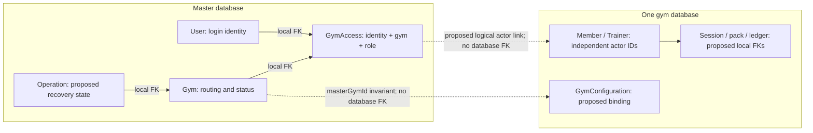

# GymOS V1 → V2: Database, Schema and Data-Ownership Map

> **30 October 2026 owner scope update:** [Segment 01 finalization](SEGMENT_01_FINALIZATION.md) supersedes earlier member-plan-delivery exclusions and suspension-earning proposals. Tasks 051/052 include authenticated read-only member access to own assigned workout/meal plans; trainer health access expires after 90 days as specified in DEC-09. Original inventory counts are not re-estimated effort. The project owner explicitly covers decision review; independent specialist review is not claimed.

## 1. Scope and evidence

**23 October 2026. Documentation only; fresh development schemas.** Old development records will be discarded and **fresh fixtures created later** in a separately authorized task. **No V1-record transfer, ETL, account/user import, old-to-new ID translation, preservation of existing IDs, or record migration is required or planned.** Mapping a V1 field below means allocating its responsibility in a new design, not copying its values.

Read together with the corrected [UI map](/Users/esanduepa/Desktop/Projects/gymos-v2/docs/migration/UI_MIGRATION_MAP.md) and [functionality map](/Users/esanduepa/Desktop/Projects/gymos-v2/docs/migration/FUNCTIONALITY_MIGRATION_MAP.md). UI IDs, W workflows and C/E API contract IDs refer to those documents. `F-D01` means decision D01 in the functionality map; `DB01` etc. are this map's decisions (section 14). Their proposed endpoints, DTOs, bindings and acceptance tests are requirements for schema review, **not evidence those structures exist**.

Only filesystem/source inspection and static document checks were used for this task. **No database connection, query, reset, migration, seed, fixture creation or modification was performed.** No Prisma CLI, generated client, provisioning script, application, API, credential workflow or end-to-end test was invoked. The functionality map's earlier EV01 pure-Zod check is referenced as prior evidence; it was not a database test and was not rerun here. Only DATABASE_MIGRATION_MAP.md is edited in this review; other maps/source/schemas/migrations/dependencies remain unchanged. The five corrections below are proposed design clarifications, not implemented database guarantees.

Evidence labels throughout:

- **V1 source/current V2:** declarations, SQL migration text and source calls inspected; no deployed schema/data state is claimed.
- **Proposed:** candidate V2 ownership, types, tables, constraints and transaction/recovery design, none implemented by this map. New names are logical design names, not files/tables created now.
- **Intentionally omitted:** no fresh schema requirement for the mapped web scope; not a deletion performed here.
- **Open:** accountable owner and question in section 14; a recommendation is not owner approval. Inferred concurrency/partial-failure risks are not observed runtime outcomes.

Source roots: `V1/` = `/Users/esanduepa/Desktop/Projects/gymos/`; `V2/` = `/Users/esanduepa/Desktop/Projects/gymos-v2/`. `V1/actions/x.ts` abbreviates `V1/app/actions/x.ts`; `V1/dashboard/` abbreviates `V1/app/(dashboard)/`; `API/` abbreviates `V2/apps/api/src/`. HEADs inspected: V1 `058aa8532741c4cb84289589fd2cf89282882988`; V2 `25546dec684382438416ecf22a65c0262bb0f558`. `M.X` denotes a master model; `T.X` a model in **one selected gym's separate PostgreSQL database**, not a schema joined to master with a database FK.

## 2. Inspected schema and migration baselines

| Source | Current facts from files / interpretation |
|---|---|
| [V1 Prisma schema](/Users/esanduepa/Desktop/Projects/gymos/prisma/schema.prisma) | PostgreSQL, Prisma `prisma-client-js`; 20 models, 14 enums. Gym, credentials, roles and domain data share one database. Section 6 inventories every declared field, including Prisma-only relation fields, and all model-level indexes/unique constraints |
| [V1 initial migration](/Users/esanduepa/Desktop/Projects/gymos/prisma/migrations/00000000000000_init/migration.sql) | Creates current-model ancestors plus Message; Float → DOUBLE PRECISION, DateTime → TIMESTAMP(3), Json → JSONB, String → TEXT, lists → TEXT[]. Initial PTSession.fee default 50 and NotificationType includes MESSAGE_RECEIVED. These initial facts are superseded below |
| [V1 required-password-change migration](/Users/esanduepa/Desktop/Projects/gymos/prisma/migrations/20260817200551_add_must_change_password/migration.sql) | Adds User.mustChangePassword BOOLEAN NOT NULL DEFAULT false |
| [V1 rate-card migration](/Users/esanduepa/Desktop/Projects/gymos/prisma/migrations/20260817213428_add_session_rate_card/migration.sql) | Adds Gym.defaultSessionFee DOUBLE PRECISION NOT NULL DEFAULT50 plus nullable level2SessionFee/introSessionFee; **drops PTSession.fee default** so bookings must supply fee |
| [V1 indexes/cascades/messaging migration](/Users/esanduepa/Desktop/Projects/gymos/prisma/migrations/20260818031951_add_indexes_cascades_drop_messaging/migration.sql) | Removes MESSAGE_RECEIVED and drops Message; adds the indexes in section 6; changes many parent deletes to CASCADE. PayRecord.sessionId remains optional/SET NULL; existing workout/meal child CASCADE remains. Do not resurrect historical Message as current parity |
| [V2 master schema](/Users/esanduepa/Desktop/Projects/gymos-v2/packages/database-master/prisma/schema.prisma) and [initial SQL](/Users/esanduepa/Desktop/Projects/gymos-v2/packages/database-master/prisma/migrations/20261021100256_init_master/migration.sql) | Four models User/Gym/GymAccess/Theme; three enums GlobalRole/GymRole/GymStatus. No subscription, audit, operation, session, credential-delivery or tenant-actor-link model/field exists |
| [V2 tenant schema](/Users/esanduepa/Desktop/Projects/gymos-v2/packages/database-tenant/prisma/schema.prisma) and [initial SQL](/Users/esanduepa/Desktop/Projects/gymos-v2/packages/database-tenant/prisma/migrations/20261021100258_init_tenant/migration.sql) | One model Member and one three-value MemberStatus enum. No trainer, membership, session/pack, finance, plan, audit, notification, GymConfiguration or applied-template metadata table exists |
| [Master Prisma config](/Users/esanduepa/Desktop/Projects/gymos-v2/prisma.master.config.ts), [tenant config](/Users/esanduepa/Desktop/Projects/gymos-v2/prisma.tenant.config.ts) | Separate schema/migration directories and datasource variables; configs were read as text, never executed or loaded. V2 generators target separate master/tenant clients; no cross-client relation/transaction is defined |

Schema defaults `cuid()`, `uuid()` and `@updatedAt` are Prisma behavior, not SQL DEFAULT expressions in the inspected migrations. SQL supplies CURRENT_TIMESTAMP for createdAt; updatedAt has no SQL default. V1 required `specialisations String[]` is emitted as TEXT[] **without SQL NOT NULL**, a schema/DDL nuance to review for fresh constraints. No claim is made that a live database applied these migrations or is drift-free. Migration files are source history, not an instruction to run them now.

## 3. What currently exists in V2 — complete field inventory

This section alone describes implemented V2 schema, not proposed parity. All IDs are String/TEXT; DateTime maps to TIMESTAMP(3) in current SQL, without an explicit timezone type. `?` nullable, no `?` required. Relation fields are virtual unless paired with a stored FK scalar. All listed SQL FKs have ON UPDATE CASCADE.

| Current model | Fields/defaults | Keys, FKs and indexes / existing consumer |
|---|---|---|
| M.User | id String @id @default(cuid()); email String; passwordHash String; globalRole GlobalRole @default(USER); gymAccesses GymAccess[]; createdAt DateTime @default(now()); updatedAt DateTime @updatedAt | email has an ordinary global UNIQUE index on stored TEXT; it does not normalize or independently guarantee case-insensitive identity uniqueness (section 4.3). No name/phone/mustChangePassword/authVersion/actor link. `API/auth.controller.ts:23` normalizes email after strict validation, verifies Argon2 and puts **M.User.id** in token subject; `API/super-admin.guard.ts:16` rereads globalRole |
| M.Gym | id String @id @default(cuid()); slug String; name String; databaseName String; status GymStatus @default(PROVISIONING); gymAccesses GymAccess[]; theme Theme?; createdAt now(); updatedAt @updatedAt | slug UNIQUE; databaseName UNIQUE. Provisioning generates databaseName server-side. No tenant config/locale/currency/timezone/schema-version field. `API/gym-provisioning.service.ts:33`, `API/gym-access.guard.ts:24` |
| M.GymAccess | userId String; gymId String; role GymRole; user User; gym Gym; createdAt DateTime @default(now()) | Composite PK(userId,gymId), FKs→M.User/M.Gym CASCADE; index(gymId,role). **No independent GymAccess.id**, no status/version/memberId/trainerId. One role per identity per gym; multi-gym rows possible. Guard checks identity + gym ACTIVE and returns databaseName; no Super Admin bypass |
| M.Theme | id String @id @default(cuid()); gymId String; gym Gym; primaryColor String @default("#2563EB"); logoUrl String?; updatedAt DateTime @updatedAt | gymId UNIQUE/FK→M.Gym CASCADE. Public GET primary/logo for ACTIVE gym, owner PATCH hex color/HTTPS logo; `API/gyms.controller.ts:48`, `:68`. No expanded presets/fonts/mode/theme version |
| T.Member | id String @id @default(cuid()); fullName String; email String?; status MemberStatus @default(ACTIVE); createdAt DateTime @default(now()); updatedAt DateTime @updatedAt | email UNIQUE **inside that tenant DB**, PostgreSQL allows multiple NULL emails. No identity FK/link, phone, DOB, membership or profile history. `API/gyms.controller.ts:105` returns newest 100; `:129` creates basic name/optional-email record only |

Current enum values: M.GlobalRole={USER,SUPER_ADMIN}; M.GymRole={OWNER,TRAINER,MEMBER}; M.GymStatus={PROVISIONING,ACTIVE,FAILED,SUSPENDED}; T.MemberStatus={ACTIVE,INACTIVE,SUSPENDED}. Current schema has **no monetary field**. Current API controllers registered in `V2/apps/api/src/app.module.ts:19` expose the eight feature method/path pairs E01–E08 from the functionality map; C01–C63 do not become implemented just because this map proposes storage.

The runtime selection source is `V2/apps/api/src/tenant-database.service.ts:9`: a client map keyed by server-resolved databaseName, using the tenant connection base with its pathname replaced. Master client construction is separate (`API/database.service.ts:8`). This is database-per-gym selection, **not row-level security or proof of isolation testing**. Neither service is imported/executed in this review.

## 4. Proposed ownership and identity boundaries

### 4.1 Allocation rules

| Location / classification | Proposed authoritative responsibility | Consequence |
|---|---|---|
| Master — existing core, extensions/new tables proposed | Login identity/password/required-change/session policy; gym slug/name/database routing/status; GymAccess and typed actor link; public theme; platform subscription; provisioning/enrollment/support operation and platform audit | No health notes, pack balances, PT sessions or trainer pay belong to a shared identity row. Ordinary access is explicit gym membership, not inferred from global role |
| Per-gym tenant — only Member exists today, all other domain structures proposed | GymConfiguration contacts/operating hours/policies/rates/pay cadence/**currency/timezone/locale**; member/trainer profiles; memberships/plans/packs/sessions/history; coaching plans; ledger/expenses/budgets/payroll; gym audit/notifications; local command receipts | Same-gym local FKs and financial transactions are possible. No master Prisma relation can enforce these tenant rows. Operational configuration lives with the transactions that consume it |
| Split V1 Gym/User/AuditLog | Master identity/registry/branding/platform events vs tenant actor/config/domain events | Explicit API composition and cross-database operation/recovery, never a copied V1 User ID or raw cross-database join |
| Intentionally omitted from initial web-parity schema | ProgressPhoto and BodyMetric; historical Message/MESSAGE_RECEIVED; mock receipt/checkout/accounting-sync/community/check-in features | V1 T03 fetches body metrics but does not render them; no web writer/viewer for progress photos. Future mobile/progress scope could add tenant tables, not master health data. Omission is design scope, not deletion now |
| Unresolved design choices | Exact decimal precision/currency, timezone/date rules, membership EXPIRED vs derived entitlement, multi-role same-gym access, credit reservation/settlement/payroll/snapshot policy, global notifications | Recommendations below are blocked by DB decisions/F-D decisions; no proposal silently authorizes a schema or behavior change |

### 4.2 New identity links — all proposed, fresh IDs only

1. Authentication yields **M.User.id** (`identityId`); retain current Argon2id hashing for **newly created** accounts and add the proposed database-backed normalized email rule in section 4.3. Current email uniqueness is on stored text, not a normalization guarantee. There is no bcrypt-hash conversion or V1 credential/account import. Add proposed nullable displayName/phone and required-change/security fields; no tenant health/profile status in M.User.
2. Resolve `(identityId, gymId)` in M.GymAccess; current composite PK remains the baseline. Proposed extensions: tenantActorId String?, actorKind MEMBER/TRAINER?, linkStatus, version Int default 0, enrollmentOperationId?; owner ordinarily has no tenant actor. These fields do not exist today. Adding a surrogate accessId for DTO convenience is optional; a current access ID must not be fabricated from a member ID.
3. T.Member and proposed T.Trainer have their **own freshly generated PKs**, plus nullable identityId String UNIQUE per actor table and enrollmentOperationId? for recovery. These are external references to master, **not FKs**. Basic E08 member records may remain unlinked. Local registration COMPLETE alone never enables gym entry, directory publication or commands; the joint eligibility predicate in section 4.4 is required. Identity authentication is distinct from tenant authorization. Trainer registration creates a trainer record, not a Member pretending to have trainer role.
4. Invariant for an ACTIVE linked access: GymAccess.actorKind matches role; tenantActorId resolves in exactly that gym's correct actor table; the actor.identityId equals the authenticated M.User.id; registrationState is COMPLETE, enrollment operation is COMPLETE and the role-specific business state permits the operation (section 4.4). Check the tuple server-side before accepting a member/trainer command. Never resolve identity by matching contact email, guessing same-valued IDs, accepting client databaseName, or using T.Member.id as token subject.
5. One M.User may have different actor IDs/roles in several gyms. Current PK permits **one role per gym**; supporting trainer+member or owner+trainer simultaneously in one gym needs an explicit access-key/cardinality decision DB02/F-D03, not an assumed enum rename. Uniqueness of identityId separately in Member/Trainer alone cannot enforce that rule across tables; enrollment/access service must enforce it.
6. New enrollment is a recoverable master/tenant operation (sections 7–9). Pending access must not grant normal gym self-service. Reconcile reciprocal references and only activate after local member/trainer+required entitlement transaction commits. A locally COMPLETE actor remains unpublished and unbookable until the master activation gate succeeds; owners have an explicit recovery view, not a silently usable actor (section 4.4). Duplicate requests reuse the same enrollment operation/result; lost one-time credentials need approved recovery/rotation without plaintext replay (F-D03/F-D04).

Tenant actor contact email is optional contact data with tenant-local uniqueness under the current Member model; master login email is identity authority. Proposed Trainer follows a reviewed equivalent. Decide contact/email synchronization and unlink/revoke behavior (DB02); a master email change must not silently relink another member. Owner/platform display names may use master displayName; member/trainer names are tenant profile fields, not a globally shared health identity.

### 4.3 Master email uniqueness — existing text constraint vs proposed identity rule

**Current source:** V1 User.email and V2 M.User.email are `String @unique`; both initial SQL migrations create an ordinary `UNIQUE INDEX "User_email_key" ON "User"("email")` over TEXT. They declare no `citext`, normalization CHECK, case-folding expression index or explicit case-insensitive collation. This prevents duplicate stored values under the database's text equality/collation; **it is not a source-defined guarantee that case/space variants identify one account**. No live collation or duplicate records were inspected. See the [V1 initial SQL](/Users/esanduepa/Desktop/Projects/gymos/prisma/migrations/00000000000000_init/migration.sql:370) and [V2 master initial SQL](/Users/esanduepa/Desktop/Projects/gymos-v2/packages/database-master/prisma/migrations/20261021100256_init_master/migration.sql:57).

Current V2 login validates then trims/lowercases before lookup (`API/auth.controller.ts:14–33`); admin gym creation normalizes ownerEmail in its input parser, while GymProvisioningService writes the supplied value (`API/admin.controller.ts:14–18`, `API/gym-provisioning.service.ts:91`). Owner/super-admin CLI scripts normalize their arguments (`V2/apps/api/scripts/create-owner.mjs:6`, `V2/apps/api/scripts/create-super-admin.mjs:5`). The verification script also writes M.User directly (`V2/apps/api/scripts/verify-milestone.mjs:165`). These are application paths, not a database-wide guarantee; none was executed.

**Proposed invariant:** store master email only in canonical form `normalizeEmail(value) = lower(btrim(value))`, with one reviewed and pinned case-folding/collation policy shared by validation, lookup and SQL. Keep the existing stored-email uniqueness and add reviewed master migration constraints: a CHECK using byte-exact canonical comparison to reject noncanonical/empty stored email and a UNIQUE expression index on the same normalized expression. The latter rejects normalized collisions even if a writer bypasses the service; a pre-read alone cannot prevent a race. These constraints are **not present today**. Do not apply this login-identity invariant to a tenant contact email as an identity link. Exact international-address/collation policy remains DB02; no provider-specific dot removal or plus-address merging is proposed.

Every identity create/update/upsert path must use that rule: provisioning service itself (not only its controller), owner/super-admin scripts, member/trainer registration or approved linking/invite/reissue flows that write an email, future account/admin email changes, fixtures and verification helpers, and authorized direct maintenance writes. Login and identity resolution use the same canonical value; catch database normalized-unique conflicts as an explicit duplicate/link conflict, never create a second case-variant identity or silently attach a tenant actor by email. Reissue that only changes a password must not create another identity. Test both service paths and constraint rejection of a bypass writer later (V02/V05). All fixtures will be fresh; no old-account reconciliation or import is needed.

### 4.4 Registration publication and partial-failure visibility — proposed gates

`registrationState=COMPLETE` means **the local tenant registration transaction committed**, not that enrollment across databases is complete. Define **operationalActor** for a linked Member/Trainer as all of: M.Gym ACTIVE; the binding/version gate in section 7.2 passes; the correct M.GymAccess has linkStatus ACTIVE and matching role/actorKind/tenantActorId/identityId; tenant registrationState COMPLETE; and its enrollment M.Operation COMPLETE. Existing linked actors created by future fixtures must satisfy the same predicate. Owner access has no tenant actor and instead requires ACTIVE owner access plus gym/binding gates. Forced password change and approved member/trainer business-status/entitlement rules are additional restrictions, not substitutes for this predicate.

| Proposed state combination | Identity login / selected-gym entry | Ordinary directories, counts and booking options | Authorized owner viewing / commands |
|---|---|---|---|
| Member BASIC, no identity/access/enrollment operation | No login is created by E08; no self gym entry | Owner basic-record roster may show a clearly labeled BASIC row; exclude from registered-member totals and all booking/member/trainer client options. No Trainer BASIC state is valid | Owner may read the basic record and start approved full registration/linking; no pack issue, booking or member self-service until operationalActor |
| Tenant actor absent or PENDING/FAILED; access PENDING/FAILED or operation incomplete | Valid credentials may authenticate an existing M.User, but this gym grants no normal entry/commands. Other independently authorized gyms remain usable | Exclude from ordinary C09/C15 registered directories/totals, C21/C36 booking/request options, C30 clients and C35 member-facing directory | Owner recovery list/detail may expose same-gym operation/status and safe actor data if present, with explicit incomplete/failed label. Recovery permission only; no normal registration-dependent commands |
| Tenant COMPLETE, but master access PENDING/FAILED, operation not COMPLETE, reciprocal link mismatched or unavailable | Local completion grants no gym entry. Authenticated context exposes pending/unavailable enrollment, not an ACTIVE gym choice | Exclude from all ordinary published/registered directories, totals and booking options, even when memberStatus/trainer.status is ACTIVE locally | Owner recovery view can inspect the committed local record/entitlement and safe operation evidence, labeled MASTER ACTIVATION PENDING/FAILED; it must not offer pack/booking/credential-delivery actions as if enrollment succeeded. Accounting/audit reads retain committed effects with their operation state; do not hide or undo revenue to repair publication |
| operationalActor true | Gym entry allowed only subject to password/security and approved business-status gates; first credential handoff occurs only after this gate | Registered owner rosters/totals include it. Member-facing trainer publication and booking additionally require approved active-status/eligibility and relationship rules | Normal authorized owner profile/commands available, still subject to command validation/version/tenant scope |
| Formerly active actor; access REVOKED/FAILED, registration FAILED or binding cannot be verified | Deny selected-gym entry/commands on authoritative recheck; identity/other gyms remain distinct | Exclude from member/trainer-facing operational directories and new booking options. An authorized owner may retain a clearly labeled blocked/inactive row in roster/history and status breakdowns for a previously activated enrollment; it is not operational. Preserve finance/audit; never reassign old sessions/identity links | Owner may inspect retained history/recovery evidence; no new pack/booking while nonoperational. Revocation propagation bound remains DB02/DB08 |

Identity authentication can succeed before a gym is usable (E01 already issues identity tokens); the **proposed** E01/C01 context must omit nonoperational access from selectable active gyms and return a safe pending/unavailable state. Permit only session/password and explicitly authorized operation-recovery endpoints in that context, not a tenant dashboard. Newly issued registration secrets are withheld until activation, so pending registration does not itself deliver a login password. Choosing generated credentials vs invite, credential recovery and existing-new-V2-account linking remain DB02/F-D03/F-D04.

Owner recovery list/detail and its state/count fields are **proposed additions** to C12/C13 operation-result handling and C09/C15 owner views, not current endpoints or permission to expose pending profiles to members/trainers. A normal owner roster may separately show BASIC contacts and retained inactive/revoked entries from previously activated enrollments, with explicit status/count labels. This preserves owner status/history visibility without granting member/trainer publication or booking. Newly pending/failed enrollments belong in an explicit recovery projection with separate totals, not the successfully registered roster. operationalActor gates new operational use; it is not a rule to erase previously authorized history. If master verification fails, ordinary publication/booking fails closed; an owner whose current master authority has been verified may receive local recovery evidence marked actor-activation verification unavailable, with no mutation. If owner authority itself cannot be verified, return no tenant data. There is no cache-only promotion or tenant publication Boolean that can bypass master confirmation. Final master activation is a separate transaction; no atomic master+tenant registration is implied. UI recovery layout, support permissions and revocation bound remain owned decisions; the fail-closed eligibility rule does not decide product/finance policy.

## 5. Every V1 enum → proposed V2 responsibility

All V1 values are listed exactly; defaults appear in the field inventory. SQL enums constrain value membership, **not transitions or authorization**. V1 plain-string status/cadence fields are separately covered in section 6. Proposed tenant enums do not already exist merely because their names match V1.

| V1 enum / values | Existing V2 / proposed allocation |
|---|---|
| Role: SUPER_ADMIN, GYM_OWNER, PERSONAL_TRAINER, GYM_MEMBER | **Split** to existing M.GlobalRole SUPER_ADMIN/USER and M.GymRole OWNER/TRAINER/MEMBER; all nonplatform roles retain global USER. No tenant User.role field; actor table/type carries role-specific FK identity. Same-gym multi-role unresolved DB02 |
| MemberStatus: ACTIVE, INACTIVE, EXPIRED, SUSPENDED | T.MemberStatus exists **without EXPIRED**. Proposed membership status includes all 4; member status either expands EXPIRED for UI parity or derives expiry from membership entitlement (DB03/F-D06). Never label EXPIRED implemented in current V2 |
| TrainerLevel: LEVEL_1, LEVEL_2 | Proposed T.TrainerLevel; nullable on V1.User, required on newly registered T.Trainer; pay snapshots may also store it |
| SessionStatus: PENDING_CONFIRMATION, SCHEDULED, ACTIVE, COMPLETED, MISSED, CANCELLED, DECLINED | Proposed tenant session/history enums; preserve exact source states, command rules open F-D01/D02. Status CHECK/enum alone does not make repeated charging safe |
| SessionType: IN_PERSON, VIRTUAL, INTRODUCTORY | Proposed tenant enum; command selects type, API derives fee, no UI-defined arbitrary string |
| ShiftStatus: IN_SHIFT, OFF_SHIFT | Proposed tenant enum for booking/pay snapshot; overnight/date interpretation DB04/F-D08 |
| PackStatus: ACTIVE, EXHAUSTED, EXPIRED | Proposed tenant enum; expired-but-ACTIVE source behavior must not become an implicit eligibility guarantee; balance/expiry rules DB05 |
| PayPeriodStatus: OPEN, CLOSED, APPROVED | Proposed tenant enum; transition/version guards required, APPROVED is not proof of payout. No bank/payment state inferred |
| RevenueCategory: MEMBERSHIP, PT_SESSION, ADD_ON | Proposed tenant enum; no SESSION_PACK value. Cash desk-payment vs recognized revenue linkage/rounding DB06; no duplicated upfront PT pack revenue |
| ExpenseCategory: RENT, UTILITIES, EQUIPMENT, MARKETING, SALARIES, MAINTENANCE, OTHER | Proposed tenant enum shared by ExpenseRecord/CategoryBudget; recurring flag does not define a scheduler |
| AuditActionType: MEMBER_CREATED, MEMBER_UPDATED, MEMBER_SUSPENDED, MEMBER_DEACTIVATED, TRAINER_CREATED, TRAINER_UPDATED, TRAINER_DEACTIVATED, SESSION_CREATED, SESSION_OVERRIDDEN, SESSION_CANCELLED, PLAN_ASSIGNED, PLAN_UPDATED, EXPENSE_CREATED, BUDGET_SET, PAY_PERIOD_CLOSED, PAY_PERIOD_APPROVED, GYM_CONFIG_UPDATED, PAY_RATES_UPDATED, POLICY_UPDATED, HIRE_REQUEST_ACCEPTED, HIRE_REQUEST_DECLINED, ACCESS_OVERRIDE | **Split** tenant gym-audit vs master platform-audit taxonomy. Existing enum values do not mean actions emit all events: expense/budget/payroll actions currently do not call logAudit. Propose explicit new STARTED/COMPLETED/NO_SHOW/credential/support/provision events as approved extensions, not source facts (DB09/F-D16) |
| SubscriptionTier: STARTER, GROWTH, PRO, ENTERPRISE | Proposed master subscription enum; no current V2 subscription model. Static UI prices/features do not enforce limits |
| SubscriptionStatus: ACTIVE, TRIAL, GRACE_PERIOD, SUSPENDED | Proposed master subscription enum, distinct from existing M.GymStatus provisioning/routing. Subscription SUSPENDED and Gym SUSPENDED are not interchangeable |
| NotificationType: HIRE_REQUEST, SESSION_BOOKED, SESSION_CANCELLED, SESSION_DECLINED, PACK_LOW, MEMBERSHIP_EXPIRING, BUDGET_EXCEEDED, PAYROLL_READY | Proposed tenant notification event enum. Current V1 writers in the journey emit HIRE_REQUEST/SESSION_BOOKED/SESSION_DECLINED only; do not infer other delivery from schema values. Historical MESSAGE_RECEIVED intentionally omitted; global platform scope unresolved DB10/F-D18 |

## 6. Every V1 model and field → proposed fresh V2 location

The following inventory reproduces each current V1 field's **type, nullability, default, uniqueness and relation attributes**, plus each model's `@@` constraints. Collection and named relation fields are included for completeness but are not stored SQL columns. Source: [V1 schema](/Users/esanduepa/Desktop/Projects/gymos/prisma/schema.prisma); current SQL evolution is section 2. Each target is proposed unless explicitly marked **existing**. A model's purpose/ownership is given before its fields.

Common proposed target rules, referenced by each row:

- **Fresh PK:** String/TEXT with the displayed Prisma cuid()/uuid() generator, newly generated; never preserve a V1 value. Current V2 existing PKs remain cuid(). No global equality between independently generated master/member/trainer IDs is assumed.
- **Instant:** DateTime `@db.Timestamptz(3)`; createdAt default now(), updatedAt `@updatedAt`; these are proposed native-type changes from current TIMESTAMP(3). Add version Int default 0 to mutable aggregates (section 7). **Date-only:** DateTime `@db.Date`, not an instant.
- **Money:** recommended Decimal `@db.Decimal(19,4)` plus required currency String (ISO4217,3 chars), API decimal string; **Rate:** Decimal(9,6) fractions. Precision/currency/rounding require DB06/F-D07 approval. Preserve meaningful zero; no Float arithmetic for a fresh money ledger.
- **Local FK:** reference correct tenant Member/Trainer/plan/etc.; proposed RESTRICT for historical business/financial parents, soft deactivation instead of cascaded financial erasure; plan child rows may CASCADE only for approved draft deletion. All target indexes/uniques are specified after the inventory/section 11. **External ref:** String/TEXT checked by application, no cross-database `@relation`.
- Unless the target cell explicitly changes it, retain the source scalar type, required/nullable marker and default, subject to Instant/Money/Rate replacement above. No target field is implemented by this table. `T.<model>.*` is a new field under that model except existing T.Member fields; intentionally omitted rows have no initial target.

### 6.1 Gym

**Split.** Existing M.Gym registry/name and M.Theme branding; proposed singleton T.GymConfiguration operational contacts/rates/policy/pay cadence. Currency/timezone/locale are new tenant config fields, not present in V1. No repeated per-domain gymId FK to master. Source: `V1/prisma/schema.prisma:78`.

| V1 field declaration (exact attributes) | Proposed allocation/type/constraint change |
|---|---|
| `id                      String  @id @default(cuid())` | Existing M.Gym.id; fresh String/cuid PK. New T.GymConfiguration.masterGymId String external binding ref (UNIQUE locally), no FK across DBs. |
| `name                    String` | Existing M.Gym.name String required, canonical gym display name; W07 spanning this and tenant profile needs Operation recovery. |
| `address                 String?` | T.GymConfiguration.address: retain displayed scalar type/nullability/default; domain CHECKs/version/indexes in sections 7/11. |
| `logo                    String?` | Existing M.Theme.logoUrl String?; validate HTTPS via API. It is a URL, no upload/blob model implied. |
| `phone                   String?` | T.GymConfiguration.phone: retain displayed scalar type/nullability/default; domain CHECKs/version/indexes in sections 7/11. |
| `email                   String?` | T.GymConfiguration.email: retain displayed scalar type/nullability/default; domain CHECKs/version/indexes in sections 7/11. |
| `operatingHours          Json?` | T.GymConfiguration.operatingHours: retain displayed scalar type/nullability/default; domain CHECKs/version/indexes in sections 7/11. |
| `cancellationWindowHours Int     @default(24)` | T.GymConfiguration.cancellationWindowHours: retain displayed scalar type/nullability/default; domain CHECKs/version/indexes in sections 7/11. |
| `noShowDeduction         Boolean @default(true)` | T.GymConfiguration.noShowDeduction: retain displayed scalar type/nullability/default; domain CHECKs/version/indexes in sections 7/11. |
| `lateCancelDeduction     Boolean @default(true)` | T.GymConfiguration.lateCancelDeduction: retain displayed scalar type/nullability/default; domain CHECKs/version/indexes in sections 7/11. |
| `minSessionDuration      Int     @default(20)` | T.GymConfiguration.minSessionDuration: retain displayed scalar type/nullability/default; domain CHECKs/version/indexes in sections 7/11. |
| `defaultSessionFee Float  @default(50)` | T.GymConfiguration.defaultSessionFee: Money; retain displayed nullability/default; add required currency; amount >=0. |
| `level2SessionFee  Float?` | T.GymConfiguration.level2SessionFee: Money; retain displayed nullability/default; add required currency; amount >=0. |
| `introSessionFee   Float?` | T.GymConfiguration.introSessionFee: Money; retain displayed nullability/default; add required currency; amount >=0. |
| `level1BaseRate  Float    @default(0.4)` | T.GymConfiguration.level1BaseRate: Rate; preserve numeric default as exact decimal fraction; bounds/combined-rate policy DB06. |
| `level2BaseRate  Float    @default(0.5)` | T.GymConfiguration.level2BaseRate: Rate; preserve numeric default as exact decimal fraction; bounds/combined-rate policy DB06. |
| `offShiftPremium Float    @default(0.1)` | T.GymConfiguration.offShiftPremium: Rate; preserve numeric default as exact decimal fraction; bounds/combined-rate policy DB06. |
| `payPeriod       String   @default("MONTHLY")` | T.GymConfiguration.payPeriod; propose required PayCadence enum WEEKLY/MONTHLY default MONTHLY, replacing unvalidated String. |
| `createdAt       DateTime @default(now())` | Existing M.Gym.createdAt; proposed Instant native type; tenant configuration gets independent timestamps. |
| `updatedAt       DateTime @updatedAt` | Existing M.Gym.updatedAt; tenant configuration has its own updatedAt/version; no assumed shared transaction timestamp. |
| `users           User[]` | Existing M.Gym.gymAccesses local relation; tenant Member/Trainer are selected through access/DB binding, not M.Gym.users cross-DB @relation. |
| `membershipPlans MembershipPlan[]` | T.MembershipPlan collection in selected DB; remove per-row master gym FK. |
| `sessions        PTSession[]` | T.PTSession collection in selected DB; no master native relation. |
| `revenues        RevenueRecord[]` | T.RevenueRecord collection/query; master dashboard aggregation needs explicit API projection, not a master FK join. |
| `expenses        ExpenseRecord[]` | T.ExpenseRecord collection/query; no master FK. |
| `auditLogs       AuditLog[]` | Split T.AuditLog context +M.PlatformAuditLog local gym FK; no cross-DB collection @relation. |
| `budgets         CategoryBudget[]` | T.CategoryBudget collection/query; no master FK. |
| `payPeriods      PayPeriod[]` | T.PayPeriod collection/query; no master FK. |
| `subscription    GymSubscription?` | New M.GymSubscription? with local UNIQUE gymId/FK; no tenant subscription duplicate. |

**V1 model-level constraints:** none beyond field PK/unique/FK attributes shown above. No target constraint is implied implemented by matching names.

### 6.2 User

**Split.** Existing M.User credentials +M.GymAccess role/gym; existing T.Member extended, new T.Trainer. Profile/privacy fields belong to the gym actor. Owner/platform profile bits may live in master. References below name newly created resources, never an ID import. Source: `V1/prisma/schema.prisma:117`.

| V1 field declaration (exact attributes) | Proposed allocation/type/constraint change |
|---|---|
| `id                 String  @id @default(cuid())` | Existing M.User.id is a fresh login PK; T.Member.id/T.Trainer.id are different fresh PKs. Reference links use identityId/actorId, never preserve/reuse the V1 PK. |
| `email              String  @unique` | Existing M.User.email required/global stored-TEXT UNIQUE; proposed canonical-write CHECK/normalized-expression uniqueness for every identity writer per section 4.3; T.Member.email existing nullable/tenant UNIQUE and proposed T.Trainer.email nullable/tenant UNIQUE are contact data. No email-based identity FK/link. |
| `phone              String?` | New T.Member.phone/T.Trainer.phone String? (full registration requires value, basic Member may omit); optional M.User.phone only for owner/global contact by policy DB02. |
| `password           String` | Existing M.User.passwordHash required String; fresh Argon2id hashes via V2 identity flow. No tenant password and no bcrypt conversion/import. |
| `mustChangePassword Boolean @default(false)` | New M.User.mustChangePassword Boolean required default false; set true for issued temporary credentials; enforce API-side. New authVersion/passwordChangedAt policy DB02/F-D04. |
| `fullName           String` | Existing T.Member.fullName String required; new T.Trainer.fullName required. New M.User.displayName String? for owner/platform/global display, distinct from per-gym name. |
| `role               Role` | Existing M.User.globalRole +M.GymAccess.role split (section 5); no nullable single global gym role or member record masquerading as identity. |
| `gymId              String?` | Existing M.GymAccess.gymId local FK paired with userId; tenant context via selected physical DB/T.GymConfiguration.masterGymId, not T.Member.gymId FK to master. |
| `gym                Gym?    @relation(fields: [gymId], references: [id], onDelete: Cascade)` | Existing local M.GymAccess.gym relation; no native actor→master Gym relation. |
| `dateOfBirth      DateTime?` | New T.Member.dateOfBirth DateTime? @db.Date; required by full C12 but nullable for basic E08. Date-only, not a deployment-timezone instant. |
| `emergencyContact String?` | New T.Member.emergencyContact String?; no master profile copy. |
| `healthNotes      String?` | New T.Member.healthNotes String?; related-trainer/owner access only, no master/profile-audit plaintext copy. |
| `photo            String?` | New T.Member.photo String? and T.Trainer.photo String? if directory/avatar contract needs it; URL metadata only, no current upload workflow. DB12 may omit unused image support. |
| `memberStatus     MemberStatus?` | Existing T.Member.status MemberStatus required default ACTIVE; adding EXPIRED or deriving it is proposed/unresolved DB03. Not an account-global suspension field. |
| `trainerLevel    TrainerLevel?` | New T.Trainer.level TrainerLevel required for completed registration; LEVEL_1/LEVEL_2 enum; request validation must supply it, no implicit null pay tier. |
| `specialisations String[]` | New T.Trainer.specialisations String[] required default [] proposed; SQL NOT NULL +empty default explicitly reviewed, not inherited from V1 TEXT[] nullable DDL. |
| `yearsExperience Int?` | New T.Trainer.yearsExperience Int?; proposed CHECK>=0 when present. |
| `shiftStart      String?` | New T.Trainer.shiftStart String? validated HH:mm; explicit overnight flag/zone from tenant config proposed; no DB proof from arbitrary text. |
| `shiftEnd        String?` | New T.Trainer.shiftEnd String?; paired validated shift rule/overnight handling DB04. |
| `bio             String?` | New T.Trainer.bio String?. |
| `ratingAvg       Float?        @default(0)` | New T.Trainer.ratingAvg Float?; propose no fake 5/default 0 as measured rating. No review/ratings writer exists; true null/fixture display policy DB12/F-D19. |
| `trainerStatus   String?       @default("ACTIVE")` | New T.Trainer.status required proposed enum ACTIVE/DEACTIVATED, default ACTIVE; operationalActor (section 4.4) gates visibility/access even if this local status is ACTIVE. |
| `createdAt DateTime @default(now())` | Existing M.User.createdAt +T.Member.createdAt and new T.Trainer.createdAt; fresh independent Instants, not necessarily equal. |
| `updatedAt DateTime @updatedAt` | Existing M.User/T.Member updatedAt plus proposed T.Trainer.updatedAt; independent Instant/version boundaries. |
| `memberships         Membership[]` | T.Member.memberships ->T.Membership.memberId local FK. |
| `sessionPacks        SessionPack[]` | T.Member.sessionPacks ->T.SessionPack.memberId local FK. |
| `sessionsClient      PTSession[]     @relation("ClientSessions")` | T.Member.sessions ->T.PTSession.memberId local FK; no role-ambiguous User FK. |
| `sessionsTrainer     PTSession[]     @relation("TrainerSessions")` | T.Trainer.sessions ->T.PTSession.trainerId local FK. |
| `workoutPlansTrainer WorkoutPlan[]   @relation("WorkoutPlanTrainer")` | T.Trainer.workoutPlans via local T.WorkoutPlan.trainerId. |
| `workoutPlansClient  WorkoutPlan[]   @relation("WorkoutPlanClient")` | T.Member.workoutPlans via local T.WorkoutPlan.memberId. |
| `mealPlansTrainer    MealPlan[]      @relation("MealPlanTrainer")` | T.Trainer.mealPlans via local T.MealPlan.trainerId. |
| `mealPlansClient     MealPlan[]      @relation("MealPlanClient")` | T.Member.mealPlans via local T.MealPlan.memberId. |
| `progressPhotos      ProgressPhoto[]` | Intentionally omitted initial collection; future T.Member→ProgressPhoto only if commissioned. |
| `bodyMetrics         BodyMetric[]` | Intentionally omitted initial collection; no model solely to support an unused fetch. |
| `payRecords          PayRecord[]` | T.Trainer.payRecords via local trainerId FK; no master identity earnings collection. |
| `notifications       Notification[]` | T.Notification.recipientIdentityId external master ref; no native M.User.notifications across DBs. Optional global master variant DB10. |
| `auditLogs           AuditLog[]` | T.AuditLog.actorIdentityId external ref +local M.PlatformAuditLog actor FK where appropriate; no cross-DB Prisma User collection. |

**V1 model-level constraints:** `@@index([gymId, role])`. No target constraint is implied implemented by matching names.

### 6.3 MembershipPlan

**New tenant model.** Sellable gym membership plan; price/duration drives registration and owner plan picker (W08/W09,C11/C40). Source: `V1/prisma/schema.prisma:167`.

| V1 field declaration (exact attributes) | Proposed allocation/type/constraint change |
|---|---|
| `id           String   @id @default(cuid())` | T.MembershipPlan.id: Fresh PK; same displayed generator, no preserved V1 ID. |
| `gymId        String` | Per-gym physical database +T.GymConfiguration.masterGymId binding; omit repeated master gym FK/relation. Local uniqueness/index drops redundant gym prefix (section 11). |
| `gym          Gym      @relation(fields: [gymId], references: [id], onDelete: Cascade)` | Per-gym physical database +T.GymConfiguration.masterGymId binding; omit repeated master gym FK/relation. Local uniqueness/index drops redundant gym prefix (section 11). |
| `name         String` | T.MembershipPlan.name: retain displayed scalar type/nullability/default; domain CHECKs/version/indexes in sections 7/11. |
| `description  String?` | T.MembershipPlan.description: retain displayed scalar type/nullability/default; domain CHECKs/version/indexes in sections 7/11. |
| `price        Float` | T.MembershipPlan.price: Money; retain displayed nullability/default; add required currency; amount >=0. |
| `durationDays Int` | T.MembershipPlan.durationDays: retain displayed scalar type/nullability/default; domain CHECKs/version/indexes in sections 7/11. |
| `createdAt    DateTime @default(now())` | T.MembershipPlan.createdAt: Instant; preserve displayed nullable/default/@updatedAt semantics. |
| `updatedAt    DateTime @updatedAt` | T.MembershipPlan.updatedAt: Instant; preserve displayed nullable/default/@updatedAt semantics. |
| `memberships Membership[]` | T.MembershipPlan.memberships: local virtual child collection; corresponding scalar FK defines constraint; no stored array column. |

**V1 model-level constraints:** `@@index([gymId])`. No target constraint is implied implemented by matching names.

### 6.4 Membership

**New tenant model.** Member entitlement to one plan and date window; no payment verification implied by this row (C10/C12/C44). Source: `V1/prisma/schema.prisma:183`.

| V1 field declaration (exact attributes) | Proposed allocation/type/constraint change |
|---|---|
| `id               String         @id @default(cuid())` | T.Membership.id: Fresh PK; same displayed generator, no preserved V1 ID. |
| `userId           String` | T.Membership.memberId String required local FK ->T.Member (RESTRICT proposed). |
| `user             User           @relation(fields: [userId], references: [id], onDelete: Cascade)` | T.Membership.member virtual relation, local typed Member FK. |
| `membershipPlanId String` | T.Membership.membershipPlanId String required local FK ->T.MembershipPlan (RESTRICT). |
| `plan             MembershipPlan @relation(fields: [membershipPlanId], references: [id], onDelete: Cascade)` | T.Membership.plan local relation; required immutable agreed price/currency/name/duration snapshot at enrollment; later plan edits do not reprice the term. |
| `startDate        DateTime` | T.Membership.startDate: Instant; preserve displayed nullable/default/@updatedAt semantics. |
| `endDate          DateTime` | T.Membership.endDate: Instant; preserve displayed nullable/default/@updatedAt semantics. |
| `status           MemberStatus   @default(ACTIVE)` | T.Membership status represents explicit ACTIVE/SUSPENDED/CANCELLED choices; expiry is derived from dates, not stored as member-account EXPIRED. No overlapping active term; renewal starts after current end. |
| `createdAt        DateTime       @default(now())` | T.Membership.createdAt: Instant; preserve displayed nullable/default/@updatedAt semantics. |
| `updatedAt        DateTime       @updatedAt` | T.Membership.updatedAt: Instant; preserve displayed nullable/default/@updatedAt semantics. |

**V1 model-level constraints:** `@@index([userId])`; `@@index([membershipPlanId])`; `@@index([status, endDate])`. No target constraint is implied implemented by matching names.

### 6.5 SessionPack

**New tenant model.** Issued PT credit entitlement and agreed sale price; proposed PackMovement records explain balance changes (C19/C36/C48). Source: `V1/prisma/schema.prisma:201`.

| V1 field declaration (exact attributes) | Proposed allocation/type/constraint change |
|---|---|
| `id                String     @id @default(cuid())` | T.SessionPack.id: Fresh PK; same displayed generator, no preserved V1 ID. |
| `userId            String` | T.SessionPack.memberId String required FK ->T.Member (RESTRICT). |
| `user              User       @relation(fields: [userId], references: [id], onDelete: Cascade)` | T.SessionPack.member local typed relation. |
| `totalSessions     Int` | T.SessionPack.totalSessions: retain displayed scalar type/nullability/default; domain CHECKs/version/indexes in sections 7/11. |
| `remainingSessions Int` | T.SessionPack.remainingSessions: retain displayed scalar type/nullability/default; domain CHECKs/version/indexes in sections 7/11. |
| `status            PackStatus @default(ACTIVE)` | T.SessionPack.status: retain displayed scalar type/nullability/default; domain CHECKs/version/indexes in sections 7/11. |
| `purchaseDate      DateTime   @default(now())` | T.SessionPack.purchaseDate: Instant; preserve displayed nullable/default/@updatedAt semantics. |
| `expiryDate        DateTime` | T.SessionPack.expiryDate: Instant; preserve displayed nullable/default/@updatedAt semantics. |
| `price             Float?` | T.SessionPack.price proposed required Money>=0 with no silent default; newly issued packs C19 explicitly supply known price. V1 nullable Float is shown for source, not a reason to invent unknown paid value. |
| `createdAt         DateTime   @default(now())` | T.SessionPack.createdAt: Instant; preserve displayed nullable/default/@updatedAt semantics. |
| `updatedAt         DateTime   @updatedAt` | T.SessionPack.updatedAt: Instant; preserve displayed nullable/default/@updatedAt semantics. |

**V1 model-level constraints:** `@@index([userId, status, expiryDate])`. No target constraint is implied implemented by matching names.

### 6.6 PTSession

**New tenant model.** Request/booking, actor relationship, lifecycle and booked fee; new SessionStateEvent/SessionSettlement carry transition/effect evidence (C20/C22–C29/C37). No V1 state-history table exists. Source: `V1/prisma/schema.prisma:218`.

| V1 field declaration (exact attributes) | Proposed allocation/type/constraint change |
|---|---|
| `id          String        @id @default(cuid())` | T.PTSession.id: Fresh PK; same displayed generator, no preserved V1 ID. |
| `gymId       String` | Per-gym physical database +T.GymConfiguration.masterGymId binding; omit repeated master gym FK/relation. Local uniqueness/index drops redundant gym prefix (section 11). |
| `gym         Gym           @relation(fields: [gymId], references: [id], onDelete: Cascade)` | Per-gym physical database +T.GymConfiguration.masterGymId binding; omit repeated master gym FK/relation. Local uniqueness/index drops redundant gym prefix (section 11). |
| `trainerId   String` | T.PTSession.trainerId String required local FK ->T.Trainer (RESTRICT). |
| `trainer     User          @relation("TrainerSessions", fields: [trainerId], references: [id], onDelete: Cascade)` | T.PTSession.trainer local relation; actor relationship validation still API-owned. |
| `clientId    String` | T.PTSession.memberId String required local FK ->T.Member; authenticated self maps to this fresh actor ID. |
| `client      User          @relation("ClientSessions", fields: [clientId], references: [id], onDelete: Cascade)` | T.PTSession.member local relation; not M.User. |
| `scheduledAt DateTime` | T.PTSession.scheduledAt: Instant; preserve displayed nullable/default/@updatedAt semantics. |
| `duration    Int` | T.PTSession.duration: retain displayed scalar type/nullability/default; domain CHECKs/version/indexes in sections 7/11. |
| `type        SessionType   @default(IN_PERSON)` | T.PTSession.type: retain displayed scalar type/nullability/default; domain CHECKs/version/indexes in sections 7/11. |
| `status      SessionStatus @default(SCHEDULED)` | T.PTSession.status required SessionStatus; source default SCHEDULED shown. Proposed commands explicitly set PENDING or SCHEDULED; version/transition rules and event row mandatory. |
| `fee         Float` | T.PTSession.fee required Money, no default (matches final V1 migration intent); source booking snapshot. New currency/rateBasis snapshots proposed; pay is NOT frozen here in V1. |
| `noShow      Boolean       @default(false)` | T.PTSession.noShow: retain displayed scalar type/nullability/default; domain CHECKs/version/indexes in sections 7/11. |
| `notes       String?` | T.PTSession.notes: retain displayed scalar type/nullability/default; domain CHECKs/version/indexes in sections 7/11. |
| `shiftStatus ShiftStatus?` | T.PTSession.shiftStatus ShiftStatus?; booking resolves it; completion/pay snapshot rules DB04/DB07, no implied frozen trainer rate. |
| `startedAt   DateTime?` | T.PTSession.startedAt: Instant; preserve displayed nullable/default/@updatedAt semantics. |
| `endedAt     DateTime?` | T.PTSession.endedAt: Instant; preserve displayed nullable/default/@updatedAt semantics. |
| `createdAt   DateTime      @default(now())` | T.PTSession.createdAt: Instant; preserve displayed nullable/default/@updatedAt semantics. |
| `updatedAt   DateTime      @updatedAt` | T.PTSession.updatedAt: Instant; preserve displayed nullable/default/@updatedAt semantics. |
| `payRecords PayRecord[]` | T.PayRecord[] local relation; proposed one base pay per SessionSettlement unique, not current one-to-one schema. |

**V1 model-level constraints:** `@@index([gymId, scheduledAt])`; `@@index([gymId, status])`; `@@index([trainerId, status])`; `@@index([clientId, status])`. No target constraint is implied implemented by matching names.

### 6.7 WorkoutPlan

**New tenant model.** Trainer-authored plan for related member; relationship remains a service rule over sessions (C31/C32). Source: `V1/prisma/schema.prisma:250`.

| V1 field declaration (exact attributes) | Proposed allocation/type/constraint change |
|---|---|
| `id          String    @id @default(cuid())` | T.WorkoutPlan.id: Fresh PK; same displayed generator, no preserved V1 ID. |
| `trainerId   String` | T.WorkoutPlan.trainerId String required local FK ->T.Trainer; proposed RESTRICT, never M.User or T.Member. |
| `trainer     User      @relation("WorkoutPlanTrainer", fields: [trainerId], references: [id], onDelete: Cascade)` | T.WorkoutPlan.trainer local relation ->T.Trainer via trainerId; no role-ambiguous User FK. |
| `clientId    String` | T.WorkoutPlan.memberId String required local FK ->T.Member (RESTRICT). |
| `client      User      @relation("WorkoutPlanClient", fields: [clientId], references: [id], onDelete: Cascade)` | T.WorkoutPlan.member local typed relation. |
| `name        String` | T.WorkoutPlan.name: retain displayed scalar type/nullability/default; domain CHECKs/version/indexes in sections 7/11. |
| `description String?` | T.WorkoutPlan.description: retain displayed scalar type/nullability/default; domain CHECKs/version/indexes in sections 7/11. |
| `startDate   DateTime?` | T.WorkoutPlan.startDate: Instant; preserve displayed nullable/default/@updatedAt semantics. |
| `endDate     DateTime?` | T.WorkoutPlan.endDate: Instant; preserve displayed nullable/default/@updatedAt semantics. |
| `createdAt   DateTime  @default(now())` | T.WorkoutPlan.createdAt: Instant; preserve displayed nullable/default/@updatedAt semantics. |
| `updatedAt   DateTime  @updatedAt` | T.WorkoutPlan.updatedAt: Instant; preserve displayed nullable/default/@updatedAt semantics. |
| `exercises WorkoutExercise[]` | T.WorkoutPlan.exercises: local virtual child collection; corresponding scalar FK defines constraint; no stored array column. |

**V1 model-level constraints:** `@@index([trainerId])`; `@@index([clientId])`. No target constraint is implied implemented by matching names.

### 6.8 WorkoutExercise

**New tenant model.** Workout child rows, not reusable exercise-library entries; no UI edit/delete parity requirement. Source: `V1/prisma/schema.prisma:269`.

| V1 field declaration (exact attributes) | Proposed allocation/type/constraint change |
|---|---|
| `id            String      @id @default(cuid())` | T.WorkoutExercise.id: Fresh PK; same displayed generator, no preserved V1 ID. |
| `workoutPlanId String` | T.WorkoutExercise.workoutPlanId String required local FK ->T.WorkoutPlan; child cascade only for approved deletable drafts. |
| `workoutPlan   WorkoutPlan @relation(fields: [workoutPlanId], references: [id], onDelete: Cascade)` | T.WorkoutExercise.workoutPlan local relation ->T.WorkoutPlan; draft/retention delete policy section 11. |
| `name          String` | T.WorkoutExercise.name: retain displayed scalar type/nullability/default; domain CHECKs/version/indexes in sections 7/11. |
| `sets          Int` | T.WorkoutExercise.sets: retain displayed scalar type/nullability/default; domain CHECKs/version/indexes in sections 7/11. |
| `reps          Int?` | T.WorkoutExercise.reps: retain displayed scalar type/nullability/default; domain CHECKs/version/indexes in sections 7/11. |
| `weight        Float?` | T.WorkoutExercise.weight: retain displayed scalar type/nullability/default; domain CHECKs/version/indexes in sections 7/11. |
| `duration      Int?` | T.WorkoutExercise.duration: retain displayed scalar type/nullability/default; domain CHECKs/version/indexes in sections 7/11. |
| `notes         String?` | T.WorkoutExercise.notes: retain displayed scalar type/nullability/default; domain CHECKs/version/indexes in sections 7/11. |

**V1 model-level constraints:** `@@index([workoutPlanId])`. No target constraint is implied implemented by matching names.

### 6.9 MealPlan

**New tenant model.** Related trainer/member plan; dates remain passive nullable fields, no weekly planner is inferred (C31/C33). Source: `V1/prisma/schema.prisma:283`.

| V1 field declaration (exact attributes) | Proposed allocation/type/constraint change |
|---|---|
| `id        String    @id @default(cuid())` | T.MealPlan.id: Fresh PK; same displayed generator, no preserved V1 ID. |
| `trainerId String` | T.MealPlan.trainerId String required local FK ->T.Trainer; proposed RESTRICT, never M.User or T.Member. |
| `trainer   User      @relation("MealPlanTrainer", fields: [trainerId], references: [id], onDelete: Cascade)` | T.MealPlan.trainer local relation ->T.Trainer via trainerId; no role-ambiguous User FK. |
| `clientId  String` | T.MealPlan.memberId String required local FK ->T.Member (RESTRICT). |
| `client    User      @relation("MealPlanClient", fields: [clientId], references: [id], onDelete: Cascade)` | T.MealPlan.member local typed relation. |
| `name      String` | T.MealPlan.name: retain displayed scalar type/nullability/default; domain CHECKs/version/indexes in sections 7/11. |
| `startDate DateTime?` | T.MealPlan.startDate: Instant; preserve displayed nullable/default/@updatedAt semantics. |
| `endDate   DateTime?` | T.MealPlan.endDate: Instant; preserve displayed nullable/default/@updatedAt semantics. |
| `createdAt DateTime  @default(now())` | T.MealPlan.createdAt: Instant; preserve displayed nullable/default/@updatedAt semantics. |
| `updatedAt DateTime  @updatedAt` | T.MealPlan.updatedAt: Instant; preserve displayed nullable/default/@updatedAt semantics. |
| `entries MealPlanEntry[]` | T.MealPlan.entries: local virtual child collection; corresponding scalar FK defines constraint; no stored array column. |

**V1 model-level constraints:** `@@index([trainerId])`; `@@index([clientId])`. No target constraint is implied implemented by matching names.

### 6.10 MealPlanEntry

**New tenant model.** Food/nutrients/day rows. V1 schema comment says day 0–6 but has no CHECK; builder sends 1; C33 proposes1–7. Fresh ISO-day decision DB12/F-D12 must settle this before constraints/fixtures. Source: `V1/prisma/schema.prisma:301`.

| V1 field declaration (exact attributes) | Proposed allocation/type/constraint change |
|---|---|
| `id         String   @id @default(cuid())` | T.MealPlanEntry.id: Fresh PK; same displayed generator, no preserved V1 ID. |
| `mealPlanId String` | T.MealPlanEntry.mealPlanId String required local FK ->T.MealPlan; approved draft-only cascade policy. |
| `mealPlan   MealPlan @relation(fields: [mealPlanId], references: [id], onDelete: Cascade)` | T.MealPlanEntry.mealPlan local relation ->T.MealPlan. |
| `dayOfWeek  Int` | T.MealPlanEntry.dayOfWeek Int; proposed CHECK 1..7 to match C33, but V1 comment 0..6/builder 1 ambiguity requires DB12 approval; no existing-record conversion. |
| `mealType   String` | T.MealPlanEntry.mealType proposed enum Breakfast/Lunch/Dinner/Snack/Pre-Workout/Post-Workout; V1 arbitrary String not DB-validated. Canonical labels/codes DB12. |
| `foodItem   String` | T.MealPlanEntry.foodItem: retain displayed scalar type/nullability/default; domain CHECKs/version/indexes in sections 7/11. |
| `calories   Int?` | T.MealPlanEntry.calories: retain displayed scalar type/nullability/default; domain CHECKs/version/indexes in sections 7/11. |
| `protein    Float?` | T.MealPlanEntry.protein: retain displayed scalar type/nullability/default; domain CHECKs/version/indexes in sections 7/11. |
| `carbs      Float?` | T.MealPlanEntry.carbs: retain displayed scalar type/nullability/default; domain CHECKs/version/indexes in sections 7/11. |
| `fats       Float?` | T.MealPlanEntry.fats: retain displayed scalar type/nullability/default; domain CHECKs/version/indexes in sections 7/11. |

**V1 model-level constraints:** `@@index([mealPlanId])`. No target constraint is implied implemented by matching names.

### 6.11 ProgressPhoto

**Intentionally omitted from initial web scope.** Current V1 schema has storage, no web writer/viewer. If progress/mobile scope is commissioned, all fields belong in a tenant model with member FK/media access policy; no master media model or old-image transfer. Source: `V1/prisma/schema.prisma:316`.

| V1 field declaration (exact attributes) | Proposed allocation/type/constraint change |
|---|---|
| `id        String   @id @default(cuid())` | Intentionally omitted initial field; no fresh target. Future tenant-only scope, source type/default retained here as inventory. |
| `userId    String` | Intentionally omitted initial field; no fresh target. Future tenant-only scope, source type/default retained here as inventory. |
| `user      User     @relation(fields: [userId], references: [id], onDelete: Cascade)` | Intentionally omitted initial field; no fresh target. Future tenant-only scope, source type/default retained here as inventory. |
| `url       String` | Intentionally omitted initial field; no fresh target. Future tenant-only scope, source type/default retained here as inventory. |
| `dateTaken DateTime @default(now())` | Intentionally omitted initial field; no fresh target. Future tenant-only scope, source type/default retained here as inventory. |
| `notes     String?` | Intentionally omitted initial field; no fresh target. Future tenant-only scope, source type/default retained here as inventory. |

**V1 model-level constraints:** `@@index([userId])`. No target constraint is implied implemented by matching names.

### 6.12 BodyMetric

**Intentionally omitted from initial web scope.** T03 fetches 5 rows but renders none; no mapped writer/viewer. Future tenant/member-owned storage only if separately scoped. No old measurements transfer. Source: `V1/prisma/schema.prisma:327`.

| V1 field declaration (exact attributes) | Proposed allocation/type/constraint change |
|---|---|
| `id           String   @id @default(cuid())` | Intentionally omitted initial field; no fresh target. Future tenant-only scope, source type/default retained here as inventory. |
| `userId       String` | Intentionally omitted initial field; no fresh target. Future tenant-only scope, source type/default retained here as inventory. |
| `user         User     @relation(fields: [userId], references: [id], onDelete: Cascade)` | Intentionally omitted initial field; no fresh target. Future tenant-only scope, source type/default retained here as inventory. |
| `dateRecorded DateTime @default(now())` | Intentionally omitted initial field; no fresh target. Future tenant-only scope, source type/default retained here as inventory. |
| `weight       Float?` | Intentionally omitted initial field; no fresh target. Future tenant-only scope, source type/default retained here as inventory. |
| `bodyFat      Float?` | Intentionally omitted initial field; no fresh target. Future tenant-only scope, source type/default retained here as inventory. |
| `muscleMass   Float?` | Intentionally omitted initial field; no fresh target. Future tenant-only scope, source type/default retained here as inventory. |
| `notes        String?` | Intentionally omitted initial field; no fresh target. Future tenant-only scope, source type/default retained here as inventory. |

**V1 model-level constraints:** `@@index([userId])`. No target constraint is implied implemented by matching names.

### 6.13 PayPeriod

**New tenant model.** Owner payroll grouping/cadence and OPEN/CLOSED/APPROVED state. Proposed pure read returns absence; no GET-created default (C49/C54/C55). Source: `V1/prisma/schema.prisma:340`.

| V1 field declaration (exact attributes) | Proposed allocation/type/constraint change |
|---|---|
| `id        String          @id @default(cuid())` | T.PayPeriod.id: Fresh PK; same displayed generator, no preserved V1 ID. |
| `gymId     String` | Per-gym physical database +T.GymConfiguration.masterGymId binding; omit repeated master gym FK/relation. Local uniqueness/index drops redundant gym prefix (section 11). |
| `gym       Gym             @relation(fields: [gymId], references: [id], onDelete: Cascade)` | Per-gym physical database +T.GymConfiguration.masterGymId binding; omit repeated master gym FK/relation. Local uniqueness/index drops redundant gym prefix (section 11). |
| `startDate DateTime` | T.PayPeriod.startDate: Instant; preserve displayed nullable/default/@updatedAt semantics. |
| `endDate   DateTime` | T.PayPeriod.endDate: Instant; preserve displayed nullable/default/@updatedAt semantics. |
| `status    PayPeriodStatus @default(OPEN)` | T.PayPeriod.status: retain displayed scalar type/nullability/default; domain CHECKs/version/indexes in sections 7/11. |
| `createdAt DateTime        @default(now())` | T.PayPeriod.createdAt: Instant; preserve displayed nullable/default/@updatedAt semantics. |
| `updatedAt DateTime        @updatedAt` | T.PayPeriod.updatedAt: Instant; preserve displayed nullable/default/@updatedAt semantics. |
| `payRecords PayRecord[]` | T.PayPeriod.payRecords: local virtual child collection; corresponding scalar FK defines constraint; no stored array column. |

**V1 model-level constraints:** `@@index([gymId, status])`. No target constraint is implied implemented by matching names.

### 6.14 PayRecord

**New tenant model.** Trainer earnings/liability record, not evidence of bank payout. Add settlement/fee/rate/level/shift snapshots for auditable completion (C26/C34). Source: `V1/prisma/schema.prisma:355`.

| V1 field declaration (exact attributes) | Proposed allocation/type/constraint change |
|---|---|
| `id          String     @id @default(cuid())` | T.PayRecord.id: Fresh PK; same displayed generator, no preserved V1 ID. |
| `trainerId   String` | T.PayRecord.trainerId String required local FK ->T.Trainer; proposed RESTRICT, never M.User or T.Member. |
| `trainer     User       @relation(fields: [trainerId], references: [id], onDelete: Cascade)` | T.PayRecord.trainer local relation ->T.Trainer via trainerId; no role-ambiguous User FK. |
| `payPeriodId String` | T.PayRecord.payPeriodId String required local FK ->T.PayPeriod, proposed RESTRICT. |
| `payPeriod   PayPeriod  @relation(fields: [payPeriodId], references: [id], onDelete: Cascade)` | T.PayRecord.payPeriod local relation ->T.PayPeriod; no master payroll FK. |
| `sessionId   String?` | T.PayRecord.sessionId String? local FK ->T.PTSession; retain nullable non-session earnings shape, base completion requires valid settlement/session. |
| `session     PTSession? @relation(fields: [sessionId], references: [id], onDelete: SetNull)` | T.PayRecord.session optional local relation ->T.PTSession. V1 SET NULL is source evidence; proposed soft-delete/RESTRICT preserves history, pending DB07/DB09. |
| `amount      Float` | T.PayRecord.amount: Money; retain displayed nullability/default; add required currency; amount >=0. |
| `description String?` | T.PayRecord.description: retain displayed scalar type/nullability/default; domain CHECKs/version/indexes in sections 7/11. |
| `createdAt   DateTime   @default(now())` | T.PayRecord.createdAt: Instant; preserve displayed nullable/default/@updatedAt semantics. |
| `updatedAt   DateTime   @updatedAt` | T.PayRecord.updatedAt: Instant; preserve displayed nullable/default/@updatedAt semantics. |

**V1 model-level constraints:** `@@index([trainerId])`; `@@index([payPeriodId])`; `@@index([sessionId])`. No target constraint is implied implemented by matching names.

### 6.15 RevenueRecord

**New tenant model.** Recognized revenue events, with proposed typed origin/member/settlement links and event uniqueness. A pack sale alone does not create PT_SESSION revenue in current source. Source: `V1/prisma/schema.prisma:374`.

| V1 field declaration (exact attributes) | Proposed allocation/type/constraint change |
|---|---|
| `id          String          @id @default(cuid())` | T.RevenueRecord.id: Fresh PK; same displayed generator, no preserved V1 ID. |
| `gymId       String` | Per-gym physical database +T.GymConfiguration.masterGymId binding; omit repeated master gym FK/relation. Local uniqueness/index drops redundant gym prefix (section 11). |
| `gym         Gym             @relation(fields: [gymId], references: [id], onDelete: Cascade)` | Per-gym physical database +T.GymConfiguration.masterGymId binding; omit repeated master gym FK/relation. Local uniqueness/index drops redundant gym prefix (section 11). |
| `amount      Float` | T.RevenueRecord.amount: Money; retain displayed nullability/default; add required currency; amount >=0. |
| `category    RevenueCategory` | T.RevenueRecord.category: retain displayed scalar type/nullability/default; domain CHECKs/version/indexes in sections 7/11. |
| `date        DateTime        @default(now())` | Split into T.RevenueRecord.occurredAt required Instant default now() and accountingDate required date-only @db.Date derived in approved gym timezone; no implicit host-local accounting default. DB04/DB06. |
| `description String?` | T.RevenueRecord.description: retain displayed scalar type/nullability/default; domain CHECKs/version/indexes in sections 7/11. |
| `createdAt   DateTime        @default(now())` | T.RevenueRecord.createdAt: Instant; preserve displayed nullable/default/@updatedAt semantics. |
| `updatedAt   DateTime        @updatedAt` | T.RevenueRecord.updatedAt: Instant; preserve displayed nullable/default/@updatedAt semantics. |

**V1 model-level constraints:** `@@index([gymId, date])`; `@@index([gymId, category])`. No target constraint is implied implemented by matching names.

### 6.16 ExpenseRecord

**New tenant model.** Owner expense event; isRecurring is a flag, not an implemented scheduler or payment automation (C46/C51). Source: `V1/prisma/schema.prisma:390`.

| V1 field declaration (exact attributes) | Proposed allocation/type/constraint change |
|---|---|
| `id          String          @id @default(cuid())` | T.ExpenseRecord.id: Fresh PK; same displayed generator, no preserved V1 ID. |
| `gymId       String` | Per-gym physical database +T.GymConfiguration.masterGymId binding; omit repeated master gym FK/relation. Local uniqueness/index drops redundant gym prefix (section 11). |
| `gym         Gym             @relation(fields: [gymId], references: [id], onDelete: Cascade)` | Per-gym physical database +T.GymConfiguration.masterGymId binding; omit repeated master gym FK/relation. Local uniqueness/index drops redundant gym prefix (section 11). |
| `amount      Float` | T.ExpenseRecord.amount: Money; retain displayed nullability/default; add required currency; amount >=0. |
| `category    ExpenseCategory` | T.ExpenseRecord.category: retain displayed scalar type/nullability/default; domain CHECKs/version/indexes in sections 7/11. |
| `date        DateTime        @default(now())` | T.ExpenseRecord.accountingDate required DateTime @db.Date from C51 local-date input; proposed no DB default. createdAt separately records insertion Instant; this is a fresh representation change, not conversion of V1 rows. |
| `description String?` | T.ExpenseRecord.description: retain displayed scalar type/nullability/default; domain CHECKs/version/indexes in sections 7/11. |
| `isRecurring Boolean         @default(false)` | T.ExpenseRecord.isRecurring: retain displayed scalar type/nullability/default; domain CHECKs/version/indexes in sections 7/11. |
| `createdAt   DateTime        @default(now())` | T.ExpenseRecord.createdAt: Instant; preserve displayed nullable/default/@updatedAt semantics. |
| `updatedAt   DateTime        @updatedAt` | T.ExpenseRecord.updatedAt: Instant; preserve displayed nullable/default/@updatedAt semantics. |

**V1 model-level constraints:** `@@index([gymId, date])`; `@@index([gymId, category])`. No target constraint is implied implemented by matching names.

### 6.17 CategoryBudget

**New tenant model.** Category/month budget vs expense totals; current dialog already supplies category+amount, optional month defaults current month in action (C47/C52). Source: `V1/prisma/schema.prisma:406`.

| V1 field declaration (exact attributes) | Proposed allocation/type/constraint change |
|---|---|
| `id        String          @id @default(cuid())` | T.CategoryBudget.id: Fresh PK; same displayed generator, no preserved V1 ID. |
| `gymId     String` | Per-gym physical database +T.GymConfiguration.masterGymId binding; omit repeated master gym FK/relation. Local uniqueness/index drops redundant gym prefix (section 11). |
| `gym       Gym             @relation(fields: [gymId], references: [id], onDelete: Cascade)` | Per-gym physical database +T.GymConfiguration.masterGymId binding; omit repeated master gym FK/relation. Local uniqueness/index drops redundant gym prefix (section 11). |
| `category  ExpenseCategory` | T.CategoryBudget.category: retain displayed scalar type/nullability/default; domain CHECKs/version/indexes in sections 7/11. |
| `amount    Float` | T.CategoryBudget.amount: Money; retain displayed nullability/default; add required currency; amount >=0. |
| `month     DateTime` | T.CategoryBudget.month: Date-only month anchor; CHECK day=1; no time-of-day. |
| `createdAt DateTime        @default(now())` | T.CategoryBudget.createdAt: Instant; preserve displayed nullable/default/@updatedAt semantics. |
| `updatedAt DateTime        @updatedAt` | T.CategoryBudget.updatedAt: Instant; preserve displayed nullable/default/@updatedAt semantics. |

**V1 model-level constraints:** `@@unique([gymId, category, month])`. No target constraint is implied implemented by matching names.

### 6.18 AuditLog

**Split.** Proposed T.AuditLog for gym-domain writes and M.PlatformAuditLog for identity/access/provision/theme/support. Replace cross-database actor/gym FKs with explicit references/invariants; retain actor/resource snapshots without secrets. Both proposed audit models add required eventKey String UNIQUE, absent in V1/current V2, with retry-stable generation in section 7.3 and local effect/audit transactions. Source: `V1/prisma/schema.prisma:444`.

| V1 field declaration (exact attributes) | Proposed allocation/type/constraint change |
|---|---|
| `id               String          @id @default(uuid())` | New T.AuditLog.id and M.PlatformAuditLog.id fresh String UUID generators; no old audit ID continuity needed. |
| `gymId            String` | T context from database binding (no repeated master FK); M.PlatformAuditLog.gymId String? local FK ->M.Gym for platform/gym events. |
| `userId           String` | T.AuditLog.actorIdentityId String external M.User ref; M.PlatformAuditLog.actorIdentityId local M.User FK/retention policy. Add support original/effective actor refs. |
| `actionType       AuditActionType` | Split tenant/platform event taxonomy, explicit proposed enum additions; existing audit enum does not imply all actions emit events. |
| `affectedRecordId String` | T/M audit resourceId String +new resourceType; polymorphic reference intentionally not a generic FK. Store immutable redacted context for history. |
| `details          String?` | T/M audit details Json? /JSONB proposed, replacing String? JSON-encoded text; validated/redacted payload, no passwords/health dumps. |
| `createdAt        DateTime        @default(now())` | T.AuditLog.createdAt and M.PlatformAuditLog.createdAt required Instants default now(); each plane records its own local commit/event time. |
| `gym  Gym  @relation(fields: [gymId], references: [id], onDelete: Cascade)` | M platform-audit local optional gym relation; no tenant→master @relation. |
| `user User @relation(fields: [userId], references: [id], onDelete: Cascade)` | M platform-audit local identity relation; tenant actor identity is external ref only. |

**V1 model-level constraints:** `@@index([gymId, createdAt])`; `@@index([userId])`. No target constraint is implied implemented by matching names.

### 6.19 GymSubscription

**New master model.** Platform subscription/billing metadata for M.Gym, not tenant member membership or gym routing status (C58). No payment portal or verified card record is inferred. Source: `V1/prisma/schema.prisma:474`.

| V1 field declaration (exact attributes) | Proposed allocation/type/constraint change |
|---|---|
| `id                 String             @id @default(uuid())` | M.GymSubscription.id: Fresh PK; same displayed generator, no preserved V1 ID. |
| `gymId              String             @unique` | New M.GymSubscription.gymId String UNIQUE/local FK ->M.Gym; never memberId. |
| `tier               SubscriptionTier   @default(STARTER)` | M.GymSubscription.tier: retain displayed scalar type/nullability/default; domain CHECKs/version/indexes in sections 7/11. |
| `status             SubscriptionStatus @default(TRIAL)` | M.GymSubscription.status: retain displayed scalar type/nullability/default; domain CHECKs/version/indexes in sections 7/11. |
| `billingCycle       String             @default("MONTHLY")` | M.GymSubscription.billingCycle proposed required enum MONTHLY/ANNUAL default MONTHLY; not tenant payroll WEEKLY/MONTHLY. |
| `nextBillingDate    DateTime` | M.GymSubscription.nextBillingDate: Instant; preserve displayed nullable/default/@updatedAt semantics. |
| `paymentMethodLast4 String?` | M.GymSubscription.paymentMethodLast4: retain displayed scalar type/nullability/default; domain CHECKs/version/indexes in sections 7/11. |
| `createdAt          DateTime           @default(now())` | M.GymSubscription.createdAt: Instant; preserve displayed nullable/default/@updatedAt semantics. |
| `updatedAt          DateTime           @updatedAt` | M.GymSubscription.updatedAt: Instant; preserve displayed nullable/default/@updatedAt semantics. |
| `gym Gym @relation(fields: [gymId], references: [id], onDelete: Cascade)` | M.GymSubscription.gym local relation; proposed RESTRICT/retention instead of blind deletion. |

**V1 model-level constraints:** none beyond field PK/unique/FK attributes shown above. No target constraint is implied implemented by matching names.

### 6.20 Notification

**New tenant model for gym journey; global scope unresolved.** Recipient is master identity ref, not a member ID. Same-tenant notification row can commit with session state/audit; optional global platform notifications require DB10/F-D18. C59–C61 minimum must precede functionality stages 5–6. Source: `V1/prisma/schema.prisma:499`.

| V1 field declaration (exact attributes) | Proposed allocation/type/constraint change |
|---|---|
| `id          String           @id @default(uuid())` | T.Notification.id: Fresh PK; same displayed generator, no preserved V1 ID. |
| `recipientId String` | T.Notification.recipientIdentityId String external M.User ref, indexed; authoritative own-identity +GymAccess check on reads/mark. Not tenant member PK. |
| `type        NotificationType` | T.Notification.type: retain displayed scalar type/nullability/default; domain CHECKs/version/indexes in sections 7/11. |
| `title       String` | T.Notification.title: retain displayed scalar type/nullability/default; domain CHECKs/version/indexes in sections 7/11. |
| `message     String` | T.Notification.message: retain displayed scalar type/nullability/default; domain CHECKs/version/indexes in sections 7/11. |
| `linkUrl     String?` | T.Notification typed target/resourceId plus safe role+gym route mapping; optional validated href only if necessary. No imported/stale links to rewrite; fresh fixtures use current routes. |
| `isRead      Boolean          @default(false)` | T.Notification.isRead: retain displayed scalar type/nullability/default; domain CHECKs/version/indexes in sections 7/11. |
| `createdAt   DateTime         @default(now())` | T.Notification.createdAt: Instant; preserve displayed nullable/default/@updatedAt semantics. |
| `recipient User @relation(fields: [recipientId], references: [id], onDelete: Cascade)` | No cross-DB @relation; target identity validated through local actor link +master access by service. Optional master-global relation only if DB10 approved. |

**V1 model-level constraints:** `@@index([recipientId, isRead])`; `@@index([recipientId, createdAt])`. No target constraint is implied implemented by matching names.

### 6.21 Historical and derived concepts without a current V1 model

| Concept | Source and proposed treatment |
|---|---|
| Historical Message | Initial SQL has id TEXT PK, senderId/receiverId TEXT required FKs→User CASCADE, content TEXT required, isRead BOOLEAN required default false, readAt TIMESTAMP(3) nullable, createdAt TIMESTAMP(3) required default CURRENT_TIMESTAMP. Latest V1 migration drops it and MESSAGE_RECEIVED. **Intentionally omitted**, no chat/import or preservation plan |
| Deferred revenue | No V1 DeferredRevenue table. `V1/actions/financials.ts:268` computes used fraction×pack.price across all packs and deferred remaining fraction only for ACTIVE packs; it is not a sum of recognized RevenueRecord events. Proposed tenant read/view from packs/movements/settlements/revenue, not another independent balance to update; recognition/expiry/rounding DB06 |
| State/credit history | No V1 SessionStateHistory, pack debit ledger, source-linked RevenueRecord, version or idempotency receipt. V1 audit text is not a complete transition/financial journal. Proposed structures below provide evidence for new operations, not reconstructed historical records |
| C10 derived billing | New schema is **not required for a payment ledger merely to render this list**. Read latest membership once, then all packs by createdAt-desc/id-desc; independently page the composed union (billingPage/pageSize,totalCount), as functionality section 10.2.1 specifies. V1 uses current joined plan.price and pack.price, and hardcodes PAID. V2 must use immutable agreed-price snapshots and never infer payment. Manual payments do not appear; older memberships use separate membershipPage. No record transfer or fabricated payment snapshot |
| Analytics/attendance | Dashboard/analytics aggregate sessions, users, pack/revenue/pay data; no physical check-in, rating submission or attendance scan table follows from a chart/label. Keep report definitions separate from stored facts (F-D19) |

## 7. Newly required structures and aggregate additions — all proposals

Names below describe logical schema candidates. They are **absent in current V2**, except the explicitly marked extensions to existing models. `ID`=fresh String/TEXT PK `@id @default(cuid())` unless a UUID generator is explicitly specified, `Instant`/`Money`/`Rate` as section 6; required unless `?`; createdAt=now(), updatedAt=@updatedAt where listed. No SQL, schema or generated client was changed. Final field/enum names and exact precision need design review.

| Proposed location/model or extension | Fields/types/defaults needed by the contracts | Keys, invariants and recovery purpose |
|---|---|---|
| M.User **existing model, proposed extensions** | displayName String?, phone String?; mustChangePassword Boolean default false; passwordChangedAt Instant?; authVersion Int default 0; version Int default 0; optional credentialExpiresAt Instant? per policy | Existing email stored-TEXT UNIQUE is not normalized uniqueness. Proposed canonical email CHECK +normalized UNIQUE expression index and all-writer rule in section 4.3; passwordHash required. Password/status/access revocation must be enforced by API/token policy; storing authVersion alone does nothing. No old credentials imported. AuthSession/refresh-token table conditional F-D04 |
| M.Gym/GymAccess **existing models, proposed extensions** | Gym: version Int default 0, expectedTenantSchemaVersion String? (required before ACTIVE); GymAccess: tenantActorId String?, actorKind enum MEMBER/TRAINER?, linkStatus enum PENDING/ACTIVE/FAILED/REVOKED (new access default PENDING), version Int default 0, enrollmentOperationId String? | Composite PK(userId,gymId) enforces the approved one-role-per-identity-per-gym policy. No actor FK across DBs. OWNER may have null actor ref; linked actor requires operationalActor (section 4.4). Proposed UNIQUE(gymId,actorKind,tenantActorId) where present. Gym expected version is desired deployment state, not evidence it was applied. Current guard enforces neither new gate |
| M.Operation | id ID; kind enum PROVISION_GYM/REGISTER_MEMBER/REGISTER_TRAINER/UPDATE_GYM_PROFILE/CHANGE_ACCESS; actorIdentityId local FK; gymId String? local FK; immutable scopeKey/idempotencyKey/requestDigest; state/step/version/timestamps; durable database/template/step/effect IDs **fully typed in section 7.1** | UNIQUE(actorIdentityId,scopeKey,kind,idempotencyKey); provisioning scope is immutable `provision-gym:<requestedSlug>`, including after gymId is assigned. Retry lookup precedes slug/email duplicate checks. Database name, intended version and completed-step evidence are persisted before/after external work as specified in section 7.1; no distributed transaction or plaintext secret result |
| M.CredentialDelivery | id ID; identityId FK→M.User; operationId FK→M.Operation UNIQUE; state enum PREPARED/DELIVERED/EXPIRED/ROTATED; expiresAt Instant; deliveredAt Instant?; recoveryTokenHash String?; createdAt/updatedAt/version | Required for the approved generated-password/one-time-handoff policy. Store delivery metadata/hash, **no recoverable plaintext password**. First authorized response may deliver secret; repeat/lost response returns status and approved rotation flow, not cached secret. Delivery acknowledgment vs lost response remains DB02/F-D03; token/password generation is later application work |
| M.SupportSession | id ID; originalActorIdentityId FK→M.User; gymId FK→M.Gym; permissionScope enum/validated value; reason String required; issuedAt Instant default now; expiresAt Instant; endedAt Instant?; version Int default 0 | Proposed C04 trusted support context, explicit original actor/effective gym, no spoofable gym cookie. Index(actor,expiresAt), gym; support permission/expiry DB08/F-D05. No tenant trainer/member impersonation implied |
| M.Theme **existing model, proposed extensions** | version Int default 0; optional secondaryColor/accentColor/surface/text String?; mode/fontPreset/preset allowlisted enum/String? | Primary/logo current fields only; additions C05 need DB13/F-D20. Validate supported fields, not arbitrary executable CSS/HTML/font URLs; theme audit in master same transaction |
| T.GymConfiguration | id String fixed singleton key; masterGymId String required UNIQUE external ref; address/phone/email String?; operatingHours Json?; policy/rate/cadence fields in Gym map; currency String(3) required, timeZone String required IANA, locale String?; version Int default 0; createdAt/updatedAt | CHECK singleton key; binding verified with T.SchemaState and M.Gym.expectedTenantSchemaVersion (section 7.2). Config.version is an optimistic business-config version, not an applied schema version. No blind currency/timezone default. Combined M.Gym.name+tenant config update needs cross-DB recovery DB01/DB08 |
| T.SchemaState **new singleton** | id String fixed "current"; state enum APPLYING/VERIFIED/FAILED/REPAIR_REQUIRED; appliedTemplateVersion String?; appliedManifestDigest String?; verifiedMigrations Json default []; appliedAt Instant?; lastOperationId String external ref; version Int default 0; updatedAt Instant | Records this physical tenant database's verified installed template, not source-file availability. VERIFIED requires nonnull applied fields and successful migration evidence; application binding/version gate and interrupted-deployment recovery are section 7.2. No such model exists in current schemas/migrations |
| T.Member **existing model, proposed extensions**; T.Trainer **new** | Source-profile fields in section 6; identityId String? UNIQUE per actor table; enrollmentOperationId String? UNIQUE external master operation ref; registrationState enum BASIC/PENDING/COMPLETE/FAILED (Member default BASIC; Trainer default PENDING proposed); version Int default 0; deactivatedAt Instant? | BASIC is owner-visible contact data only. COMPLETE is local completion; joint operationalActor gate (section 4.4) controls login context, published directories/counts and all booking/pack options. COMPLETE+pending master remains owner-recovery-only. Trainer cannot be BASIC; no role-ambiguous tenant User table |
| T.CommandReceipt | id ID; actorIdentityId String external ref; commandKind String/enum; idempotencyKey String; requestDigest String; resourceType/resourceId String?; sourceMasterOperationId String? external ref; state enum RUNNING/COMMITTED/REJECTED; safeResult Json?; createdAt/updatedAt; committedAt Instant? | UNIQUE(actorIdentityId,commandKind,idempotencyKey) **inside selected gym DB**, plus unique sourceMasterOperationId for an enrollment command. Receipt/result commits with domain effects. Master support context/role is part of normalized request scope/digest. No secret result payload. A RUNNING receipt cannot permanently strand retries; recovery/lock policy DB09 |
| T.SessionStateEvent | id ID; sessionId FK→PTSession required; fromStatus SessionStatus?; toStatus SessionStatus; fromVersion Int?; toVersion Int; actorIdentityId external String; actorRole snapshot; commandReceiptId local FK; occurredAt Instant default now; reason String? | UNIQUE(sessionId,toVersion); index(sessionId,occurredAt,id). Append-only; aggregate status/version +event committed together. Initial create has null fromStatus, not reconstructed history; note edit may use audit/version without fabricated state transition. Strict transition eligibility remains command logic, not enum membership |
| T.SessionSettlement | id ID; sessionId FK→PTSession **UNIQUE**; commandReceiptId local FK UNIQUE; kind enum COMPLETION/NO_SHOW/LATE_CANCEL; packId FK→SessionPack?; creditUnits Int default 0; fee Money; payAmount Money default 0; rateApplied Rate?; createdAt Instant | One base financial terminal settlement per confirmed session, even across different idempotency keys. Cannot use generic upsert to re-charge terminal sessions. MVP settlement requires its existing held credit; no-show and correction/reversal rules follow section 14.1. Zero-charge ordinary withdrawal/on-time cancel still protected by session version/event, no financial settlement required |
| T.SessionCreditHold | id ID; sessionId FK→PTSession UNIQUE; packId FK→SessionPack; memberId FK→Member; state HELD/RELEASED/CONSUMED; createdAt/resolvedAt Instants; commandReceiptId/eventKey and version | Required for approved MVP. Request creates no hold; owner booking and trainer acceptance create one atomically with confirmation. `available=remainingSessions−activeHolds` for unexpired packs. A hold remains valid for its booking after pack expiry. Completion/charged no-show/charged late cancellation consume once; free cancellation/suspension/deactivation release once. Lock pack/hold with session transition; uniqueness and state guards prevent double charge |
| T.PackMovement | id ID; packId FK→SessionPack; settlementId FK→SessionSettlement?; commandReceiptId local FK; kind enum ISSUE/CONSUME/FORFEIT/EXPIRE (expiry policy open); quantity Int signed; resultingBalance Int; occurredAt Instant default now | UNIQUE(settlementId,packId) for a debit; UNIQUE(packId,commandReceiptId,kind). Initial ISSUE is explicit new credit grant. CHECK balance0..total, conditional atomic decrement/version; read balance and ledger must agree. A durable credit-hold structure is required by the approved MVP policy; see T.SessionCreditHold below |
| T.DeskPayment | id ID; memberId FK→Member; kind enum MEMBERSHIP/ADD_ON; amount Money>0; description String?; occurredAt Instant default now; commandReceiptId FK UNIQUE; revenueRecordId FK UNIQUE | Future only; supersede generic desk payment with an allocated payment ledger linked to membership/pack, plus linked refund reversals. Never create recognized income merely because cash was received. No MVP payment capture |
| T.RevenueRecord/T.PayRecord additions | Revenue: occurredAt Instant default now(), accountingDate date-only required; memberId?,membershipId?,sessionId?,packId?,settlementId? local typed FKs; sourceKind/eventKey required; currency; commandReceiptId local FK. Pay: settlementId? local FK UNIQUE, currency, feeSnapshot Money?, rateApplied Rate?, trainerLevelSnapshot TrainerLevel?, shiftSnapshot ShiftStatus?; completion settlement requires all four snapshots by CHECK/service, non-session earnings do not invent them; approved correction fields only later | Revenue eventKey UNIQUE; one recognized PT earned-value event per consumed hold/settlement (unique settlementId where present), term-based membership earning events or projection, never full registration revenue; no unique(amount,date) heuristic. One completion base-pay row per settlement; confirmation-time rate/level/shift snapshot required. User display/fee/pay records cannot be recomputed from current rates as if historical |
| T.AuditLog +M.PlatformAuditLog | Each: id String fresh UUID; **eventKey String required UNIQUE, no random default**; actionType; resourceType/resourceId; actorIdentityId; originalActorIdentityId?; effectiveGymRef?; actorDisplaySnapshot?; details Json? redacted; operationId?; createdAt Instant default now(); tenant commandReceiptId local FK where applicable | Generate stable keys from persisted receipt/operation or aggregate version plus event identity (section 7.3). Tenant actor/master-operation refs external; master identity/gym/operation FKs local where applicable. Append-only; indexes(createdAt,id), actionType/date, actor. Write required audit with local business effects, never silently skip a conflicting different event |
| T.Notification | V1 fields mapped in section 6 +eventKey String; recipientIdentityId external String; sessionId? local FK; targetResourceType/resourceId/gym binding; readAt Instant?; isRead default false; createdAt Instant default now | UNIQUE(eventKey,recipientIdentityId,type); indexes(recipientIdentityId,isRead,createdAt,id), (recipientIdentityId,createdAt,id). Own-recipient+active gym-access authorization. With local insertion, AVAILABLE in C23/C24 can mean committed/readable notification. Global M.PlatformNotification is **conditional DB10**, not part of current V2 |
| T.OutboxEvent /M.OutboxEvent | **Conditional new structures** for asynchronous cross-plane projections, queued notification strategy or external delivery: id ID; eventKey UNIQUE; kind; aggregateId/version; redacted payload Json; status PENDING/CLAIMED/DELIVERED/FAILED; attemptCount Int default 0; availableAt/createdAt Instants; deliveredAt?; lastErrorCode? | Outbox insert commits with originating local domain transaction; worker has retry lease/idempotent destination. Dedupe on destination eventKey. Same-tenant basic notification can be inserted directly and needs no external worker. Outbox does not make a cross-database transaction atomic and must not contain passwords/health dumps |

Proposed additions to all mutable aggregates (config/profile/plan/pack/session/budget/pay period/theme/access): version Int default 0, updatedAt Instant where appropriate. Immutable movement/settlement/audit rows need event identity/uniqueness, not arbitrary user-editable status. Master subscription fields follow section 6 but creation/defaults/real payment metadata remain DB11/F-D14; no extra payment gateway or synthetic 4242 card row is proposed.

### 7.1 Durable M.Operation and immutable idempotency scope — proposed

All fields below are proposed master columns; none exists in current V2. `?` is nullable, required otherwise; Strings are TEXT. Enforce provisioning-required fields by reviewed CHECK/service validation. Generic operation state alone is insufficient to recover a physical database or a committed tenant enrollment.

| Field group | Durable fields/types/defaults and use |
|---|---|
| Operation identity and request | id ID; kind enum as section 7; actorIdentityId String FK→M.User; scopeKey String; idempotencyKey String; requestDigest String; requestedSlug String? immutable and required for PROVISION_GYM; supportContextId String? local FK→SupportSession if used. Pin normalized request/digest version in requestDigest encoding; include effective permissions/support identity. No raw password/request body in the row |
| Master effect IDs | gymId String? FK→M.Gym, set when reserved; subjectIdentityId String? FK→M.User for owner/member/trainer account; ownerThemeId String? FK→M.Theme for provisioning. GymAccess is identified by `(subjectIdentityId,gymId)` under the current proposed one-role key, **not an invented access.id**. CredentialDelivery is found by its UNIQUE operationId. Persist relevant IDs in their master creation transaction; do not rediscover an owner by email on retry |
| Physical target | databaseName String? UNIQUE when nonnull; server-generated once and persisted **before CREATE DATABASE**, required for PROVISION_GYM. It must equal linked M.Gym.databaseName; it is not regenerated per attempt, accepted from caller or reused for a second provisioning operation |
| Intended template | intendedTenantTemplateVersion String?; intendedTenantManifestDigest String?; required for provisioning, immutable/pinned to a reviewed deployment artifact on first request. Copy intended version to M.Gym.expectedTenantSchemaVersion before activation; never replace intention with the newest source directory during a retry |
| Observed application evidence | appliedTenantTemplateVersion String?; appliedTenantManifestDigest String?; tenantSchemaVerifiedAt Instant?; null until verification against the actual target tenant succeeds. These are a master **observation**, not the tenant authority; the authoritative installed marker is T.SchemaState. A failed/lost checkpoint is recovered by re-verification; never set these merely because a file or intended version exists |
| Completed steps | completedSteps Json default {}: validated map `stepCode → {completedAt: ISO Instant, evidence: safe typed IDs/version/digest}`; stepCode unique in the map. Provision steps: GYM_RESERVED, DATABASE_CREATED, TENANT_TEMPLATE_VERIFIED, TENANT_BOUND, MASTER_ACTIVATED. Enrollment steps: MASTER_PREPARED, TENANT_REGISTRATION_COMMITTED, MASTER_ACTIVATED. Record only verified completion, monotonically by version compare-and-set; step is the current/recovery target, not a substitute for completedSteps |
| Tenant effect IDs | tenantActorId String?; tenantCommandReceiptId String?; tenantMembershipId String?; tenantRegistrationRevenueId String?; all external refs, **no cross-DB FK**. Required applicable IDs are returned by the committed tenant receipt keyed by sourceMasterOperationId and then checkpointed to master. Receipt/resource links recover them after a crash before that checkpoint |
| Recovery/control | state enum PENDING/MASTER_PREPARED/TENANT_COMMITTED/COMPLETE/FAILED_RETRYABLE/FAILED_FINAL/REPAIR_REQUIRED; step String; version Int default 0; attemptCount Int default 0; leaseToken String?; leaseExpiresAt Instant?; safeResult Json?; errorCode String?; createdAt Instant default now(); updatedAt Instant @updatedAt; lastAttemptAt Instant?. Compare version/lease to prevent competing workers; expired lease triggers evidence reconciliation, not blind replay. Lease/retry/retention policy DB08/DB09 |

**Stable lookup:** PROVISION_GYM scopeKey is `provision-gym:<normalized requestedSlug>` from the first request for the entire operation lifetime. After creating Gym, fill gymId; **never change scopeKey to gymId**. Other gym-bound operations start with the already-authorized immutable gym ID (`gym:<gymId>`); when support applies, include the original support-context ID in the frozen scope/digest. UNIQUE(actorIdentityId,scopeKey,kind,idempotencyKey) is the retry lookup. For PROVISION_GYM, also require a partial UNIQUE(actorIdentityId,kind,idempotencyKey) request-key claim: reusing the same key with a different requested slug conflicts 409 instead of starting a second scope. The authenticated initiator resubmits the same requested slug/key/body; lookup/claim this tuple (or find the provisioning key claim to reject a scope mismatch) and compare digest **before** duplicate slug/email checks. It finds the same operation even when the Gym/owner already exists. Existing completed operation returns safeResult; incomplete one returns pending state/resumes verified steps; changed body returns 409. An authorized recovery operator may find the existing operation by opaque operationId after explicit permission checks, not create a new actor-scoped operation for the same effects.

Persist first operation, one generated databaseName, pinned artifact and Gym reservation/IDs in a master transaction before physical work. A different key claiming the same slug must hit Gym.slug uniqueness and return a conflict or permitted existing-operation recovery pointer; it must not adopt an unrelated Gym/DB or overwrite the first operation. Resending only the newly created gym ID cannot change a provisioning request into a different idempotency scope. Completion/lost response uses the same stable operation ID, name and relevant IDs.

CREATE DATABASE, tenant migration execution and master checkpoints remain separate. An external step may succeed before its completedSteps checkpoint is written. Resume must verify the persisted target: a missing DB can be created; an existing DB requires operation-owned target evidence and, once initialized, matching binding/marker/migration evidence. If ownership or outcome cannot be established safely, mark REPAIR_REQUIRED for authorized inspection rather than recreate/drop/adopt it. A partial template has APPLYING/FAILED or no verified marker. Only the verifier can record TENANT_TEMPLATE_VERIFIED; master finalization cannot infer it from a successful-looking source artifact or a stale checkpoint.

### 7.2 Tenant applied-template authority and access gate — proposed

Every tenant database gets exactly one **T.SchemaState** row (`id="current"`) alongside the distinct **T.GymConfiguration** singleton. T.SchemaState.appliedTemplateVersion/appliedManifestDigest/appliedAt and verifiedMigrations describe the last **verified application** to that physical database. `verifiedMigrations` is validated JSON with ordered migration names/checksums and verification time; it is recovery evidence, not permission to edit Prisma's migration history. Its state is APPLYING during a deployment, VERIFIED only after verification, FAILED on known failure and REPAIR_REQUIRED for ambiguous evidence. Preserve any previous applied values during a failed upgrade, but non-VERIFIED state blocks ordinary access. First deployment starts with null applied fields; VERIFIED requires all applied fields and migration evidence. T.GymConfiguration.version remains a business optimistic version, never a template version.

A proposed deployment verifier checks actual completed migration records/checksums in that tenant's `_prisma_migrations` and required schema/constraint postconditions against the **pinned** immutable template manifest. No failed/unfinished required migration may be treated as applied. Only after verification does a local tenant transaction write the VERIFIED T.SchemaState marker/evidence and initialize/validate GymConfiguration.masterGymId/currency/timezone binding. Source migration files or a deployed application build show intended SQL; **they do not prove a database applied it**, and a marker is an attestation rather than perpetual proof against later manual drift. These are future implementation/acceptance requirements; neither migration history nor schema has been read from any database here.

Before routing any ordinary tenant read/command, the service must establish all of:

1. Master resolves the selected M.Gym/databaseName from authenticated access/support; status is ACTIVE and expectedTenantSchemaVersion is nonnull.
2. In that exact physical DB, GymConfiguration.masterGymId equals M.Gym.id; singleton SchemaState exists, state VERIFIED, and appliedTemplateVersion equals **M.Gym.expectedTenantSchemaVersion**. Resolve that version's immutable reviewed manifest and require appliedManifestDigest to match; the running API must support that version.
3. Apply actor publication/security checks (section 4.4) and ordinary role/relationship policy. A cached Prisma client or cached old marker is not sufficient authorization. Any verification cache must be invalidated on rollout/binding/access changes and honor a reviewed short visibility bound; commands require current gate evidence. Metadata absent, mismatched, unverifiable or unsupported means 503/unavailable, no fallback database, source-version assumption or auto-migration on read.

The future deployment process sets master expected version to the intended rollout target, records per-tenant progress and reconciles actual evidence; it does not label every tenant upgraded by editing one source file. Authorized provisioning/recovery needs a limited metadata/operation path while ordinary access is blocked; it may inspect/reconcile **its own** target, never bypass the gate for domain commands. After tenant verification/binding, update M.Operation's observed fields and completed steps in a separate master checkpoint; after a lost checkpoint, re-read/re-verify the same tenant. Activate Gym only after these checks. Exact rollout scheduling, version compatibility/lease policy and recovery permissions remain DB08/DB14; strict mismatch denial is the safe proposed baseline, not evidence implemented by current TenantDatabaseService.

### 7.3 Audit eventKey generation and local atomicity — proposed

Both **T.AuditLog.eventKey** and **M.PlatformAuditLog.eventKey** are required String UNIQUE fields with **no random/default generator**. V1 AuditLog has no eventKey; current V2 has neither audit model. A fresh UUID row ID alone does not deduplicate an event. Keys use a versioned hash of a canonical JSON tuple (unambiguous encoding, no secrets):

- Tenant command audit: `ta1:<hash([masterGymId, commandReceiptId, eventCode, resourceType, resourceId, eventOrdinal])>`. Claim/reuse the persisted receipt first; eventOrdinal is a deterministic subevent index, normally 0. Enrollment finds the same receipt through UNIQUE sourceMasterOperationId, so master retries do not generate another audit key.
- Master operation step audit: `ma1:<hash([operationId, stepCode, eventCode, resourceType, resourceId, eventOrdinal])>`. Persist effect IDs/step evidence and platform audit in that master step transaction. Retry/recovery reuses the same operation/step/effect IDs, not attempt time or a new UUID. A distinct approved event such as credential rotation has its own persisted operation/event identity.
- Master-only versioned command without an M.Operation: `mv1:<hash([resourceType, resourceId, committedVersion, eventCode, eventOrdinal])>`. Compare-and-set the aggregate version and insert audit in the **same master transaction**. Replay finds the committed event/result or returns the already-defined stale outcome; it must not increment a version solely to emit the same event again. Full command-result replay storage remains a DB09/F-D16 contract requirement, not solved by eventKey alone.

The tuple includes actual committed resource IDs and a fixed event code; a new request key is not license to duplicate a terminal business event. Domain transition/settlement/version constraints still reject different-key duplicates. Required tenant audit, receipt/result, state event and local financial/business effects commit in **one tenant transaction**; an audit insert failure aborts that transaction. A unique-key conflict with an identical already-committed event is handled through receipt/operation recovery; different content for the same key is an integrity error, not `skipDuplicates`. Master business effects and their platform audit likewise share their local master transaction. No audit requirement is met by calling the V1 log helper after financial commit. Cross-plane audit projection, when needed, uses durable operation/outbox reconciliation with the same source event identity; it cannot atomically share a transaction across master/tenant. Which extra events, retention and queued outcomes are required remains DB09/F-D16.

## 8. Foreign-key boundaries, invariants and recovery

PostgreSQL FKs in one database cannot refer to rows in a different gym/master database under this architecture. Prisma master/tenant clients do not create such FKs. An opaque String ref is a reference requiring service validation/recovery, not referential integrity by itself.

| Relationship | Native FK? Current vs proposed invariant | Required failure/recovery behavior (proposed) |
|---|---|---|
| M.GymAccess.userId/gymId, M.Theme.gymId | **Yes, existing master-local**; source FK CASCADE. Proposed platform operation/support/subscription/audit master-local links can also use FKs | Before deletion/revocation consider dependent tenant actors/events. Prefer controlled revoke/soft state and RESTRICT retention policy; existing cascades do not erase or reconcile tenant references |
| T.Member/Trainer.identityId→M.User.id | **No**, proposed external link to the correct master identity; never contact-email matching | Section 4.4 operationalActor gate: local COMPLETE+pending/failed master remains unpublished/unbookable, visible only to authorized owner recovery. Login identity remains separate; repair only this operation, not unrelated identity |
| M.GymAccess.tenantActorId→T.Member/Trainer.id | **No**; role/actorKind/actorId/identityId tuple must match, linkStatus ACTIVE, local COMPLETE and enrollment operation COMPLETE | Final master activation only after committed tenant receipt/profile. Every operational directory/options query and registration-dependent command checks operationalActor; owner BASIC/retained-history/recovery projections use the distinct rules in section 4.4; expose explicit owner recovery state, not ACTIVE based solely on tenant status. Current guard must be upgraded |
| T.GymConfiguration.masterGymId +T.SchemaState→M.Gym | **No cross FK**; exact DB binding matches masterGymId and VERIFIED appliedTemplateVersion/digest matches master expected version/manifest (section 7.2) | Missing/mismatched/unfinished deployment blocks ordinary access. Durable M.Operation target/version/step evidence resumes only its own physical DB. Source files/cached client are not application evidence; no fallback routing |
| T.Membership→Member/Plan; Pack→Member; Session→Member/Trainer; plan children; pay→Trainer/Period; financial→local origins | **Yes, proposed local FKs**, stronger role typing than V1's generic User FKs | Same-database transaction; missing/foreign IDs reject before effects. Database-per-gym prevents local FK from linking into another tenant, but does not stop routing to the wrong DB—binding checks still required |
| T.AuditLog actorIdentityId/originalActorIdentityId and master operation refs | **No cross FK**; current master authority plus sanitized actor evidence; each audit model has required UNIQUE eventKey | Commit tenant audit with local business effects/receipt; platform audit with its local master effects. Stable receipt/operation/version keys (section 7.3). Cross-plane projection has explicit operation/outbox repair; preserve original support actor |
| T.Notification.recipientIdentityId→M.User/GymAccess | **No cross FK**; readable/markable only by authenticated recipient with approved gym scope; derive recipient from correct local session actor link | Local notifications can commit atomically with session and audit; if identity/access changes, delivery/read policy DB10 applies. Dedupe eventKey; orphan recipient means explicit unavailable/recovery, never another member's email match |
| M.Operation→tenant receipt/actor; tenant enrollmentOperationId→master operation | **No cross FK**; immutable scope/key finds one operation; UNIQUE sourceMasterOperationId finds one tenant registration receipt | Typed effect IDs, pinned target/intended template, observed applied template and completedSteps in section 7.1. Recover committed local effects before checkpoint; never switch provisioning scope from slug to gymId or duplicate credentials/revenue |
| M.Gym.name/theme/subscription vs tenant config/role shell | No cross-DB transaction for combined context; each authoritative field has one owner | API composes versioned reads. W07 multi-plane update uses operation/recovery or explicitly split commands after DB01 decision; do not report an atomic all-fields save that source cannot guarantee |
| Audit.resourceId /Notification.targetResourceId | Polymorphic references are **not generic FKs even inside one DB** | Require allowlisted resourceType, same-gym target lookup on navigation, safe role route builder; preserve log metadata if resource soft-deactivated; no trusted arbitrary href |

Master and tenant access may change between authorization and a local transaction. Define revocation/update visibility bound, authVersion/access version checks and support expiry (DB02/DB08/F-D04), then test the race. A master read before tenant commit is **not a distributed lock**. Account/gym hard deletion requires a separately approved orchestration/retention decision; no such workflow is run or silently introduced here.

## 9. Critical journey → reads, writes, transactions and repeat safety

**Source V2 provisioning sequence:** `API/gym-provisioning.service.ts:33` checks slug/email, hashes fresh owner password, creates M.Gym PROVISIONING, executes CREATE DATABASE through pg, invokes tenant migrate deploy, then uses **one master-only transaction** to create owner User/GymAccess/Theme and mark ACTIVE. Catch attempts FAILED; no source DROP compensation, durable resume/idempotency record or tenant config/actor setup. A process interruption can leave intermediate state (risk, untested). The CLI `V2/apps/api/scripts/provision-gym.mjs` instead creates/migrates/activates a gym only; separate `V2/apps/api/scripts/create-owner.mjs`/`V2/apps/api/scripts/create-super-admin.mjs` create identities. They must not be conflated with the API service, and **none was run**.

| Journey / UI,W,C reference | Actual V1/source facts | Proposed tables read→written; required local transaction | Idempotency/version/recovery gate |
|---|---|---|---|
| Gym provisioning / S01,W06,E03 | No equivalent V1 UI provisioning; V2 sequence above is existing | Master tx claims M.Operation under immutable slug scope and persists databaseName/pinned template+Gym PROVISIONING; physical create/apply later; tenant verifier writes T.SchemaState VERIFIED+GymConfiguration binding in tenant tx; final master tx writes owner/access ACTIVE+Theme+Gym ACTIVE+stable-key PlatformAudit+operation COMPLETE and IDs/steps | Retry lookup before duplicate checks; same target and scope after gym creation. Compare actual marker/migration evidence to intended/master expected version before activation. Lost external checkpoint requires verification, not recreate/drop/adopt; DB deployment and master tx are not atomic |
| Plan creation / O12,W08,C40 | MembershipPlan.create then GYM_CONFIG_UPDATED audit separately; plan price Float/daysInt | T.GymConfiguration access→MembershipPlan+AuditLog+CommandReceipt in one tenant tx | Receipt key, valid nonnegative price/positive integer days, currency; no duplicate plan after uncertain response; no name uniqueness implied by V1 |
| Trainer enrollment / O06,W10,C13 | V1 User.create with hashed temp password+ACTIVE trainer; audit afterwards | Master tx: Operation+fresh canonical-email User (or approved attach to new V2 identity)+GymAccess PENDING. Tenant tx: Trainer(identityRef,registration COMPLETE)+stable-key Audit+Receipt keyed by sourceMasterOperationId. Final master tx: typed access ACTIVE+PlatformAudit+Operation COMPLETE; credential handoff only afterwards | Distinct IDs, one registration receipt; local COMPLETE is owner-recovery-only until operationalActor. Retry resumes finalization without new trainer/secret/audit. Email constraint covers every writer; linking/credential policy remains DB02 |
| Member registration / O03,W09,C12 | V1 same-gym plan; nested User+Membership create; MEMBERSHIP revenue then audit outside that create; no all-effects transaction | Master prepares Operation+canonical-email identity/access PENDING. Tenant tx reads Plan+Config; creates Member COMPLETE+Membership with agreed-price snapshot and term dates+stable-key Audit+Receipt. No cash payment or full recognized RevenueRecord is created at registration. Final master tx records effect IDs/active link+PlatformAudit+Operation COMPLETE; then approved credential handoff | One operation→one actor/membership/agreed-price snapshot/receipt. Local COMPLETE is not publication: exclude pending master activation from ordinary directories/counts, pack/booking and login gym choices; authorized owner recovery shows committed local effects. No generic retry that repeats money; no cross-DB atomicity |
| Pack issue / O04,W14,C19 | SessionPack.create+MEMBER_UPDATED audit; **no upfront RevenueRecord** | Read Member+Config; tenant tx writes SessionPack+ISSUE PackMovement+Audit+Receipt; no cash/tender record in MVP | Require operationalActor for the member; Pack/receipt uniqueness, count>0, known price>=0, currency, expiry/version; available credits vs expired/suspended rules DB03/DB05; no recognized PT revenue duplication |
| Staff book / O09,W15,C22 | Positive ACTIVE pack, target parties, collision; creates SCHEDULED+audit; no debit/revenue/pay/notification | Tenant tx reads active Member/Trainer, scheduled-date Membership, Config, usable Pack and collision interval; writes PTSession SCHEDULED, StateEvent(initial), SessionCreditHold, fee and trainer pay snapshots, Audit+Receipt | Both actors operational; membership covers session date, pack unexpired/available at confirmation, race-safe overlap and hold uniqueness. No earned revenue or pay yet |
| Member request / M02,W16,C23 | Creates PENDING, then trainer HIRE_REQUEST notification and audit separately; no credit reservation/debit/pay | Tenant tx reads self Member, active Trainer, scheduled-date Membership, unexpired Pack availability and overlaps; writes PTSession PENDING+StateEvent+Audit+Receipt+trainer Notification, **no hold** | Both actors operational; request requires available credit but does not reserve it. Pending grants no client health profile; C59–C61 selected-gym bell available in stage 5 |
| Accept/decline / T01,W17,C24 | Accept collision+status update in tx but initial state read outside; decline update/notif/audit separate; members notified; no money | Tenant tx locks/version-checks assigned trainer's pending session and overlap; writes SCHEDULED or DECLINED +StateEvent+Audit+Receipt+member Notification | Same key replays, different-key conflicting decision stale409; no duplicate delivery. Acceptance rechecks scheduled-date membership and pack eligibility; atomically creates one hold and pay snapshots. Decline creates no hold. Relationship derives from SCHEDULED/ACTIVE/COMPLETED sessions, not a global member list |
| Start / T01,W18,C25 | SCHEDULED→ACTIVE, startedAt now; no source audit/notification/time guard | Tenant tx compares version/status; writes ACTIVE/start snapshot as approved +StateEvent+Audit+Receipt; no debit/revenue/pay | Early start/one ACTIVE session rules F-D01; unique partial active-per-trainer only if approved. Server clock, not local timer; repeated start must not reset clock |
| Complete / T01/O08,W19/W22,C26 | **Accepts SCHEDULED or ACTIVE; minimum duration only ACTIVE**. Tenant-like V1 tx writes COMPLETED/end, pack debit if found, PT_SESSION revenue even without pack, current-rate pay, OPEN period find/create +PayRecord. SESSION_OVERRIDDEN audit afterwards; no notification | One tenant tx requires ACTIVE+startedAt, locks held credit/Pack/period, writes COMPLETED+StateEvent+unique Settlement, consumes hold/debits Pack once, earns one equal pack-price share, creates PayRecord from confirmation snapshot and the period if this is its first completed pay, plus Audit+Receipt | Reject SCHEDULED completion in V2. No trainer pay for no-show/cancel. Period close race is resolved under one tenant lock/version strategy. One settlement/revenue/base-pay despite retries |
| No-show / T01/O08,W20/W22,C27 | Sign-in/record/actor only, **no status/time/already-noShow guard**; every authorized call enters MISSED+debit/revenue path; no pay create or prior-pay reversal; audit afterwards. Repeat outcome untested | Require SCHEDULED/not-started and server time at least start+15 minutes; one tenant tx consumes hold, writes MISSED+StateEvent+Settlement+Movement+distinct no-show earned Revenue+Audit+Receipt, no PayRecord | Same-key replay or different-key terminal rejection has no second charge; completed/pay-bearing corrections require separate future authority |
| Withdraw/on-time cancel / M03,W21,C28 | PENDING/SCHEDULED only; pending free; on-time confirmed free; status+notes then audit; no notify/pay | Tenant tx: Session CANCELLED+StateEvent+Audit+Receipt, zero charge in explicit result | Compare status/version, dedupe key; no settlement/debit needed for free branch; no unrestricted terminal override. Member/trainer/owner party authorization+tenant scope |
| Late cancel / M03,W21,C28 | Confirmed inside hours<(window or24), including past; toggle unused; transaction status+pack debit/revenue; no pay; audit after | Tenant tx: CANCELLED+StateEvent+unique Settlement(kind LATE_CANCEL)+Movement/credit+Revenue+Audit+Receipt as policy approves | Policy/cutoff/version and consequence acknowledgment before charge; same/different-key retries cannot charge twice; no fabricated trainer payout. Zero cutoff/timezone/toggle choices F-D02/D08 |
| Read results / O04/O08/O10/T01/T03/T06/M02/M03/O13/bell | Balance/revenue/earnings/audit/bell come from independent loaders; V1 invalidation incomplete | Read T member/pack/movement/session/finance/pay/audit/notification and master access/context via authorized API; no write on GET | Complete C10 independently paged derived billing vs actual event ledger; cross-role asOf/version/refresh bound F-D17. Queries never create default payroll/subscription records or infer total from 100 basic rows |

### 9.1 Tenant transaction and constraint requirements

These are proposed implementation requirements, not claims about current V2 transactions:

- Scope the command to verified master access/support context, then enforce T.SchemaState/config binding/expected-version gate (section 7.2) and operationalActor publication/command gate (section 4.4) in the correct tenant DB. Neither COMPLETE alone nor a cached client is enough. Within the tenant transaction, compare PTSession.version/status and config/policy version as needed. Increment version only on a committed change; write state event, receipt and audit with the required deterministic eventKey (section 7.3) together. Do not copy V1's pre-read/status update by id alone.
- Claim a receipt under its unique key; same body returns known committed safeResult, changed request conflicts. Different keys still encounter unique session settlement, revenue event and pay keys. Do not reuse financial execution to retry only failed notification delivery. Registration/credentials return safe operation/delivery state without secret replay.
- Pack hold creation and debit require row locks/version checks and uniqueness. Available credits subtract active holds from remaining credits; hold selection requires an unexpired pack, while consumption honors an existing hold after pack expiry. Movement, balance, hold state, settlement and earned value commit together. Eligible-pack selection order still needs review. V1 source itself neither reserves nor binds a pack.
- Booking overlap check must be concurrency-safe: consider PostgreSQL exclusion of trainer/time-range for confirmed states (extension/custom SQL review), or a documented trainer/date lock with serializable retry. A simple UNIQUE(trainerId,scheduledAt) does **not** prevent overlapping different start times. Pending-request overlap/acceptance rules need their own approved scope. Any one-active-session or one-open-period partial index is conditional on approved cardinality, not an existing Prisma guarantee.
- Completion/payroll closing must coordinate period status/version in the same tenant DB; opening a period belongs to explicit provisioning/command policy, not a GET. No two handlers may independently create overlapping OPEN periods and claim safe payroll because findFirst was used.
- Required audit event/notification/outbox insertion must be within that same local transaction for the core journey. Each audit eventKey is derived from the reused receipt/event identity; an audit failure rolls back the local business effects, not just the audit row. If policy permits queued/failed delivery after core commit, return core-committed status with durable event ID and recovery outcome; do not turn an unreported committed debit into a generic retry prompt. Cross-plane audit/projection uses operation/outbox reconciliation, never an asserted distributed transaction.

### 9.2 Cross-database operation recovery

Proposed enrollment sequence: (1) master transaction claims the immutable-scope operation, canonical identity and **PENDING** access; (2) one tenant transaction creates actor with registrationState COMPLETE plus entitlement/agreed-price snapshot where applicable, stable-key audit and COMMITTED receipt with UNIQUE sourceMasterOperationId; (3) master validates that same receipt/reciprocal link, checkpoints relevant effect IDs and TENANT_REGISTRATION_COMMITTED, then atomically sets the typed master access ACTIVE, writes platform audit, records MASTER_ACTIVATED and sets operation COMPLETE in a **master-only** transaction; (4) approved one-time handoff. There is no transaction spanning steps 2 and 3.

During the gap after step 2, local COMPLETE remains unpublished/unbookable under section 4.4 even if trainer/member business status is ACTIVE. The owner recovery projection may show the safe committed actor, entitlement and operation state; normal owner/member/trainer directories, registered counts/options and registration-dependent commands do not treat it as successful. Accounting/audit retain actual committed effects, labeled with their operation state. Authentication of an existing identity/other gyms is independent; this gym is not a selectable active login context until the joint gate passes. A failure must not promote tenant visibility via a local Boolean or cache.

On master-prepared/tenant-failed: retain pending/failed operation and deny normal access; retry only the intended local command. On tenant-committed/master-checkpoint/finalization-failed: query the existing receipt by sourceMasterOperationId, verify its actor/IDs/digest, recover missing master ID/step checkpoints and finish linking; do not create another membership/revenue/audit. Missing or contradictory evidence becomes REPAIR_REQUIRED. On credential-response loss: no plaintext retrieval from operation result; authorized rotate/reissue has its own stable event identity. Never delete a global identity now used in another gym as compensation. A timeout remains unknown until receipt/operation evidence resolves it.

Provisioning follows section 7.1: retry by the original actor+immutable slug scope+kind+key before duplicate checks, reuse persisted databaseName/pinned manifest/gym/subject IDs, and reconcile completedSteps against the same physical target. Distinguish DB absent, created but unverified, verified tenant template, bound tenant and final master activation/lost response. T.SchemaState is the applied authority; compare its VERIFIED version/digest and GymConfiguration.masterGymId against the expected master/pinned artifact before marking active (section 7.2). Master observed fields alone are not enough. An unknown CREATE DATABASE or deployment result needs ownership/evidence verification or REPAIR_REQUIRED, not an automatically repeated creation or assumption of completion. Only authorized operation-scoped recovery may inspect/repair its own failed target. No cleanup, drop, migration, provisioning or database workflow is performed here; current FAILED Gym status does not capture completed steps.

## 10. Remaining workflows and read-model ownership

The functionality map sections 5/12 list every page dependency and 39 workflow bindings. The table below joins the remaining groups to storage; none of their proposed C endpoints is implemented by this document. All GET/read/report/export paths are pure reads in the proposed design, even where V1 source loaders currently write defaults.

| UI/workflow/contracts | Current source / proposed storage and consistency |
|---|---|
| Login/password/session / A01/A02,W01–W04/W38,C01–C03 | `V1/lib/auth.ts`, `actions/account.ts:30`, `V2/apps/api/src/auth.controller.ts:23`, `API/auth-token.ts`. Master User/GymAccess and optional AuthSession/CredentialDelivery; canonical email constraints/all writers (section 4.3), required-change/authVersion enforcement and expiry policy DB02. Pending registration may authenticate an identity but cannot enter/select this gym (section 4.4). Web cookie is not a tenant record or database permission |
| Support/admin / S01,W05/C04/C07 | `V1/actions/admin.ts:9`, `:50` sets support cookie, no audit. Proposed master SupportSession+PlatformAudit+Operation; gym counts via tenant API projections/aggregation with asOf/role, not M.Gym.users foreign relation. All-users V1 member count is not a true tenant-member total |
| Profile/config/theme / O12,W07/W27–W29/W37,C05/C06/C38–C43 | `V1/actions/gym-config.ts` writes one Gym then audit; proposed tenant config local version/audit for rates/policy, master Theme+PlatformAudit/version for branding. Name+tenant contacts/pay cadence C39 crosses ownership and needs operation or deliberate command split DB01. Verified V1 blank optional-rate→0 (functionality EV01); **intended V2 blank→null→standard** is a behavior change; nullable Decimal overrides preserve explicit0 |
| Status/shifts/expiry / O04/O07/O12,W11–W13/W26,C14/C17/C18/C44 | `V1/actions/members.ts:116`, `:155`, `trainers.ts:92`, `:123`: nontransactional status propagation/sweep, audit after; sweep counts memberships. Proposed Member/Membership/Trainer local version+audit+receipt tx; reciprocal master access revoke/update is a separate recovery operation if policy requires. Multiple membership rules and current-token denial DB02/DB03; don't overwrite user EXPIRED because one old membership ended |
| Workouts/meals / T03–T05,W24/W25,C30–C33 | `V1/actions/plans.ts:17`, `:43`, `:98` verifies trainer-client session relationship, nested plan/children create then audit. Proposed local typed Member/Trainer/plan/child FKs, validated rows and atomic audit/receipt. No trainer-client assignment table required for current relationship query; if added cache/projection, it cannot grant access from pending alone. No mobile body metrics/photos are created to satisfy an unused fetch |
| Expense/budget/desk payment / O10/O04,W30–W32,C46/C47/C51–C53 | `V1/actions/financials.ts:125`, `:183`, `:538`. MVP local ExpenseRecord/CategoryBudget/Receipt/Audit; linked payment ledger future only; budget UNIQUE(category,month) per DB. Seven categories/required category+amount already exist; omitted month becomes current **gym** month. Desk payment is not a membership renewal/pack purchase; recurrence is metadata |
| Payroll / O10/T06,W33/W34,C34/C49/C54/C55 | `financials.ts:329`, `:404`, `:420`: current read creates month period if absent; close/approve unconditionally set status and do not audit or pay. Proposed PayPeriod/PayRecord pure reads, status/version/receipt/audit local commands. Snapshot/base-pay uniqueness, nullable non-session snapshots, period overlap and actual payout meaning DB07 |
| Revenue/deferred/P&L / O10,C45/C48/C50 | `financials.ts:39`, `:268`, `:437`: source amounts Float, recognized pack fraction differs from RevenueRecord ledger, payroll expense includes records whose whole period lies in range, prior comparison omits payroll. Proposed local reporting views over event-linked decimal sources, clear economic/accountingDate/asOf. Do not create another authoritative deferred balance or double-count pack sold cash+PT recognition/salary expense+payroll; DB06 |
| Directory/profile/session/monthly reads / O02–O09,T01–T03,M01–M03,C09–C11/C15/C16/C20/C21/C30/C31/C35–C37/C63 | Corresponding V1 page direct Prisma reads (functionality section 5). Typed tenant joins with operationalActor publication gate and separate owner BASIC/retained-history/recovery projections (section 4.4), stable filter-wide totals and independent pagination; C10 union paging independent of source pages, not a payment ledger. Master identity links are server-side, not raw cross-DB Prisma joins. Existing E07 basic100-row read does not supply profile/plan/session coverage |
| Dashboard/analytics / O01/O11,C08/C56 | `actions/dashboard.ts:7`, `analytics.ts:28` derive stats from sessions/users/rates/revenues; use proposed tenant queries/materialized projection only with defined versions/asOf and rebuild semantics. No attendance check-in or physical-presence table follows from V1 labels; no static fallback rating is a measured average |
| Subscription / O14,C58 | `actions/subscription.ts:7` can create GROWTH/ACTIVE/monthly/4242+30days on read. Proposed master Subscription pure read/explicit initialization; default TRIAL/STARTER only if approved for fresh provisioning, never invented card digits. BillingCycle differs from tenant payroll cadence. Static four-tier cards/mocks do not require gateway/webhook/payment-instrument models |
| Notifications / shared bell,W35/W36,C59–C61 | `actions/notifications.ts:6`, `:27`, `:39`, `lib/notifications.ts:12`: recipient query5+unread, no explicit gym scope; marks scoped to user. Proposed tenant Notification directly by recipient identity+approved context; mark-one/all update read state only, idempotent; index both sorted list and unread count. Basic delivery/read/mark+audit storage must be ready for functionality **stage 5**, regression stage 6; stage 10 is optional bell refinement |
| Audit/export / O13,H02,C57/C62 | `actions/audit.ts:7`, `lib/audit.ts:12`, `app/api/export/csv/route.ts:26`. Tenant domain-audit JSON vs master platform audit; event uniqueness and safe actor snapshots. Export joins same authorized report sources, safe CSV/scope/paging/asOf, no token/secret/health leakage. Audit-current-page vs session-all-filtered vs finance/payroll period scope remains explicit, no new export job table unless size policy requires it |
| Pure UI and absent/mock features | Tabs/drafts/filters/timers/clipboard/confirmation cancel have no persistence by themselves. Receipt alert, billing portal/switch-plan alerts, disabled accounting sync and absent check-in/community/gamification do not justify new authoritative tables. Distinguish future product scope from working parity |

## 11. Proposed representations, constraints, deletion and query indexes

### 11.1 Money and dates

Current V1 Float money is DOUBLE PRECISION; current V2 contains no money columns. **Recommended fresh design:** Decimal(19,4) amounts and Decimal(9,6) rate fractions, currency code on monetary facts/snapshots, API decimal strings. Finance must approve supported currencies/precision/minor-unit rounding, fee allocation/residuals and aggregate reconciliation before migrations. No currency is inferred from `$` and no existing rows are converted/backfilled. Recipe/body/rating measurements are not automatically Money; preserve nullable Float/nonnegative validations where scoped.

Use T.GymConfiguration.timeZone (IANA) to compute scheduling, cancellation cutoffs, business-day/month/period ranges. Store Instants with explicit timestamptz native types and UTC API representation; retain timezone/offset/policy version on sensitive session/settlement snapshots where needed. DOB/accountingDate/month anchors are date-only; month CHECK day 1. Validate ambiguous/nonexistent local DST times and overnight shifts; never infer gym timezone from host, browser or Colombo merely because the client is there. Membership/pay period boundary semantics (exclusive end, day count, cutoff equality) require DB04/DB07/F-D08 before schema CHECKs/fixtures are finalized.

### 11.2 Local constraints and indexes — proposed additions/replacements

| Model/group | Proposed constraints and query access path; current evidence remains section 6 |
|---|---|
| GymConfiguration/SchemaState | Distinct singleton PK/CHECKs. Config UNIQUE(masterGymId external), business version>=0, required currency/timezone. SchemaState VERIFIED requires nonnull appliedTemplateVersion/digest/appliedAt +validated migration evidence; no default that pretends verification. Gate applied version/digest against master expected manifest+actual binding (section 7.2) |
| Member/Trainer | Independent PKs; current Member optional tenant contact-email UNIQUE is distinct from master identity. UNIQUE(identityId), UNIQUE(enrollmentOperationId) when present; Trainer registrationState cannot be BASIC. Query indexes(registrationState,status,createdAt,id), Trainer(level,status). Local COMPLETE alone cannot authorize operational publication/booking: compose master ACTIVE/operation COMPLETE/reciprocal-link predicate, including operational directory totals; retain explicitly labeled owner history per section 4.4; cross-DB predicate is application-level |
| MembershipPlan/Membership | PKs; local Member/Plan FKs RESTRICT; plan price>=0/durationDays>0; membership end>start under approved zone semantics; indexes(memberId,createdAt,id),(membershipPlanId),(status,endDate). Fresh V2 must reject overlapping active membership date ranges for one member; renewal begins at current term end. Implement a concurrency-safe exclusion/lock strategy reviewed for tenant time zone |
| SessionPack/PackMovement | Member FK RESTRICT; totalSessions>0,0<=remaining<=total, expiry>purchase per policy, price>=0/currency, version>=0. Index(memberId,status,expiryDate,id), movement(packId,occurredAt,id); one debit per settlement+pack and one issue per operation. Durable SessionCreditHold with UNIQUE(sessionId), pack/member FKs and HELD/RELEASED/CONSUMED transition required |
| PTSession/StateEvent/Settlement | Typed local Trainer/Member FKs RESTRICT; duration positive, explicit fee>=0/currency, no client-authoritative computed fee. Index(scheduledAt,id),(status,scheduledAt,id),(trainerId,status,scheduledAt,id),(memberId,status,scheduledAt,id); event(sessionId,toVersion) UNIQUE, settlement(sessionId) UNIQUE. Overlap and ACTIVE cardinality need reviewed custom SQL/locking; enum does not enforce edges |
| Workout/MealPlan +children | Local Trainer/Member parent FKs RESTRICT, child FK→plan; index(trainerId,memberId,createdAt,id), child(planId,position,id) if explicit ordering added. Proposed position Int>=0 +UNIQUE(planId,position) for stable display; no V1 position field exists. Sets positive, nullable reps/weight/duration/nutrients nonnegative; day/mealType checks DB12. No member UI implied |
| ExpenseRecord/CategoryBudget | Decimal/currency, expense>0,budget>=0; local budget UNIQUE(category,month) (V1 gym prefix removed per database); month first-of-month CHECK. Index expense(accountingDate,id),(category,accountingDate,id); budget(month,category). Recurring flag false default, no repeated write/job uniqueness invented |
| RevenueRecord/DeskPayment | Typed optional local origin FKs; required origin/eventKey UNIQUE, settlementId UNIQUE when present, term-based membership earning source/date uniqueness; nonnegative recognized revenue vs explicitly separate correction policy. Index(accountingDate,id),(category,accountingDate,id),(memberId,accountingDate,id). DeskPayment.memberId FK and receipt/revenue one-to-one links; reports sum RevenueRecord only, not both copies of same economic event |
| PayPeriod/PayRecord | Local Trainer/Period/Session/Settlement FKs; period end>start, unique approved period key (start,end,cadence); index(status,startDate,id). One OPEN period/overlap exclusion only if DB07 approved, via partial/exclusion constraint or lock strategy. Record indexes(trainerId,createdAt,id),(payPeriodId),(sessionId), base-pay settlementId UNIQUE. No status APPROVED=PAID CHECK because approval is not payout |
| Notification | UNIQUE(eventKey,recipientIdentityId,type); list/unread recipient indexes in section 7; readAt/isRead consistency, own-recipient update predicate. No cascade FK to master User; deletion/unlink and global scope DB10 |
| Audit/platform audit/receipts/operations | Both audit models declare eventKey String required UNIQUE, with stable generators in section 7.3, no random default; local audit/effects atomic. Operation UNIQUE(actorIdentityId,immutable scopeKey,kind,idempotencyKey), additional PROVISION_GYM partial UNIQUE(actorIdentityId,kind,idempotencyKey), optional databaseName UNIQUE; typed durable targets/IDs/completedSteps and version/lease constraints (section 7.1). External refs service-validated; safeResult never one-time secret |
| Master identity email | Existing User.email @unique indexes stored TEXT only. Proposed CHECK canonical/nonempty +UNIQUE normalized expression using reviewed matching collation/function (section 4.3); every create/update/upsert path normalizes and handles conflict, including scripts/fixtures/future endpoints. No tenant email-to-identity inference; exact international policy DB02 |
| Master subscription/theme/access/support | Existing master uniqueness/FKs in section 3 retained or deliberately reviewed; Subscription UNIQUE(gymId), schema-safe tier/cycle/status, no synthetic card. Theme version, Support expiresAt>issuedAt +actor/gym/time indexes. Access-link status/actor shape CHECK +application reciprocal checks; no FK can reach tenant actors |

V1's many ON DELETE CASCADE relations would erase sessions/financial/audit/profile history if carried blindly. **Proposed initial policy:** local historical parents RESTRICT +soft deactivation; immutable audit/settlement/movement/revenue/pay records are not cascade-deleted by normal account actions. PayRecord.sessionId is SET NULL in V1, but new financial history should prefer preserved/soft-deleted session and RESTRICT; choose correction/retention policy DB07/DB09 before constraint generation. Child CASCADE is limited to explicitly approved deletable plan drafts; no plan-delete UI exists today. Master User/Gym hard delete cannot enforce cross-DB cleanup—deny it or orchestrate with reviewed state/retention, never assume existing master CASCADE is sufficient.

Per-gym databases remove redundant gymId prefixes from many domain indexes, **not** the need for tenant binding/auth checks. Preserve full-filter totals and stable (createdAt,id)/(scheduledAt,id) ordering; C10 billing membership-first union and independent billing pagination are API query rules. Proposed materialized report views/caches are rebuildable projections with versions/asOf, not sources of truth; no frontend cache entry becomes a DB record by implication.

## 12. Dependency-ordered schema migration plan — fresh development environment

**Plan only; none of these steps has been executed or authorized as an operation by this document.** V1 remains hosted on Vercel for function testing while V2 is developed; this plan does not decommission V1 or delete its current test database. V2 will use separate new databases and credentials. Do not plan exports, source-to-target row jobs, imported accounts/password hashes, ID-preservation maps, historical event reconstruction or a production-data cutover. Multi-gym links in this design refer to identities created within the new V2 environment, not imported old users.

`S` stages below are **schema** stages, distinct from functionality implementation stages. Keep existing committed migrations as reviewed source history; normally add reviewed new migration files for the new design rather than silently rewrite previously shared migration history. A squashed fresh baseline is an explicit repository/team decision (DB14), not a consequence of disposable records. No migration file is created/edited in this task.

| Schema stage | Dependencies and planned schema/template/provisioning work | Gate / dependency on functionality map |
|---|---|---|
| S0 — Freeze ownership and semantics | Approve DB01–DB14 and linked F-D decisions; exact types, enum values/day numbering, money/zone defaults, role cardinality, delete/retention, terminal/repeat/accounting rules | Source inventories checked; open decisions remain visibly blocked. No schema requirement equates to a deployed API or approved business rule |
| S1 — Master foundation | Extend User/Gym/GymAccess/Theme; add Operation with immutable scopes, generated target, pinned/observed template evidence, effect IDs, completedSteps/version/lease; credential/support/platform audit with required stable eventKey; master subscription only if approved. Add canonical-email CHECK/normalized UNIQUE expression constraint and update requirements for every identity writer | Identity/actor distinction and master PKs/FKs agreed; database-enforced normalized conflict rule designed, not just controller lowercasing. No old identity import. Operation lookup remains valid after gym creation; safe result excludes secrets |
| S2 — Tenant template core | Add distinct SchemaState singleton and GymConfiguration binding, existing Member extensions, new Trainer/CommandReceipt; registration enums/typed local profile keys. Define actual migration manifest/checksum verification and metadata write process; configuration.version is not a schema version | VERIFIED applied version/digest +master expected version+masterGymId must match before ordinary access (section 7.2). COMPLETE+pending master is owner-recovery-only; BASIC distinct. Service must not infer application from source files or cache |
| S3 — Provisioning/recovery integration | Stable operation lookup before duplicate checks→persist target/Gym/pinned version→physical create/deploy→tenant marker+binding verification→master owner/access/theme/activation+audit+operation step transaction. Enrollment scaffolding includes tenant receipt correlation, final master activation and owner recovery projection | Same scope/DB/IDs after lost response; external-success/checkpoint-loss reconciled from actual evidence. local COMPLETE cannot leak into login gym choices/directories/counts/options before joint activation. Approved recovery permissions only; no cross-DB atomicity |
| S4 — Domain parents and financial foundations | Add MembershipPlan→Membership/SessionPack; PTSession/PayPeriod parents; StateEvent/SessionCreditHold/Settlement/PackMovement, RevenueRecord/PayRecord, tenant AuditLog with required eventKey and Notification/outbox strategy. Add local FKs/uniques in dependency order; currency/fee/pay snapshots | Registration local actor COMPLETE+membership/agreed-price snapshot/audit/receipt commit together; no cash or full earned-revenue row; publication still waits for master access ACTIVE/operation COMPLETE. Receipt-based audit keys and recovery never duplicate effects; committed finance remains visible with pending enrollment evidence. Core audit/notification storage is not deferred |
| S5 — Lifecycle constraints and race safety | Approved transition/version checks, settlement/revenue/pay/event dedupe, conditional debit and collision/open-period strategy; reviewed custom SQL. All options/commands gate operationalActor and current schema binding; audit/effects share local transaction | Before functionality stages 5–6: minimum C59–C61 +C57 and recipient scope ready. Acceptance must reject locally COMPLETE/master-pending parties, schema mismatch and duplicate audit keys without duplicate money. Product/finance transition choices remain decisions |
| S6 — Remaining finance/profile/config ownership | ExpenseRecord/CategoryBudget, operational earning/reporting views and payroll guards; DeskPayment future only, payroll close/approve guards; multi-plane gym profile/access-status operation recovery. All GETs remain pure, including payroll/subscription absence | C10 independent derived billing pagination vs genuine ledger distinction; no automatic renewal/pack from payment, no approval=payout, no fake recurring scheduler. Revenue/deferred/payroll/P&L math definitions agreed |
| S7 — Coaching/settings/report scope completion | Workout/MealPlan parent/child tables and order/row bounds; reviewed theme/subscription additions; audit/report query indexes and exports. Retain nullable passive fields without inventing controls; ProgressPhoto/BodyMetric and historical Message remain omitted initially | Related-trainer privacy and day 1..7 vs V1 comment0..6 settled before fixture generation. No table solely for unused/mock/absent UI feature; subscription card/portal mocks stay distinct |
| S8 — Fresh fixtures and validation later | Later, in an explicitly designated disposable environment, apply approved master/tenant chains; verify actual migration evidence and SchemaState binding/version; create fresh identities/access/actors/examples and run section 13 tests, including every partial-registration gate and all email-writing paths | **Not executed here.** No old-record transfer/account import/ID preservation. Prove immutable-scope retry after gym creation, stable audit event keys and fail-closed version/publication gates before recording actual runtime evidence |

New tenant provisioning uses the **same reviewed tenant migration chain/template version** as existing fresh test tenants. Advancing a template file alone does not upgrade every database: master Gym stores expectedTenantSchemaVersion, each tenant SchemaState stores VERIFIED appliedTemplateVersion/digest/evidence, and Operation checkpoints the pinned intent/observed outcome (sections 7.1–7.2). Future orchestration compares all of these with GymConfiguration.masterGymId, blocks mismatches and retries the original immutable-scope operation. This is a future schema rollout concern, not a plan to preserve or transform development records. Do not edit `_prisma_migrations` by hand or infer applied state from source directories.

## 13. Rollback considerations, future fixtures and validation

### 13.1 Rollback and partial-schema failure

- Separate master and tenant migration/application versions. A rollback must deliberately reconcile master expected version, tenant SchemaState and operation evidence; never rewrite applied markers to mimic reverted DDL. Keep ordinary access blocked for APPLYING/FAILED/missing or mismatched markers until actual schema verification succeeds. Review compatibility in both directions before code depends on a new required field/enum or constraint; a master deployment succeeding does not mean tenant template deployment succeeded. Feature gates/schema versions keep unsupported commands unavailable.
- PostgreSQL DDL transaction scope must be reviewed per generated migration, extension and command. V1's enum replacement has its own BEGIN/COMMIT; provisioning CREATE DATABASE/deploy and master writes are separate. Never promise a single rollback covers physical DB creation plus master/tenant migrations.
- Use reviewed forward repair/compensating migration when appropriate; do not describe Prisma migrate deploy as having an automatic down migration. Enum removal, column drop, stronger CHECK, decimal/date type changes and index changes need tested reversal/rebuild strategy. No existing record preservation/conversion is required for this fresh-dev project.
- For an explicitly approved disposable **new fixture environment**, rebuilding the isolated environment from reviewed schema and regenerating fixtures is a valid recovery option. This does not authorize resetting today's databases or executing V1's destructive seed. A later operator must identify the intended environment and operation-owned resources before any destructive cleanup.
- Failed provisioning/enrollment remains FAILED/PENDING/REPAIR_REQUIRED with safe correlated metadata. Do not activate broken tenants, replay financial work to recover linking/delivery, automatically delete an identity linked to another gym, or drop an unverified database. Master-only rollback cannot erase a tenant commit; tenant-only rollback cannot revoke already-created master access—deny access until reconciled.
- Treat immutable finance/audit history and reversible business corrections separately from schema rollback. Even in disposable development, tests should prove repeat/constraint correctness with fresh fixtures; disposal is not a reason to omit operational safeguards from the design.

### 13.2 Fresh fixture design — later, not created now

Create at least two new gyms with separate physical DBs and explicitly set currency/timezone; platform administrator, owners, linked trainers/members, an unlinked basic Member and one new identity with access to both gyms. Test both same-valued local IDs across separate tenant DBs deliberately in isolation tests without treating them as shared login IDs; fixtures are new constructs, not preserved V1 IDs. Generate IDs and hold references in the fixture builder rather than copying V1 row identifiers.

Include membership plans/entitlement statuses and multiple memberships, zero-price and paid packs, usable/expired/exhausted credits, every approved session state, owned/unrelated/pending-only trainer relationships, period OPEN/CLOSED/APPROVED, explicit0 vs null rate overrides, partial operation states and unread/read notifications. Include local COMPLETE +master PENDING/FAILED/ACTIVE, operation incomplete/COMPLETE, BASIC contact, missing/mismatched reciprocal links and marker states, and mixed-case/space-variant email attempts from each identity-writing path. Verify owner recovery visibility separately from registered/public directory totals and booking eligibility. Use >100 members, >25 list rows and >20 audit entries to test full totals; C10 has latest membership plus >25 pack rows, tied createdAt sorting and independent membership/pack/billing pages. Include known decimal rounding/residual, timezone midnight/overnight/DST and minimum-duration/cutoff boundary cases. Passive plans/drafts do not establish member-facing delivery; no synthetic 4242 card is a real fixture payment method.

### 13.3 Required acceptance evidence — all unexecuted

| Test group | Required checks before calling schema/API ready |
|---|---|
| V01 — Schema/migration parity | Compare approved Prisma/DDL types/defaults/nullability/enums/FKs/indexes, including array NOT NULL/native money/date/custom constraints, both audit eventKey columns and normalized email constraints. Verify required migration history/checksums/postconditions in each future test DB before SchemaState VERIFIED; source file/build alone must never mark an unapplied DB current. Config.version must not substitute for schema version |
| V02 — Identity/link constraints | Independent master/member/trainer PKs, nullable basic Member, reciprocal links, same-gym cardinality and multiple gyms. Exercise provisioning/service/CLI/registration/account-email/fixture writers against canonical email uniqueness, mixed case/edge spaces and concurrent variants; bypass service to prove proposed CHECK/normalized UNIQUE rejection. No automatic email-based actor link. Existing credential authentication alone cannot select a pending gym; forced-change/status checks remain enforced |
| V03 — Tenant isolation/routing | Wrong slug/databaseName/local IDs, wrong GymConfiguration.masterGymId, absent/APPLYING/FAILED/REPAIR_REQUIRED marker, version/digest mismatch, unsupported API version and stale cached client/evidence all fail ordinary access. Test rollout/context/support-expiry changes; authorized recovery sees only its own safe target metadata. No tenant A profile/health/money/audit/notification in B; no source-file or cached-client shortcut |
| V04 — Referential/deletion behavior | Member/Trainer role-typed parents, plan/member membership, session parties, plan children, movement/settlement/revenue/pay links all valid. Reject orphan/inconsistent source refs; RESTRICT/soft deactivation preserves historical finance/audit, optional PayRecord.session policy deliberate. Master delete/revoke cannot silently leave an authorized tenant orphan |
| V05 — Enrollment/provisioning recovery | Fail before/after target reservation, DB create, actual template apply, marker/binding write, tenant registration commit, master ID/step checkpoint, activation and credential response. Retry original slug/key after gym creation finds the identical Operation before duplicate checks, with same scope/name/pinned version/IDs; changed digest/slug with reused key or conflicting new key rejected. Recover receipt/evidence once; local COMPLETE+pending/failed/unavailable master stays unpublished/unbookable and unavailable for selected-gym entry, while authorized owner recovery/committed accounting remain accurate. One actor/membership/agreed-price snapshot/audit per intent; no secret replay or global identity deletion |
| V06 — Session transitions/repeats | Every approved from/to edge, actor/role/time checks, stale version and different-key duplicates. Explicitly test F-D01 scheduled completion branch and ACTIVE minimum duration; no-show from all statuses and repeated calls under approved F-D02. No repeated terminal settlement/debit/revenue/pay/audit/notification; terminal correction only through approved separate policy |
| V07 — Credit/money consistency | Concurrent last-credit claims and overlapping bookings/acceptances; positive/expired/zero-price/no-pack branches per DB05. Balance equals movements, exhaustion consistent, one recognized PT revenue/settlement/base pay, no upfront pack-sale revenue duplication. Decimal/currency/rounding snapshots and residual totals match approved accounting rules |
| V08 — Payroll/reports | Period find/create/close/approve races, boundaries/overlap/cardinality, unique base pay, snapshot vs current-rate distinction; APPROVED is not paid. Revenue/deferred/member payment/P&L aggregates reconcile without salary or cash/recognition double counting; empty GET creates nothing; recurring flag alone creates no future expense |
| V09 — Audit/notification transaction outcomes | Both audit models reject null/missing/duplicate eventKey. Same receipt/operation-step/aggregate-version generates identical key on retry; legitimate distinct event/subevent generates a distinct key. Same key/different content is integrity error; no skipDuplicates. Inject required audit failure and prove local business/state/financial/receipt rollback; cross-plane repair reuses source event identity. Core local notification/receipt commit together; recipient scope/read/mark/delivery failure cannot duplicate money. Minimum notification/audit evidence precedes functionality stage 5 release and stage 6 regression |
| V10 — Read/report/pagination | Operational publication/options/counts use joint operationalActor, not tenant COMPLETE/status alone; owner BASIC/previously activated inactive-history and new pending/failed recovery projections have explicit labels/separate totals with no member/trainer leak. Current owner authority required for recovery data; unavailable authority exposes none. Verify stable full-filter totals beyond 100 rows, independent C10 derived billing, committed accounting/audit labeled with operation state and no fictitious ledger rows. All GETs pure; mock receipt/portal not advertised as implemented |
| V11 — Numeric/date/constraint rejection | Fractional/negative counts, malformed dates, invalid day/meal/status/cadence/rate enum, blank-vs-zero overrides, currency mismatch, DST gap/ambiguity and overnight/cutoff equality. Explicit DOB date-only behavior; V1 day comment0..6 vs C33 proposal1..7 resolved before asserting expected result |
| V12 — Schema failure/rollback | Later isolated fixtures simulate partial master/tenant rollout, DDL success with lost metadata/master checkpoint, migration/checksum/postcondition failure and incompatible template. Do not mark applied from intended/source version; fail closed until actual T.SchemaState+binding/master expectation agree. Test version/lease recovery, authorized REPAIR_REQUIRED and reviewed forward/rebuild recovery; no app rollback assumed to reverse DDL/cross-DB commits. Record actual runtime versions/results only after execution |

## 14. Decision register — unresolved ownership and business rules

Accountable roles below are proposed owners for assignment, not evidence of approval. Several product choices are settled in section 14.1; remaining subquestions are technical review or deferred billing/accounting policy. Earlier open wording cannot override approved MVP choices. This map recommends a coherent fresh design but cannot approve business choices that the functionality map intentionally leaves unresolved. No row requests record transfer or preservation of old development data.

| ID / owner | Concrete question / proposed direction | Dependencies |
|---|---|---|
| DB01 — Backend architecture/product lead | Confirm master registry/name/theme/subscription vs tenant operational config/currency/zone ownership. Does C39 profile name+tenant contacts/pay cadence become a staged operation or deliberately separate saves, and what pending/error/version outcome is shown? Prefer tenant-local rates/policy for finance atomicity | Sections4/7/8,C05/C06/C38/C39; F-D07/D08/D16/D20 |
| DB02 — Identity/security lead | Settled: one role per identity/gym; verified V2 identity reuse across gyms; owner-visible temporary password with forced first change and rotation on loss. Remaining: canonical email constraints, verification evidence, credential lifetime/acknowledgment and access revocation mechanics. | C01–C04/C12/C13/C14/C17; F-D03/D04/D05 |
| DB03 — Membership product owner | Settled: derive membership expiry from dates; no overlapping active terms; renewal starts after current term. Suspension cancels future sessions and releases holds free. Remaining: exact exclusion/lock strategy and reactivation edge cases. | C09/C10/C12/C14/C44; F-D06 |
| DB04 — Scheduling lead | Settled: IANA gym time zone chosen at creation, exact cancellation cutoff is free, confirmation snapshots pay terms. Remaining: DST ambiguity, overnight shifts and date/time representation. | C06/C18/C22–C29; F-D01/D08 |
| DB05 — Gym operations/Product with Finance | Settled: request requires unexpired available pack but no hold; direct booking/acceptance holds one credit; held booking survives pack expiry; completion requires start; no-show after 15 minutes consumes once; late cancellation consumes only inside cutoff with toggle; member/trainer suspension cancels future bookings and releases holds. Remaining: pack selection and lock mechanics. | C19/C22–C28/C36/StateEvent/Settlement/Movement; F-D01/D02/D06 |
| DB06 — Finance/accounting lead | Settled for MVP: currency chosen at gym creation/locked after financial activity; term-based membership earning, equal pack share per consumed credit, separate missed/late and expired-unused lines, no cash record on entitlement creation. Payments/refunds future. Remaining: precision/rounding, early suspension earning and expired-unused accounting treatment. | Money/Rate types,C10/C19/C41/C45–C53; F-D07/D10 |
| DB07 — Payroll owner with Finance | Settled: trainer rate/level/shift snapshot at confirmation; pay only for completed sessions; first completed pay creates period; approval is not payout; approved adjustments in later open period. Remaining: local period boundaries and close race. | C26/C34/C49/C54/C55; F-D10/D11 |
| DB08 — Platform security/operations lead | Settled: support starts read-only with original actor; local COMPLETE never publishes access before master ACTIVE. Remaining: operation/retry/lease/expiry details. | E03/C04/C39/Operation/SupportSession; F-D05/D13/D16 |
| DB09 — Reliability/security lead | Which core effects/audit/notification must commit locally, which can queue via outbox, and what exact committed-but-delivery-failed result/recovery is allowed? Approve idempotency retention/receipt lease/digest/safeResult, immutable history and cross-plane audit retention. Required audit eventKey generation/local transaction rules are section 7.3; what full replay storage is required for master-only versioned commands and which extra events are commissioned? | All commands,CommandReceipt/Audit/Outbox; F-D16/D17 |
| DB10 — Notification product/security owner | Settled: tenant bell/read state selected-gym-only. Remaining: delivery/retry, link safety and optional extra event policy. Global inbox is future only. | C23/C24/C59–C61,Notification/event keys; F-D18 |
| DB11 — Subscription/billing product owner | Future only: subscription page hidden in MVP; master read uses real data or null, never synthetic tier/card. Billing/access policy awaits later scope. | C06/C58; F-D14 |
| DB12 — Coaching/privacy product owner | Settled: workout/meal builders MVP; private health notes owner plus confirmed-relationship trainer only; ratings without input unavailable. Remaining: row/day units and editing/history bounds. | C29/C31–C33,coaching child constraints; F-D12/D19 |
| DB13 — Design/frontend/security lead | Settled: MVP primary color plus HTTPS logo only. Expanded theme fields/presets/font/mode deferred; remaining public-safe fallback details need review. | C05/C06; F-D20 |
| DB14 — Repository/platform database lead | Preserve/add to migration histories or explicitly approve a fresh baseline squash? Define reviewed custom SQL constraints/extensions and the immutable version→manifest registry, actual migration/postcondition verification, SchemaState rollout/cache-visibility rules and failed-schema recovery (section 7.2). What disposable new fixture environment is authorized for later apply/rebuild tests? No current DB operation authorized here | Sections 12–13; all schema deployment/validation work |

Frontend route/root/label/export choices remain in functionality F-D09/D15/D19; they do not force additional authoritative data tables. Approve any new source-linked payment/receipt or progress/mobile scope separately. Carry decisions into actual schema/DTO/command PRs and future test expectations; do not silently convert a proposal into an existing table or treat a source bug as an approved rule.

### 14.1 Approved MVP schema implications and deferred accounting

The user settled the following product rules after the initial open register was written. They override conflicting **proposed V2** rows in sections 4–14; V1 source observations are unchanged. The [functionality map](/Users/esanduepa/Desktop/Projects/gymos-v2/docs/migration/FUNCTIONALITY_MIGRATION_MAP.md#141-approved-v2-mvp-decisions-and-scope) defines the behavior and the API map binds it to commands.

- **Identity/access:** one role per identity/gym; verified identity reuse across gyms; generated owner-visible temporary password with forced change and rotation on loss. Never persist/replay plaintext. Support context begins read-only. Local actor COMPLETE plus active master access is required before publication.
- **Entitlement:** derive membership expiry from start/end dates; prevent overlapping active terms and place renewal after current end. Validate active member and membership coverage of scheduled PT date at request, direct booking and acceptance. Suspend member/deactivate trainer → cancel their future confirmed/pending sessions and release holds without charge, preserving historical settlements.
- **Pack holds:** add `T.SessionCreditHold` (or an equivalent durable, uniquely constrained hold ledger): sessionId UNIQUE FK, packId/memberId FKs, state HELD/RELEASED/CONSUMED, createdAt/resolvedAt, command/event IDs and version. Request checks unexpired available credit but creates no hold. Direct booking and acceptance create one hold atomically with SCHEDULED state. Available credits = positive unexpired pack balance minus active holds; a held credit remains valid for its booking after pack expiry. Completion, charged no-show and charged late cancel consume that hold exactly once. Free cancellation, decline when applicable, suspension and trainer deactivation release it exactly once. Terminal settlement uniqueness still applies. Selection order among eligible packs needs a technical decision.
- **Valuation:** snapshot pack sale price and total credits at issue, membership agreed price and term at registration, trainer rate/level/shift at confirmation. A used pack credit contributes an equal share of its price to operational earned value. Keep completed, no-show and charged late-cancel earned lines distinct; keep expired unused value separate. Spread membership earned value across active dates. Do not create a full membership RevenueRecord at registration, a cash record at entitlement creation or a pay record for missed/cancelled sessions. Period is created on first completed-session pay; approval is separate from actual payment, and approved corrections use later open-period adjustments.
- **Money scope:** per-gym currency and IANA time zone are chosen at gym creation; lock currency after financial activity. `Decimal(19,4)` storage, per-currency minor-unit rounding, local Monday/week and first-of-month boundaries are **proposed technical defaults**, pending review; no currency conversion. Payment capture, partial allocation, refund reversal, receipts and subscriptions are **outside MVP**. Future linked payment ledger should attach to a specific membership/pack, support partial payment and remaining balance, reject overpayment, and represent refunds as linked reversals. The earlier `T.DeskPayment`→immediate `RevenueRecord` proposal must not be implemented for MVP or treated as proof of cash. Finance must approve early suspension/cancellation earning changes and any recognition of unused expired pack value; separate report lines until then.
- **Privacy and reporting:** private health notes are accessible only to owner and trainers with confirmed client relationship. Selected-gym notification scope and tenant recipient index are required. Store no invented ratings/check-ins. Reports label session-based proxies honestly; cash remains unavailable without payments. Future subscription data stays master-owned and absent unless real.

The decision register above remains useful for precision, concurrency, DST, support expiry, pack-selection, policy versioning, payroll close races, finance accounting treatment and rollout mechanics. These are review items, not a reason to reopen the listed user choices.

## 15. Coverage, limits and files

Coverage: **all 20 current V1 models, 14 enums and 248 declared fields**, their field/model constraints and all four V1 SQL migration files; **all 4 current V2 master models/3 enums and 1 tenant model/1 enum**, both SQL migrations, datasource configs and relevant read/write/provision/auth/authorization/report helpers. Historical Message/MESSAGE_RECEIVED and derived/state/ledger concepts are separately labeled. Schema declarations and migration source were checked statically; no live schema/records or runtime behavior was verified.

This map can guide a fresh V2 schema/template and data-ownership review, domain implementation, constraints and operation recovery. It is not a generated schema, applied migration, proof of deployed data integrity or an ETL/import plan. **Old development records will be discarded and fresh fixtures created later; no record migration or ID preservation is required.** Existing UI/functionality maps remain unchanged and continue to supply screen/interaction/API requirements; proposed structures here remain subject to the owned decisions above.

Changed only `docs/migration/DATABASE_MIGRATION_MAP.md` in this review. No application code, schema, migration, dependency, other Markdown file or database record was changed. **No database connection, reset, migrate, seed, query or other database operation was performed.** Validation for this review is static field/enum/constraint inventory, link/contract/section/table consistency, correction searches and file-hash comparison only; future database acceptance tests have not run. Sections 4.3–4.4 and 7.1–7.3 supply the shared definitions used by the model/constraint/journey/stage/test registers.
