# GymOS V2 — Migration Dependencies

Supporting graph for [Master Plan §13](MIGRATION_EXECUTION_PLAN.md#13-task-dependency-graph). Task specifications are authoritative. Every direct edge is listed; dependency validation found88 unique tasks, no dangling reference and no directed cycle. This validates the proposed plan, not application correctness. Phase numbers are workstreams, not a rule to finish an entire phase before starting the next.

| Task | Direct prerequisites | Migration / coordination / approval |
|---|---|---|
| [GYMOS-MIG-001](MIGRATION_TASK_SPECS.md#task-id-gymos-mig-001) | None | No Prisma change; coordinated client/API; no unresolved decision assigned |
| [GYMOS-MIG-002](MIGRATION_TASK_SPECS.md#task-id-gymos-mig-002) | GYMOS-MIG-001 | No Prisma change; coordinated client/API; no unresolved decision assigned |
| [GYMOS-MIG-003](MIGRATION_TASK_SPECS.md#task-id-gymos-mig-003) | GYMOS-MIG-002, GYMOS-MIG-078 | DB migration required; coordinated client/API; DEC-02 |
| [GYMOS-MIG-004](MIGRATION_TASK_SPECS.md#task-id-gymos-mig-004) | GYMOS-MIG-002, GYMOS-MIG-003, GYMOS-MIG-080 | DB migration required; coordinated client/API; DEC-04 |
| [GYMOS-MIG-005](MIGRATION_TASK_SPECS.md#task-id-gymos-mig-005) | GYMOS-MIG-003, GYMOS-MIG-004, GYMOS-MIG-080, GYMOS-MIG-081 | DB migration required; coordinated client/API; DEC-04 DEC-05 |
| [GYMOS-MIG-006](MIGRATION_TASK_SPECS.md#task-id-gymos-mig-006) | GYMOS-MIG-001, GYMOS-MIG-005, GYMOS-MIG-081 | No Prisma change; DEC-05 |
| [GYMOS-MIG-007](MIGRATION_TASK_SPECS.md#task-id-gymos-mig-007) | GYMOS-MIG-002, GYMOS-MIG-004, GYMOS-MIG-005, GYMOS-MIG-006 | DB migration required; coordinated client/API; no unresolved decision assigned |
| [GYMOS-MIG-008](MIGRATION_TASK_SPECS.md#task-id-gymos-mig-008) | GYMOS-MIG-001, GYMOS-MIG-002, GYMOS-MIG-007 | No Prisma change; no unresolved decision assigned |
| [GYMOS-MIG-009](MIGRATION_TASK_SPECS.md#task-id-gymos-mig-009) | GYMOS-MIG-005, GYMOS-MIG-007, GYMOS-MIG-081 | No Prisma change; DEC-05 |
| [GYMOS-MIG-010](MIGRATION_TASK_SPECS.md#task-id-gymos-mig-010) | GYMOS-MIG-001 | No Prisma change; no unresolved decision assigned |
| [GYMOS-MIG-011](MIGRATION_TASK_SPECS.md#task-id-gymos-mig-011) | GYMOS-MIG-001, GYMOS-MIG-002, GYMOS-MIG-086 | No Prisma change; coordinated client/API; DEC-10 |
| [GYMOS-MIG-012](MIGRATION_TASK_SPECS.md#task-id-gymos-mig-012) | GYMOS-MIG-011 | No Prisma change; no unresolved decision assigned |
| [GYMOS-MIG-013](MIGRATION_TASK_SPECS.md#task-id-gymos-mig-013) | GYMOS-MIG-012, GYMOS-MIG-018, GYMOS-MIG-019 | No Prisma change; coordinated client/API; no unresolved decision assigned |
| [GYMOS-MIG-014](MIGRATION_TASK_SPECS.md#task-id-gymos-mig-014) | GYMOS-MIG-007, GYMOS-MIG-011, GYMOS-MIG-012 | No Prisma change; no unresolved decision assigned |
| [GYMOS-MIG-015](MIGRATION_TASK_SPECS.md#task-id-gymos-mig-015) | GYMOS-MIG-011, GYMOS-MIG-012, GYMOS-MIG-013, GYMOS-MIG-024, GYMOS-MIG-027, GYMOS-MIG-086 | DB migration required; coordinated client/API; DEC-10 |
| [GYMOS-MIG-016](MIGRATION_TASK_SPECS.md#task-id-gymos-mig-016) | GYMOS-MIG-002, GYMOS-MIG-003, GYMOS-MIG-007, GYMOS-MIG-078 | DB migration required; coordinated client/API; DEC-02 |
| [GYMOS-MIG-017](MIGRATION_TASK_SPECS.md#task-id-gymos-mig-017) | GYMOS-MIG-004, GYMOS-MIG-016, GYMOS-MIG-078 | DB migration required; coordinated client/API; DEC-02 |
| [GYMOS-MIG-018](MIGRATION_TASK_SPECS.md#task-id-gymos-mig-018) | GYMOS-MIG-003, GYMOS-MIG-004, GYMOS-MIG-005, GYMOS-MIG-016, GYMOS-MIG-078, GYMOS-MIG-080 | No Prisma change; coordinated client/API; DEC-02 DEC-04 |
| [GYMOS-MIG-019](MIGRATION_TASK_SPECS.md#task-id-gymos-mig-019) | GYMOS-MIG-012, GYMOS-MIG-016, GYMOS-MIG-018, GYMOS-MIG-086 | No Prisma change; coordinated client/API; DEC-10 |
| [GYMOS-MIG-020](MIGRATION_TASK_SPECS.md#task-id-gymos-mig-020) | GYMOS-MIG-016, GYMOS-MIG-017, GYMOS-MIG-019, GYMOS-MIG-078, GYMOS-MIG-087 | No Prisma change; coordinated client/API; DEC-02 DEC-11 |
| [GYMOS-MIG-021](MIGRATION_TASK_SPECS.md#task-id-gymos-mig-021) | GYMOS-MIG-004, GYMOS-MIG-005, GYMOS-MIG-016, GYMOS-MIG-018, GYMOS-MIG-080, GYMOS-MIG-081 | DB migration required; coordinated client/API; DEC-04 DEC-05 |
| [GYMOS-MIG-022](MIGRATION_TASK_SPECS.md#task-id-gymos-mig-022) | GYMOS-MIG-006, GYMOS-MIG-007, GYMOS-MIG-009, GYMOS-MIG-021, GYMOS-MIG-080, GYMOS-MIG-081 | DB migration required; coordinated client/API; DEC-04 DEC-05 |
| [GYMOS-MIG-023](MIGRATION_TASK_SPECS.md#task-id-gymos-mig-023) | GYMOS-MIG-017, GYMOS-MIG-018, GYMOS-MIG-022 | DB migration required; coordinated client/API; no unresolved decision assigned |
| [GYMOS-MIG-024](MIGRATION_TASK_SPECS.md#task-id-gymos-mig-024) | GYMOS-MIG-013, GYMOS-MIG-020, GYMOS-MIG-023, GYMOS-MIG-079, GYMOS-MIG-085 | DB migration required; coordinated client/API; DEC-03 DEC-09 |
| [GYMOS-MIG-025](MIGRATION_TASK_SPECS.md#task-id-gymos-mig-025) | GYMOS-MIG-018, GYMOS-MIG-023, GYMOS-MIG-024, GYMOS-MIG-078, GYMOS-MIG-080 | DB migration required; coordinated client/API; DEC-02 DEC-04 |
| [GYMOS-MIG-026](MIGRATION_TASK_SPECS.md#task-id-gymos-mig-026) | GYMOS-MIG-005, GYMOS-MIG-007, GYMOS-MIG-009, GYMOS-MIG-022, GYMOS-MIG-025, GYMOS-MIG-081 | DB migration required; DEC-05 |
| [GYMOS-MIG-027](MIGRATION_TASK_SPECS.md#task-id-gymos-mig-027) | GYMOS-MIG-013, GYMOS-MIG-018, GYMOS-MIG-023, GYMOS-MIG-077, GYMOS-MIG-082, GYMOS-MIG-083 | DB migration required; coordinated client/API; DEC-01 DEC-06 DEC-07 |
| [GYMOS-MIG-028](MIGRATION_TASK_SPECS.md#task-id-gymos-mig-028) | GYMOS-MIG-012, GYMOS-MIG-018, GYMOS-MIG-027, GYMOS-MIG-082, GYMOS-MIG-083 | DB migration required; coordinated client/API; DEC-06 DEC-07 |
| [GYMOS-MIG-029](MIGRATION_TASK_SPECS.md#task-id-gymos-mig-029) | GYMOS-MIG-012, GYMOS-MIG-027, GYMOS-MIG-028, GYMOS-MIG-082, GYMOS-MIG-083, GYMOS-MIG-084 | DB migration required; coordinated client/API; DEC-06 DEC-07 DEC-08 |
| [GYMOS-MIG-030](MIGRATION_TASK_SPECS.md#task-id-gymos-mig-030) | GYMOS-MIG-018, GYMOS-MIG-028, GYMOS-MIG-029, GYMOS-MIG-083 | DB migration required; coordinated client/API; DEC-07 |
| [GYMOS-MIG-031](MIGRATION_TASK_SPECS.md#task-id-gymos-mig-031) | GYMOS-MIG-017, GYMOS-MIG-018, GYMOS-MIG-023, GYMOS-MIG-028, GYMOS-MIG-030, GYMOS-MIG-078, GYMOS-MIG-080, GYMOS-MIG-083 | DB migration required; coordinated client/API; DEC-02 DEC-04 DEC-07 |
| [GYMOS-MIG-032](MIGRATION_TASK_SPECS.md#task-id-gymos-mig-032) | GYMOS-MIG-013, GYMOS-MIG-018, GYMOS-MIG-030, GYMOS-MIG-031 | DB migration required; coordinated client/API; no unresolved decision assigned |
| [GYMOS-MIG-033](MIGRATION_TASK_SPECS.md#task-id-gymos-mig-033) | GYMOS-MIG-004, GYMOS-MIG-018, GYMOS-MIG-031, GYMOS-MIG-040, GYMOS-MIG-043, GYMOS-MIG-078, GYMOS-MIG-080, GYMOS-MIG-084 | DB migration required; coordinated client/API; DEC-02 DEC-04 DEC-08 |
| [GYMOS-MIG-034](MIGRATION_TASK_SPECS.md#task-id-gymos-mig-034) | GYMOS-MIG-018, GYMOS-MIG-030, GYMOS-MIG-031, GYMOS-MIG-040, GYMOS-MIG-082, GYMOS-MIG-083, GYMOS-MIG-084 | DB migration required; coordinated client/API; DEC-06 DEC-07 DEC-08 |
| [GYMOS-MIG-035](MIGRATION_TASK_SPECS.md#task-id-gymos-mig-035) | GYMOS-MIG-007, GYMOS-MIG-020, GYMOS-MIG-031, GYMOS-MIG-032, GYMOS-MIG-034 | No Prisma change; coordinated client/API; no unresolved decision assigned |
| [GYMOS-MIG-036](MIGRATION_TASK_SPECS.md#task-id-gymos-mig-036) | GYMOS-MIG-017, GYMOS-MIG-018, GYMOS-MIG-023, GYMOS-MIG-027, GYMOS-MIG-078, GYMOS-MIG-080, GYMOS-MIG-083 | DB migration required; coordinated client/API; DEC-02 DEC-04 DEC-07 |
| [GYMOS-MIG-037](MIGRATION_TASK_SPECS.md#task-id-gymos-mig-037) | GYMOS-MIG-013, GYMOS-MIG-018, GYMOS-MIG-029, GYMOS-MIG-036, GYMOS-MIG-083, GYMOS-MIG-085 | DB migration required; coordinated client/API; DEC-07 DEC-09 |
| [GYMOS-MIG-038](MIGRATION_TASK_SPECS.md#task-id-gymos-mig-038) | GYMOS-MIG-004, GYMOS-MIG-018, GYMOS-MIG-036, GYMOS-MIG-040, GYMOS-MIG-043, GYMOS-MIG-078, GYMOS-MIG-080, GYMOS-MIG-084 | DB migration required; coordinated client/API; DEC-02 DEC-04 DEC-08 |
| [GYMOS-MIG-039](MIGRATION_TASK_SPECS.md#task-id-gymos-mig-039) | GYMOS-MIG-013, GYMOS-MIG-018, GYMOS-MIG-036, GYMOS-MIG-037 | No Prisma change; coordinated client/API; no unresolved decision assigned |
| [GYMOS-MIG-040](MIGRATION_TASK_SPECS.md#task-id-gymos-mig-040) | GYMOS-MIG-002, GYMOS-MIG-004, GYMOS-MIG-007, GYMOS-MIG-018, GYMOS-MIG-029, GYMOS-MIG-030, GYMOS-MIG-036, GYMOS-MIG-080, GYMOS-MIG-082, GYMOS-MIG-083, GYMOS-MIG-084 | DB migration required; coordinated client/API; DEC-04 DEC-06 DEC-07 DEC-08 |
| [GYMOS-MIG-041](MIGRATION_TASK_SPECS.md#task-id-gymos-mig-041) | GYMOS-MIG-013, GYMOS-MIG-018, GYMOS-MIG-034, GYMOS-MIG-037, GYMOS-MIG-040, GYMOS-MIG-043, GYMOS-MIG-083, GYMOS-MIG-084 | DB migration required; coordinated client/API; DEC-07 DEC-08 |
| [GYMOS-MIG-042](MIGRATION_TASK_SPECS.md#task-id-gymos-mig-042) | GYMOS-MIG-013, GYMOS-MIG-018, GYMOS-MIG-034, GYMOS-MIG-039, GYMOS-MIG-040, GYMOS-MIG-043, GYMOS-MIG-080, GYMOS-MIG-083, GYMOS-MIG-084 | DB migration required; coordinated client/API; DEC-04 DEC-07 DEC-08 |
| [GYMOS-MIG-043](MIGRATION_TASK_SPECS.md#task-id-gymos-mig-043) | GYMOS-MIG-004, GYMOS-MIG-013, GYMOS-MIG-018, GYMOS-MIG-040, GYMOS-MIG-080, GYMOS-MIG-085 | DB migration required; coordinated client/API; DEC-04 DEC-09 |
| [GYMOS-MIG-044](MIGRATION_TASK_SPECS.md#task-id-gymos-mig-044) | GYMOS-MIG-013, GYMOS-MIG-018, GYMOS-MIG-041, GYMOS-MIG-042, GYMOS-MIG-043, GYMOS-MIG-083, GYMOS-MIG-085 | No Prisma change; coordinated client/API; DEC-07 DEC-09 |
| [GYMOS-MIG-045](MIGRATION_TASK_SPECS.md#task-id-gymos-mig-045) | GYMOS-MIG-040, GYMOS-MIG-044, GYMOS-MIG-083, GYMOS-MIG-084 | DB migration required; coordinated client/API; DEC-07 DEC-08 |
| [GYMOS-MIG-046](MIGRATION_TASK_SPECS.md#task-id-gymos-mig-046) | GYMOS-MIG-029, GYMOS-MIG-040, GYMOS-MIG-045, GYMOS-MIG-082, GYMOS-MIG-083, GYMOS-MIG-084 | DB migration required; coordinated client/API; DEC-06 DEC-07 DEC-08 |
| [GYMOS-MIG-047](MIGRATION_TASK_SPECS.md#task-id-gymos-mig-047) | GYMOS-MIG-033, GYMOS-MIG-038, GYMOS-MIG-040, GYMOS-MIG-044, GYMOS-MIG-045, GYMOS-MIG-083, GYMOS-MIG-084 | DB migration required; coordinated client/API; DEC-07 DEC-08 |
| [GYMOS-MIG-048](MIGRATION_TASK_SPECS.md#task-id-gymos-mig-048) | GYMOS-MIG-007, GYMOS-MIG-033, GYMOS-MIG-038, GYMOS-MIG-041, GYMOS-MIG-042, GYMOS-MIG-043, GYMOS-MIG-044, GYMOS-MIG-046, GYMOS-MIG-047, GYMOS-MIG-049 | No Prisma change; coordinated client/API; no unresolved decision assigned |
| [GYMOS-MIG-049](MIGRATION_TASK_SPECS.md#task-id-gymos-mig-049) | GYMOS-MIG-032, GYMOS-MIG-043, GYMOS-MIG-046, GYMOS-MIG-047, GYMOS-MIG-082, GYMOS-MIG-084 | DB migration required; coordinated client/API; DEC-06 DEC-08 |
| [GYMOS-MIG-050](MIGRATION_TASK_SPECS.md#task-id-gymos-mig-050) | GYMOS-MIG-013, GYMOS-MIG-018, GYMOS-MIG-041, GYMOS-MIG-042, GYMOS-MIG-044, GYMOS-MIG-085 | No Prisma change; coordinated client/API; DEC-09 |
| [GYMOS-MIG-051](MIGRATION_TASK_SPECS.md#task-id-gymos-mig-051) | GYMOS-MIG-012, GYMOS-MIG-050, GYMOS-MIG-085 | DB migration required; coordinated client/API; DEC-09 |
| [GYMOS-MIG-052](MIGRATION_TASK_SPECS.md#task-id-gymos-mig-052) | GYMOS-MIG-012, GYMOS-MIG-050, GYMOS-MIG-085 | DB migration required; coordinated client/API; DEC-09 |
| [GYMOS-MIG-053](MIGRATION_TASK_SPECS.md#task-id-gymos-mig-053) | GYMOS-MIG-030, GYMOS-MIG-034, GYMOS-MIG-046, GYMOS-MIG-047, GYMOS-MIG-049, GYMOS-MIG-082, GYMOS-MIG-083 | DB migration required; coordinated client/API; DEC-06 DEC-07 |
| [GYMOS-MIG-054](MIGRATION_TASK_SPECS.md#task-id-gymos-mig-054) | GYMOS-MIG-012, GYMOS-MIG-018, GYMOS-MIG-027, GYMOS-MIG-049 | DB migration required; coordinated client/API; no unresolved decision assigned |
| [GYMOS-MIG-055](MIGRATION_TASK_SPECS.md#task-id-gymos-mig-055) | GYMOS-MIG-012, GYMOS-MIG-027, GYMOS-MIG-054, GYMOS-MIG-082 | DB migration required; coordinated client/API; DEC-06 |
| [GYMOS-MIG-056](MIGRATION_TASK_SPECS.md#task-id-gymos-mig-056) | GYMOS-MIG-018, GYMOS-MIG-046, GYMOS-MIG-049, GYMOS-MIG-053, GYMOS-MIG-084 | DB migration required; coordinated client/API; DEC-08 |
| [GYMOS-MIG-057](MIGRATION_TASK_SPECS.md#task-id-gymos-mig-057) | GYMOS-MIG-012, GYMOS-MIG-053, GYMOS-MIG-054, GYMOS-MIG-055, GYMOS-MIG-056, GYMOS-MIG-082, GYMOS-MIG-084 | No Prisma change; coordinated client/API; DEC-06 DEC-08 |
| [GYMOS-MIG-058](MIGRATION_TASK_SPECS.md#task-id-gymos-mig-058) | GYMOS-MIG-013, GYMOS-MIG-032, GYMOS-MIG-037, GYMOS-MIG-043, GYMOS-MIG-044, GYMOS-MIG-049, GYMOS-MIG-053, GYMOS-MIG-083, GYMOS-MIG-085 | No Prisma change; coordinated client/API; DEC-07 DEC-09 |
| [GYMOS-MIG-059](MIGRATION_TASK_SPECS.md#task-id-gymos-mig-059) | GYMOS-MIG-024, GYMOS-MIG-037, GYMOS-MIG-044, GYMOS-MIG-053, GYMOS-MIG-058, GYMOS-MIG-083, GYMOS-MIG-085 | DB migration required; coordinated client/API; DEC-07 DEC-09 |
| [GYMOS-MIG-060](MIGRATION_TASK_SPECS.md#task-id-gymos-mig-060) | GYMOS-MIG-013, GYMOS-MIG-024, GYMOS-MIG-043, GYMOS-MIG-056, GYMOS-MIG-080, GYMOS-MIG-085 | DB migration required; coordinated client/API; DEC-04 DEC-09 |
| [GYMOS-MIG-061](MIGRATION_TASK_SPECS.md#task-id-gymos-mig-061) | GYMOS-MIG-020, GYMOS-MIG-044, GYMOS-MIG-057, GYMOS-MIG-060, GYMOS-MIG-085 | No Prisma change; coordinated client/API; DEC-09 |
| [GYMOS-MIG-062](MIGRATION_TASK_SPECS.md#task-id-gymos-mig-062) | GYMOS-MIG-002, GYMOS-MIG-015, GYMOS-MIG-032, GYMOS-MIG-057 | No Prisma change; coordinated client/API; no unresolved decision assigned |
| [GYMOS-MIG-063](MIGRATION_TASK_SPECS.md#task-id-gymos-mig-063) | GYMOS-MIG-015, GYMOS-MIG-024, GYMOS-MIG-025, GYMOS-MIG-026, GYMOS-MIG-030, GYMOS-MIG-035, GYMOS-MIG-037, GYMOS-MIG-038, GYMOS-MIG-039, GYMOS-MIG-048, GYMOS-MIG-050, GYMOS-MIG-051, GYMOS-MIG-052, GYMOS-MIG-057, GYMOS-MIG-058, GYMOS-MIG-059, GYMOS-MIG-060, GYMOS-MIG-061, GYMOS-MIG-062 | No Prisma change; no unresolved decision assigned |
| [GYMOS-MIG-064](MIGRATION_TASK_SPECS.md#task-id-gymos-mig-064) | GYMOS-MIG-007, GYMOS-MIG-035, GYMOS-MIG-038, GYMOS-MIG-048, GYMOS-MIG-051, GYMOS-MIG-052, GYMOS-MIG-057, GYMOS-MIG-063 | No Prisma change; no unresolved decision assigned |
| [GYMOS-MIG-065](MIGRATION_TASK_SPECS.md#task-id-gymos-mig-065) | GYMOS-MIG-014, GYMOS-MIG-063, GYMOS-MIG-064 | No Prisma change; no unresolved decision assigned |
| [GYMOS-MIG-066](MIGRATION_TASK_SPECS.md#task-id-gymos-mig-066) | GYMOS-MIG-006, GYMOS-MIG-010, GYMOS-MIG-026, GYMOS-MIG-048, GYMOS-MIG-061, GYMOS-MIG-064 | No Prisma change; no unresolved decision assigned |
| [GYMOS-MIG-067](MIGRATION_TASK_SPECS.md#task-id-gymos-mig-067) | GYMOS-MIG-008, GYMOS-MIG-009, GYMOS-MIG-020, GYMOS-MIG-022, GYMOS-MIG-026, GYMOS-MIG-069, GYMOS-MIG-081, GYMOS-MIG-087 | No Prisma change; DEC-05 DEC-11 |
| [GYMOS-MIG-068](MIGRATION_TASK_SPECS.md#task-id-gymos-mig-068) | GYMOS-MIG-008, GYMOS-MIG-026, GYMOS-MIG-063, GYMOS-MIG-067, GYMOS-MIG-081, GYMOS-MIG-087 | No Prisma change; DEC-05 DEC-11 |
| [GYMOS-MIG-069](MIGRATION_TASK_SPECS.md#task-id-gymos-mig-069) | GYMOS-MIG-006, GYMOS-MIG-016, GYMOS-MIG-022, GYMOS-MIG-043, GYMOS-MIG-049, GYMOS-MIG-080, GYMOS-MIG-081, GYMOS-MIG-087 | No Prisma change; DEC-04 DEC-05 DEC-11 |
| [GYMOS-MIG-070](MIGRATION_TASK_SPECS.md#task-id-gymos-mig-070) | GYMOS-MIG-009, GYMOS-MIG-026, GYMOS-MIG-067, GYMOS-MIG-068, GYMOS-MIG-069, GYMOS-MIG-081, GYMOS-MIG-087 | No Prisma change; DEC-05 DEC-11 |
| [GYMOS-MIG-071](MIGRATION_TASK_SPECS.md#task-id-gymos-mig-071) | GYMOS-MIG-064, GYMOS-MIG-065, GYMOS-MIG-066, GYMOS-MIG-068, GYMOS-MIG-069, GYMOS-MIG-070, GYMOS-MIG-087 | No Prisma change; DEC-11 |
| [GYMOS-MIG-072](MIGRATION_TASK_SPECS.md#task-id-gymos-mig-072) | GYMOS-MIG-002, GYMOS-MIG-020, GYMOS-MIG-048, GYMOS-MIG-050, GYMOS-MIG-057, GYMOS-MIG-088 | No Prisma change; coordinated client/API; DEC-12 |
| [GYMOS-MIG-073](MIGRATION_TASK_SPECS.md#task-id-gymos-mig-073) | GYMOS-MIG-072, GYMOS-MIG-088 | No Prisma change; coordinated client/API; DEC-12 |
| [GYMOS-MIG-074](MIGRATION_TASK_SPECS.md#task-id-gymos-mig-074) | GYMOS-MIG-039, GYMOS-MIG-042, GYMOS-MIG-044, GYMOS-MIG-047, GYMOS-MIG-073 | No Prisma change; coordinated client/API; no unresolved decision assigned |
| [GYMOS-MIG-075](MIGRATION_TASK_SPECS.md#task-id-gymos-mig-075) | GYMOS-MIG-045, GYMOS-MIG-046, GYMOS-MIG-047, GYMOS-MIG-049, GYMOS-MIG-050, GYMOS-MIG-073 | No Prisma change; coordinated client/API; no unresolved decision assigned |
| [GYMOS-MIG-076](MIGRATION_TASK_SPECS.md#task-id-gymos-mig-076) | GYMOS-MIG-066, GYMOS-MIG-073, GYMOS-MIG-074, GYMOS-MIG-075, GYMOS-MIG-088 | No Prisma change; DEC-12 |
| [GYMOS-MIG-077](MIGRATION_TASK_SPECS.md#task-id-gymos-mig-077) | GYMOS-MIG-001 | No Prisma change; no unresolved decision assigned |
| [GYMOS-MIG-078](MIGRATION_TASK_SPECS.md#task-id-gymos-mig-078) | GYMOS-MIG-001 | No Prisma change; no unresolved decision assigned |
| [GYMOS-MIG-079](MIGRATION_TASK_SPECS.md#task-id-gymos-mig-079) | GYMOS-MIG-001 | No Prisma change; no unresolved decision assigned |
| [GYMOS-MIG-080](MIGRATION_TASK_SPECS.md#task-id-gymos-mig-080) | GYMOS-MIG-001 | No Prisma change; no unresolved decision assigned |
| [GYMOS-MIG-081](MIGRATION_TASK_SPECS.md#task-id-gymos-mig-081) | GYMOS-MIG-001 | No Prisma change; no unresolved decision assigned |
| [GYMOS-MIG-082](MIGRATION_TASK_SPECS.md#task-id-gymos-mig-082) | GYMOS-MIG-001 | No Prisma change; no unresolved decision assigned |
| [GYMOS-MIG-083](MIGRATION_TASK_SPECS.md#task-id-gymos-mig-083) | GYMOS-MIG-001 | No Prisma change; no unresolved decision assigned |
| [GYMOS-MIG-084](MIGRATION_TASK_SPECS.md#task-id-gymos-mig-084) | GYMOS-MIG-001 | No Prisma change; no unresolved decision assigned |
| [GYMOS-MIG-085](MIGRATION_TASK_SPECS.md#task-id-gymos-mig-085) | GYMOS-MIG-001 | No Prisma change; no unresolved decision assigned |
| [GYMOS-MIG-086](MIGRATION_TASK_SPECS.md#task-id-gymos-mig-086) | GYMOS-MIG-001 | No Prisma change; no unresolved decision assigned |
| [GYMOS-MIG-087](MIGRATION_TASK_SPECS.md#task-id-gymos-mig-087) | GYMOS-MIG-001 | No Prisma change; no unresolved decision assigned |
| [GYMOS-MIG-088](MIGRATION_TASK_SPECS.md#task-id-gymos-mig-088) | GYMOS-MIG-048 | No Prisma change; no unresolved decision assigned |

## Complete dependency graph

```mermaid
flowchart TD
  T001["GYMOS-MIG-001"]
  T002["GYMOS-MIG-002"]
  T003["GYMOS-MIG-003"]
  T004["GYMOS-MIG-004"]
  T005["GYMOS-MIG-005"]
  T006["GYMOS-MIG-006"]
  T007["GYMOS-MIG-007"]
  T008["GYMOS-MIG-008"]
  T009["GYMOS-MIG-009"]
  T010["GYMOS-MIG-010"]
  T011["GYMOS-MIG-011"]
  T012["GYMOS-MIG-012"]
  T013["GYMOS-MIG-013"]
  T014["GYMOS-MIG-014"]
  T015["GYMOS-MIG-015"]
  T016["GYMOS-MIG-016"]
  T017["GYMOS-MIG-017"]
  T018["GYMOS-MIG-018"]
  T019["GYMOS-MIG-019"]
  T020["GYMOS-MIG-020"]
  T021["GYMOS-MIG-021"]
  T022["GYMOS-MIG-022"]
  T023["GYMOS-MIG-023"]
  T024["GYMOS-MIG-024"]
  T025["GYMOS-MIG-025"]
  T026["GYMOS-MIG-026"]
  T027["GYMOS-MIG-027"]
  T028["GYMOS-MIG-028"]
  T029["GYMOS-MIG-029"]
  T030["GYMOS-MIG-030"]
  T031["GYMOS-MIG-031"]
  T032["GYMOS-MIG-032"]
  T033["GYMOS-MIG-033"]
  T034["GYMOS-MIG-034"]
  T035["GYMOS-MIG-035"]
  T036["GYMOS-MIG-036"]
  T037["GYMOS-MIG-037"]
  T038["GYMOS-MIG-038"]
  T039["GYMOS-MIG-039"]
  T040["GYMOS-MIG-040"]
  T041["GYMOS-MIG-041"]
  T042["GYMOS-MIG-042"]
  T043["GYMOS-MIG-043"]
  T044["GYMOS-MIG-044"]
  T045["GYMOS-MIG-045"]
  T046["GYMOS-MIG-046"]
  T047["GYMOS-MIG-047"]
  T048["GYMOS-MIG-048"]
  T049["GYMOS-MIG-049"]
  T050["GYMOS-MIG-050"]
  T051["GYMOS-MIG-051"]
  T052["GYMOS-MIG-052"]
  T053["GYMOS-MIG-053"]
  T054["GYMOS-MIG-054"]
  T055["GYMOS-MIG-055"]
  T056["GYMOS-MIG-056"]
  T057["GYMOS-MIG-057"]
  T058["GYMOS-MIG-058"]
  T059["GYMOS-MIG-059"]
  T060["GYMOS-MIG-060"]
  T061["GYMOS-MIG-061"]
  T062["GYMOS-MIG-062"]
  T063["GYMOS-MIG-063"]
  T064["GYMOS-MIG-064"]
  T065["GYMOS-MIG-065"]
  T066["GYMOS-MIG-066"]
  T067["GYMOS-MIG-067"]
  T068["GYMOS-MIG-068"]
  T069["GYMOS-MIG-069"]
  T070["GYMOS-MIG-070"]
  T071["GYMOS-MIG-071"]
  T072["GYMOS-MIG-072"]
  T073["GYMOS-MIG-073"]
  T074["GYMOS-MIG-074"]
  T075["GYMOS-MIG-075"]
  T076["GYMOS-MIG-076"]
  T077["GYMOS-MIG-077"]
  T078["GYMOS-MIG-078"]
  T079["GYMOS-MIG-079"]
  T080["GYMOS-MIG-080"]
  T081["GYMOS-MIG-081"]
  T082["GYMOS-MIG-082"]
  T083["GYMOS-MIG-083"]
  T084["GYMOS-MIG-084"]
  T085["GYMOS-MIG-085"]
  T086["GYMOS-MIG-086"]
  T087["GYMOS-MIG-087"]
  T088["GYMOS-MIG-088"]
  T001 --> T002
  T002 --> T003
  T078 --> T003
  T002 --> T004
  T003 --> T004
  T080 --> T004
  T003 --> T005
  T004 --> T005
  T080 --> T005
  T081 --> T005
  T001 --> T006
  T005 --> T006
  T081 --> T006
  T002 --> T007
  T004 --> T007
  T005 --> T007
  T006 --> T007
  T001 --> T008
  T002 --> T008
  T007 --> T008
  T005 --> T009
  T007 --> T009
  T081 --> T009
  T001 --> T010
  T001 --> T011
  T002 --> T011
  T086 --> T011
  T011 --> T012
  T012 --> T013
  T018 --> T013
  T019 --> T013
  T007 --> T014
  T011 --> T014
  T012 --> T014
  T011 --> T015
  T012 --> T015
  T013 --> T015
  T024 --> T015
  T027 --> T015
  T086 --> T015
  T002 --> T016
  T003 --> T016
  T007 --> T016
  T078 --> T016
  T004 --> T017
  T016 --> T017
  T078 --> T017
  T003 --> T018
  T004 --> T018
  T005 --> T018
  T016 --> T018
  T078 --> T018
  T080 --> T018
  T012 --> T019
  T016 --> T019
  T018 --> T019
  T086 --> T019
  T016 --> T020
  T017 --> T020
  T019 --> T020
  T078 --> T020
  T087 --> T020
  T004 --> T021
  T005 --> T021
  T016 --> T021
  T018 --> T021
  T080 --> T021
  T081 --> T021
  T006 --> T022
  T007 --> T022
  T009 --> T022
  T021 --> T022
  T080 --> T022
  T081 --> T022
  T017 --> T023
  T018 --> T023
  T022 --> T023
  T013 --> T024
  T020 --> T024
  T023 --> T024
  T079 --> T024
  T085 --> T024
  T018 --> T025
  T023 --> T025
  T024 --> T025
  T078 --> T025
  T080 --> T025
  T005 --> T026
  T007 --> T026
  T009 --> T026
  T022 --> T026
  T025 --> T026
  T081 --> T026
  T013 --> T027
  T018 --> T027
  T023 --> T027
  T077 --> T027
  T082 --> T027
  T083 --> T027
  T012 --> T028
  T018 --> T028
  T027 --> T028
  T082 --> T028
  T083 --> T028
  T012 --> T029
  T027 --> T029
  T028 --> T029
  T082 --> T029
  T083 --> T029
  T084 --> T029
  T018 --> T030
  T028 --> T030
  T029 --> T030
  T083 --> T030
  T017 --> T031
  T018 --> T031
  T023 --> T031
  T028 --> T031
  T030 --> T031
  T078 --> T031
  T080 --> T031
  T083 --> T031
  T013 --> T032
  T018 --> T032
  T030 --> T032
  T031 --> T032
  T004 --> T033
  T018 --> T033
  T031 --> T033
  T040 --> T033
  T043 --> T033
  T078 --> T033
  T080 --> T033
  T084 --> T033
  T018 --> T034
  T030 --> T034
  T031 --> T034
  T040 --> T034
  T082 --> T034
  T083 --> T034
  T084 --> T034
  T007 --> T035
  T020 --> T035
  T031 --> T035
  T032 --> T035
  T034 --> T035
  T017 --> T036
  T018 --> T036
  T023 --> T036
  T027 --> T036
  T078 --> T036
  T080 --> T036
  T083 --> T036
  T013 --> T037
  T018 --> T037
  T029 --> T037
  T036 --> T037
  T083 --> T037
  T085 --> T037
  T004 --> T038
  T018 --> T038
  T036 --> T038
  T040 --> T038
  T043 --> T038
  T078 --> T038
  T080 --> T038
  T084 --> T038
  T013 --> T039
  T018 --> T039
  T036 --> T039
  T037 --> T039
  T002 --> T040
  T004 --> T040
  T007 --> T040
  T018 --> T040
  T029 --> T040
  T030 --> T040
  T036 --> T040
  T080 --> T040
  T082 --> T040
  T083 --> T040
  T084 --> T040
  T013 --> T041
  T018 --> T041
  T034 --> T041
  T037 --> T041
  T040 --> T041
  T043 --> T041
  T083 --> T041
  T084 --> T041
  T013 --> T042
  T018 --> T042
  T034 --> T042
  T039 --> T042
  T040 --> T042
  T043 --> T042
  T080 --> T042
  T083 --> T042
  T084 --> T042
  T004 --> T043
  T013 --> T043
  T018 --> T043
  T040 --> T043
  T080 --> T043
  T085 --> T043
  T013 --> T044
  T018 --> T044
  T041 --> T044
  T042 --> T044
  T043 --> T044
  T083 --> T044
  T085 --> T044
  T040 --> T045
  T044 --> T045
  T083 --> T045
  T084 --> T045
  T029 --> T046
  T040 --> T046
  T045 --> T046
  T082 --> T046
  T083 --> T046
  T084 --> T046
  T033 --> T047
  T038 --> T047
  T040 --> T047
  T044 --> T047
  T045 --> T047
  T083 --> T047
  T084 --> T047
  T007 --> T048
  T033 --> T048
  T038 --> T048
  T041 --> T048
  T042 --> T048
  T043 --> T048
  T044 --> T048
  T046 --> T048
  T047 --> T048
  T049 --> T048
  T032 --> T049
  T043 --> T049
  T046 --> T049
  T047 --> T049
  T082 --> T049
  T084 --> T049
  T013 --> T050
  T018 --> T050
  T041 --> T050
  T042 --> T050
  T044 --> T050
  T085 --> T050
  T012 --> T051
  T050 --> T051
  T085 --> T051
  T012 --> T052
  T050 --> T052
  T085 --> T052
  T030 --> T053
  T034 --> T053
  T046 --> T053
  T047 --> T053
  T049 --> T053
  T082 --> T053
  T083 --> T053
  T012 --> T054
  T018 --> T054
  T027 --> T054
  T049 --> T054
  T012 --> T055
  T027 --> T055
  T054 --> T055
  T082 --> T055
  T018 --> T056
  T046 --> T056
  T049 --> T056
  T053 --> T056
  T084 --> T056
  T012 --> T057
  T053 --> T057
  T054 --> T057
  T055 --> T057
  T056 --> T057
  T082 --> T057
  T084 --> T057
  T013 --> T058
  T032 --> T058
  T037 --> T058
  T043 --> T058
  T044 --> T058
  T049 --> T058
  T053 --> T058
  T083 --> T058
  T085 --> T058
  T024 --> T059
  T037 --> T059
  T044 --> T059
  T053 --> T059
  T058 --> T059
  T083 --> T059
  T085 --> T059
  T013 --> T060
  T024 --> T060
  T043 --> T060
  T056 --> T060
  T080 --> T060
  T085 --> T060
  T020 --> T061
  T044 --> T061
  T057 --> T061
  T060 --> T061
  T085 --> T061
  T002 --> T062
  T015 --> T062
  T032 --> T062
  T057 --> T062
  T015 --> T063
  T024 --> T063
  T025 --> T063
  T026 --> T063
  T030 --> T063
  T035 --> T063
  T037 --> T063
  T038 --> T063
  T039 --> T063
  T048 --> T063
  T050 --> T063
  T051 --> T063
  T052 --> T063
  T057 --> T063
  T058 --> T063
  T059 --> T063
  T060 --> T063
  T061 --> T063
  T062 --> T063
  T007 --> T064
  T035 --> T064
  T038 --> T064
  T048 --> T064
  T051 --> T064
  T052 --> T064
  T057 --> T064
  T063 --> T064
  T014 --> T065
  T063 --> T065
  T064 --> T065
  T006 --> T066
  T010 --> T066
  T026 --> T066
  T048 --> T066
  T061 --> T066
  T064 --> T066
  T008 --> T067
  T009 --> T067
  T020 --> T067
  T022 --> T067
  T026 --> T067
  T069 --> T067
  T081 --> T067
  T087 --> T067
  T008 --> T068
  T026 --> T068
  T063 --> T068
  T067 --> T068
  T081 --> T068
  T087 --> T068
  T006 --> T069
  T016 --> T069
  T022 --> T069
  T043 --> T069
  T049 --> T069
  T080 --> T069
  T081 --> T069
  T087 --> T069
  T009 --> T070
  T026 --> T070
  T067 --> T070
  T068 --> T070
  T069 --> T070
  T081 --> T070
  T087 --> T070
  T064 --> T071
  T065 --> T071
  T066 --> T071
  T068 --> T071
  T069 --> T071
  T070 --> T071
  T087 --> T071
  T002 --> T072
  T020 --> T072
  T048 --> T072
  T050 --> T072
  T057 --> T072
  T088 --> T072
  T072 --> T073
  T088 --> T073
  T039 --> T074
  T042 --> T074
  T044 --> T074
  T047 --> T074
  T073 --> T074
  T045 --> T075
  T046 --> T075
  T047 --> T075
  T049 --> T075
  T050 --> T075
  T073 --> T075
  T066 --> T076
  T073 --> T076
  T074 --> T076
  T075 --> T076
  T088 --> T076
  T001 --> T077
  T001 --> T078
  T001 --> T079
  T001 --> T080
  T001 --> T081
  T001 --> T082
  T001 --> T083
  T001 --> T084
  T001 --> T085
  T001 --> T086
  T001 --> T087
  T048 --> T088
```

## Execution lanes and critical path

Safety/product spine:001→002+decision077–086→003→004→005→006→007→021→022→023→027→028/029→030→031/036→040→034→041/042/043→044→045→046/047→049→048→053/056/057→063→064/065/066→067/068/070→071. This is a dependency-critical sequence, not a time estimate; all actual edges above govern, including shared UI, recovery and decision prerequisites. Mobile072 begins after stable API/lifecycle/client/finance contracts; it does not wait for web production launch.

Independent after001: credential follow-up010 and focused decision records077–087; token11 after002 can proceed alongside identity foundations once DEC-10 resolved. UI primitives012 can proceed against explicit fixtures while auth services mature. After configuration/identity gates, member and trainer enrollment can use separate feature branches with one coordinated enrollment/schema owner. Workout051/meal052 parallel after050; expense054 and finance valuation053 can proceed after their prerequisites; dashboard058 and audit060 can proceed independently of remaining visual polish. Never parallel-edit the same schema/contract/guard without reservations.

Blocked by information: DEC-01–DEC-12 resolution tasks; V1 disposable capture environment014; credential owner/remediation010; provider limits/secret ownership087; restore evidence009/070. Decision tasks prepare concrete options without presuming approval. Schema-changing tasks are explicitly flagged in table; controlled rollout026 precedes ordinary multi-tenant deployment.

Phase gates are Master Plan §24. Shared UI full gate includes later editor015/auth shell013. People status tasks033/038 wait for session hold foundation040/043 so cancellation effects are not rewritten later; registration/list tasks may ship before status controls are enabled. Minimal notifications/audit043 are required alongside booking/request, not deferred to phase10. Phase7 value/pay reads049 precede race gate048; full finance later reuses these.

## One valid topological order

GYMOS-MIG-001, GYMOS-MIG-002, GYMOS-MIG-078, GYMOS-MIG-003, GYMOS-MIG-080, GYMOS-MIG-004, GYMOS-MIG-081, GYMOS-MIG-005, GYMOS-MIG-006, GYMOS-MIG-007, GYMOS-MIG-008, GYMOS-MIG-009, GYMOS-MIG-010, GYMOS-MIG-086, GYMOS-MIG-011, GYMOS-MIG-012, GYMOS-MIG-016, GYMOS-MIG-018, GYMOS-MIG-019, GYMOS-MIG-013, GYMOS-MIG-014, GYMOS-MIG-017, GYMOS-MIG-087, GYMOS-MIG-020, GYMOS-MIG-021, GYMOS-MIG-022, GYMOS-MIG-023, GYMOS-MIG-079, GYMOS-MIG-085, GYMOS-MIG-024, GYMOS-MIG-077, GYMOS-MIG-082, GYMOS-MIG-083, GYMOS-MIG-027, GYMOS-MIG-015, GYMOS-MIG-025, GYMOS-MIG-026, GYMOS-MIG-028, GYMOS-MIG-084, GYMOS-MIG-029, GYMOS-MIG-030, GYMOS-MIG-031, GYMOS-MIG-032, GYMOS-MIG-036, GYMOS-MIG-040, GYMOS-MIG-043, GYMOS-MIG-033, GYMOS-MIG-034, GYMOS-MIG-035, GYMOS-MIG-037, GYMOS-MIG-038, GYMOS-MIG-039, GYMOS-MIG-041, GYMOS-MIG-042, GYMOS-MIG-044, GYMOS-MIG-045, GYMOS-MIG-046, GYMOS-MIG-047, GYMOS-MIG-049, GYMOS-MIG-048, GYMOS-MIG-050, GYMOS-MIG-051, GYMOS-MIG-052, GYMOS-MIG-053, GYMOS-MIG-054, GYMOS-MIG-055, GYMOS-MIG-056, GYMOS-MIG-057, GYMOS-MIG-058, GYMOS-MIG-059, GYMOS-MIG-060, GYMOS-MIG-061, GYMOS-MIG-062, GYMOS-MIG-063, GYMOS-MIG-064, GYMOS-MIG-065, GYMOS-MIG-066, GYMOS-MIG-069, GYMOS-MIG-067, GYMOS-MIG-068, GYMOS-MIG-070, GYMOS-MIG-071, GYMOS-MIG-088, GYMOS-MIG-072, GYMOS-MIG-073, GYMOS-MIG-074, GYMOS-MIG-075, GYMOS-MIG-076.

This order is illustrative, not a requirement to serialize all independent work. Every task begins Not Started and requires its dependency evidence, not merely its position here.
