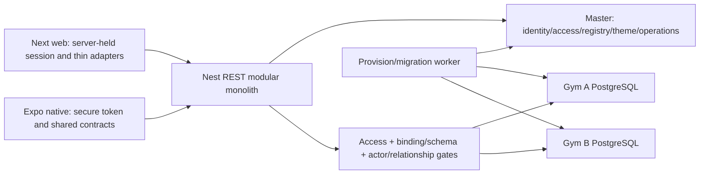
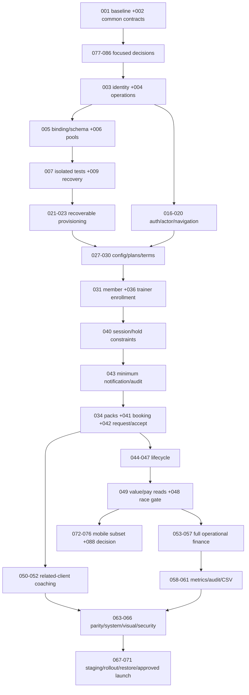

# GymOS V2 — Master Migration Execution Plan

**Planning baseline:23 October2026. Status: documentation ready for review; migration not implemented.** V1 HEAD `058aa8532741c4cb84289589fd2cf89282882988`; V2 HEAD `25546dec684382438416ecf22a65c0262bb0f558`. Both source revisions match the supplied maps. Initial task statuses were Not Started; current progress/evidence is in the live task index and tracker.

This document and its [authoritative task-detail appendix](MIGRATION_TASK_SPECS.md) form one plan. [Traceability](MIGRATION_TRACEABILITY.md) supplies exhaustive source/API/interaction inventories and task bindings. The six requested artifacts reuse the existing `docs/migration` directory; two linked appendices keep detailed specs and evidence navigable. Existing maps remain historical source references and were updated only where needed to reflect explicitly owner-approved scope.

## 1. Executive Summary

Migrate V1 design and intended web workflows incrementally into V2’s existing Next/Nest modular-monolith foundation. Preserve working V2 infrastructure: Argon2/JWT login, server-held cookies, current-access guard, separate Master/tenant clients, server-generated physical gym DB provisioning, primary/logo branding, registry/create and basic contacts. Extend these rather than rebuilding the backend. V2 is a real foundation, not an empty repository; it does not yet implement most V1 domains.

Each feature task includes UI, typed API, backend rules, data boundary, authorization, negative/failure tests and evidence. Foundations prevent repeated rewrites: typed identity/actor links, operational-publication gate, actual schema/binding verification, bounded pools, durable operations/receipts, exact money/time contracts and once-only settlement. Notification and audit minimums ship alongside request/acceptance. Backup/restore begins before feature rollout.

Approved map §14.1 governs MVP: one role per identity/gym; verified login reuse across gyms; temporary-password forced change; read-only support; date-derived memberships; hold credits at booking/acceptance; complete only started ACTIVE sessions; constrained no-show/cancellation; snapshot pay; exact operational earned-value reports. Payment capture/refunds/receipts/cash reports/subscription billing are future scope; hide mock controls/O14. MVP branding editor supports primary color+HTTPS logo, with an internal V1 Classic baseline. Do not reopen these settled choices because earlier map paragraphs call them open.

Historical planning checkpoint: implementation initially began with **GYMOS-MIG-001**, a small non-mutating baseline. Decision tasks 077–086 have since been resolved; deployment/mobile choices remain separate open tasks 087/088. Current task progress is in the live tracker. This plan does not authorize production deployment, database reset or V1 changes.

## 2. Project Goals and Scope

In scope: all29 V1 page-route responsibilities,26 rendered screens (including deferred O14 reference), role navigation/shared UI,44 exported actions, direct page data loaders, two HTTP families,20 models/14 enums and approved web workflows. Target is fresh V2 schemas/fixtures with independent IDs: no V1 data transfer, account/hash import, ETL, old→new ID table or dual-write/catch-up migration. V1 remains a demo/reference untouched.

Web/mobile share REST/Nest business services; mobile uses native UI and follows stable contracts after core lifecycle. Unsupported progress/community/gamification/check-in/ratings/payment gateways/external accounting/global inbox/push/extended theme editing are not invented parity. Authenticated read-only member viewing of own assigned workout/meal plans was explicitly added to first-release scope by the project owner on 30 October 2026 and is owned by tasks 051/052; it is new V2 scope, not V1 parity. Other deferred source entities/components/controls remain in traceability and task062; further product work needs owner approval and task ownership.

## 3. Source Documents and Evidence

Primary inputs: [UI map](UI_MIGRATION_MAP.md), [Functionality map](FUNCTIONALITY_MIGRATION_MAP.md), [Database map](DATABASE_MIGRATION_MAP.md), [API map](API_MIGRATION_MAP.md). All four exist and were read across the source-review workstreams. No missing map is assumed. Precedence for target behavior: explicit user request and settled map addenda; this plan’s recorded resolution; detailed map contracts; V1 behavior as evidence, never authority to preserve defects. Record disagreements rather than silently choose.

Source roots: V1 `/Users/esanduepa/Desktop/Projects/gymos`; V2 `/Users/esanduepa/Desktop/Projects/gymos-v2`. Absolute source links, exact action/model declaration lines and all TSX/control/contract rows are in the Traceability Appendix. Inspected artifacts include V1 auth/authz/proxy/actions/pricing/shared UI/schema/four SQL migrations/config/workflows; V2 controllers/guards/services/pages/actions/two schemas+SQL/configs/scripts/tests/compose/manifests. Maps are untracked existing user documentation, not disposable generated content.

Evidence limits: source inspection verifies declarations/branches, not live schema, tenant isolation, accounting or visual behavior. This planning run executed only existing API unit suite:1 test passed, greeting assertion; no domain runtime claim follows. No V1 runtime, DB connection/query/migrate/seed/reset, API provisioning, milestone script or screenshots were run. No production/staging account/provider configuration or backups were observed. README instructions are not current execution evidence. Source-inferred race/partial-failure risks are explicitly not reproduced runtime incidents.

Known map disagreements and resolutions are recorded in [Decisions](MIGRATION_DECISIONS.md#recorded-documentation-disagreements): stale pre-start completion/billing/DeskPayment/theme proposals, UI readiness wording, meal day mismatch, basic E08 vs registration, and the request’s inaccurate missing-budget-input example. Those do not make the four documents inaccessible; they constrain which text future agents may follow.

## 4. Existing V1 Architecture Summary

V1 is an integrated Next16.3/React19.2.8/TypeScript/Tailwind4/Auth.js/Prisma6 PostgreSQL application (manifest/source facts; original brief rounded versions). Auth, actions, direct page loaders and UI share one database with gymId filtering. Roles SUPER_ADMIN/GYM_OWNER/PERSONAL_TRAINER/GYM_MEMBER map to Master global role and gym-scoped OWNER/TRAINER/MEMBER, not a single copied User.role. V1 has password hashing, login limiting, inactive-role checks, JWT sessions and periodic database revalidation; do not describe security as wholly absent. Forced-change/backend enforcement and tenant/privacy boundaries still require target correction.

Routes: root1, auth2, platform1, owner14, trainer7, member4; root/trainer/member entries redirect, leaving26 rendered pages. Payroll/plans/financial reports/settings are tabs, not additional routes. Coaching is trainer-client UI; progress metrics are fetched unused, and no member progress/check-in/community interface exists. Auth.js catchall and CSV handler are separate HTTP families. Next/Vercel-related comments/config support V1 deployment intent, but no live Vercel project/account was verified; no hosting migration is performed here.

V1 supports owner enrollment/credentials/config/plans/packs, trainer roster/shifts/coaching, member requests, trainer responses/lifecycle, owner oversight, operational finance/payroll/analytics/audit/bell and partial subscription display. Float money, raw record serialization, read-triggered writes, mock billing, inconsistent expiry/settlement/refresh/authorization are correction obligations, not parity targets.

## 5. Current V2 Implementation Assessment

Workspace: pnpm9.15.0, README Node24, `apps/web` Next16.4.2/React19.3/TS5; `apps/api` Nest12/TS6/Zod4/Prisma7.10.1/pg/Argon2/jose; PostgreSQL17 local compose. Versions are package declarations/lockfile facts, not a recommendation to upgrade. Preserve toolchain until targeted compatibility evidence supports change. `packages/contracts`, `api-client`, `theme-tokens` and `infrastructure/scripts` are empty scaffolding, not working packages. No mobile app, CI workflows, production Dockerfiles/deploy manifests/backup tooling found.

| Subsystem | Readiness classification | Source evidence / preserve or extend |
|---|---|---|
| Workspace / App Router / Nest shell | Implemented but not verified | pnpm-workspace.yaml, root/app manifests, apps/api/src/app.module.ts; retain boundaries |
| Separate schemas/clients | Implemented but not verified | packages/database-master and database-tenant/schema+migrations; master4 models/3 enums, tenant1 model/1 enum |
| Global identity/access | Partially implemented | User/Gym/GymAccess/Theme; composite userId+gymId, one gym role; missing actor/status/version/forced-change |
| Login/token/web cookie | Partially implemented | auth.controller.ts/auth-token.ts; Argon2id, HS256 issuer/audience,15min; web HttpOnly/SameSite/Lax/prodSecure; no renewal/revocation/forced change |
| Tenant guard/client lifecycle | Needs refactoring | gym-access.guard.ts checks current GymAccess+ACTIVE Gym, no admin bypass; client map unbounded/no schema-binding gate |
| Gym provisioning | Needs refactoring | gym-provisioning.service.ts physical CREATE+migrate then master-only owner/access/theme activation; preserve generated DB names, add durable recovery |
| Admin registry/create | Implemented but not verified | admin.controller.ts and web/admin/page.tsx; keep creation capability during V1 UI adaptation |
| Theme | Partially implemented | gyms.controller.ts GET/PATCH primary/logo; web CSS variable/logo; no editor/version/audit |
| Basic members | Implemented but not verified for limited scope | GET capped100; POST basic fullName/optional email contact only, no global identity/access/membership |
| Role entry/privacy UI | Needs refactoring | gyms/[slug]/page.tsx unconditionally fetches members, causing MEMBER403; TRAINER currently sees broad roster |
| Advanced domains | Missing | No trainer/membership/pack/session/coaching/finance/audit/notification domain implementation |
| Shared contracts/API client | Missing | Empty dirs; current lib/gymos.ts manual types/casts only |
| Automated tests | Partially implemented | Scaffold unit/e2e; verify-milestone.mjs useful but mutating, not real-browser E2E |
| CI/deploy/backup/mobile | Missing | compose only local PostgreSQL; no verified remote environment/provider/Expo |

No major subsystem is marked Implemented and verified; the one scaffold unit pass does not verify architecture. None requires blanket replacement. E01–E08 are exactly eight existing feature method/path pairs plus diagnostic GET/; [API inventory](MIGRATION_TRACEABILITY.md#api-contract-register) states DTOs/auth and gaps. No proposed C route is counted as existing.

Preservation obligations: retain server-held bearer token/no-store fetches, explicit field selection in existing basic APIs, fresh current-access checks, server-generated DB names, separate clients and schema directories, Argon2id, throttle and theme validation. Adapt current ownerPassword/duplicate-owner behavior to approved generated credentials/verified reuse. Preserve basic contacts without pretending they are enrolled members. The standalone provisioning CLI differs from API: it creates gym/db only; CLIs must converge on reviewed safe services rather than be assumed equivalent.

`verify:milestone` creates Master fixtures and physical databases and forcibly drops generated DBs during cleanup. Do not run it in this planning task or against an unknown environment. Task007 adds per-run disposable environment ownership guards before reusing it.

## 6. Approved Target Architecture

Master PostgreSQL owns identity/auth, gym registry/routing/status, per-gym memberships/roles, brand, provisioning/enrollment/support operations and platform audit. Future platform subscriptions remain Master-owned but outside MVP. Tenant PostgreSQL owns gym-specific Member/Trainer, operational configuration, membership plans/terms, packs/holds/sessions, coaching, exact-value/expense/budget/payroll, gym audit/notifications/receipts and schema/binding markers. One common tenant schema, one physical database per gym, separate Prisma clients; no cross-database FKs or transaction.

Compatibility prerequisites:003 identity links;004 recoverable operations/receipts/audit;005 installed-schema+binding gate;006 bounded connections;016/018 backend auth/actor rules;027 configuration/028 plans/030 term eligibility;040 transition/hold/settlement constraints. Design once and extend current services; do not begin visual-only page migration disconnected from backend tasks. Theme tokens and read-only explicit fixtures can proceed independently, but fixtures do not establish API implementation.

## 7. Architecture Rules and Non-Negotiable Constraints

These constraints bind every future agent unless project owner explicitly approves a recorded revision.

- Frontend: App Router+TS; preserve V1 hierarchy/fields/tabs/modals/journeys. Semantic tokens replace hardcoded brand. Business rules remain Nest-owned; typed/runtime-validated DTOs replace Prisma types/records. Role navigation and all cache keys/state/refresh/polls include identity+selected gym+role; stale responses discarded. Accessible form labels/focus/keyboard/feedback are required.
- Backend: Nest modular monolith; HTTP controllers validate, services transact, policies enforce current role/gym/relationship. One business implementation serves web/native. Standard errors and explicit success/pending/unknown outcomes; idempotent commands plus database uniqueness/state/version invariants. No generic session-status setter.
- Database: distinct Master/tenant ownership, common versioned tenant schema, stable global identity external refs with independent local actor IDs; no cross-DB FK/ACID. Secure server registry only, bounded reused pools, controlled provisioning/migrations, backup/restore evidence and fail-closed mismatches. No automatic tenant DDL during ordinary API requests/builds.
- Security: never trust browser gym/actor/fee/recipient/database names; current membership first. No credentials/connection details/hash/raw health/finance in unauthorized DTO/logs. Owner/confirmed-related-trainer health access only. Super Admin ordinary access is not implicit OWNER; support read-only with original actor. Required administrative actions audited with stable event identity.
- API: one REST surface with consistent validation/decimal-string/currency/date/pagination/filter/error conventions; documented version/compatibility evolution, typed shared client. Retain current unprefixed paths until a reviewed compatible version strategy. An API proposal remains proposed until registered/tested.
- Theme: centrally stored primary/logo, safe defaults and V1 Classic internal tokens; status colors semantic, contrast tested. Public-safe projection excludes identity/registry internals. Context switch cannot leak previous gym data. User-selectable fonts/modes/extra presets are deferred, not scope creep through token work.

## 8. Unified V1-to-V2 Feature Traceability Matrix

The [Traceability Appendix](MIGRATION_TRACEABILITY.md) is the exhaustive matrix: each of29 original V1 route records supplies all22 requested mappings (UI/components/interactions/actions/rules/validation/auth/models/Master+tenant destinations/Nest/endpoints/DTOs/Next/tests/defects/current V2/complexity/dependencies/acceptance/disposition). Separate inventories bind every74 TSX file,40 component file,149 authored handler-line sites,52 UI groups,22 local-control groups,39 workflows,44 action exports,20 models/14 enums,65 C contracts and8 E feature operations to task IDs. Owner-approved V2 member plan views are additional scope, not original V1 routes.

Grouped controls/workflows overlap; they are not a precise independent-click denominator. Static handler search is a completeness cross-check, not proof of every runtime conditional interaction. Task063 reconciles current source again;014/064/065 verify rendered/functional conditional states. All discovered items have a disposition; none is counted runtime complete. BodyMetric/ProgressPhoto, historical Message, unused FormattedDate/TrainerPayChart and deferred payment/subscription components are explicitly allocated or omitted.

## 9. Known Defects and Correction Register

V1 paths below are relative to the verified V1 root; `financials.ts`, `dashboard.ts`, `admin.ts`, `notifications.ts` etc. under `app/actions` where abbreviated. Evidence describes source branches/serialization flow; duplicate financial outcomes are risks until reproduced by future tests. Status for all rows: **Open / correction not implemented**. Settled behavior uses map §14.1; decision outputs from tasks077–086 are recorded and approved, while correction implementation remains in the owning feature tasks.

| Defect ID | Source finding | V1 source evidence | Impact / intended correction | V2 task IDs | Required regression evidence |
|---|---|---|---|---|---|
| DEF-01 | Raw User records reach client props | V1 owner/members/page.tsx:11,32; owner/members/[id]/page.tsx:16,46; trainer/clients/[id]/page.tsx:20,66 | Password/health serialization risk; explicit sanitized DTO selects, no raw Prisma | GYMOS-MIG-002, GYMOS-MIG-018, GYMOS-MIG-032, GYMOS-MIG-037, GYMOS-MIG-050, GYMOS-MIG-066 | Recursive response/props forbidden-key checks, role-specific health projection |
| DEF-02 | Completion race | V1 app/actions/sessions.ts:515,529,549,550; PayRecord.sessionId not unique | Pre-read status then unconditional update can repeat effects; version/state CAS+unique origin | GYMOS-MIG-040, GYMOS-MIG-046, GYMOS-MIG-048 | Concurrent same/different-key completes yield one settlement/debit/pay |
| DEF-03 | Repeated no-show settlement | V1 app/actions/sessions.ts:623,642 | No state/time/repeat guard; scheduled not-started at+15min only, one settlement | GYMOS-MIG-040, GYMOS-MIG-047, GYMOS-MIG-048 | All state/time boundaries and sequential/concurrent duplicate calls |
| DEF-04 | Unbound pack debit and revenue with no pack | V1 app/actions/sessions.ts:133 | Arbitrary current pack and read-set balance; durable selected-pack hold/guarded consume | GYMOS-MIG-034, GYMOS-MIG-040, GYMOS-MIG-046, GYMOS-MIG-047, GYMOS-MIG-048 | Held pack after expiry, no-pack denial, balance conservation |
| DEF-05 | Booking/accept collision race | V1 app/actions/sessions.ts:182,382 | Availability check not full concurrency exclusion; interval locks/constraints | GYMOS-MIG-040, GYMOS-MIG-041, GYMOS-MIG-042, GYMOS-MIG-048 | Overlapping/different-duration slots and last credit race |
| DEF-06 | Completion before Start | V1 app/actions/sessions.ts:529,538 | SCHEDULED accepted; require ACTIVE+startedAt and approved elapsed minimum | GYMOS-MIG-045, GYMOS-MIG-046, GYMOS-MIG-048 | Direct SCHEDULED completion rejected with0 effects |
| DEF-07 | Policy switches/zero ignored | V1 app/actions/sessions.ts:534,642,693,695 | Truthy defaults replace0; late policy ignored. Exact cutoff free/toggle respected | GYMOS-MIG-029, GYMOS-MIG-047, GYMOS-MIG-048 | Zero window, toggle on/off, equality and grace boundaries |
| DEF-08 | Pay uses mutable current terms | V1 app/actions/sessions.ts:571,585 | Rate/level read at completion and arbitrary30-day period; confirmation snapshot/local periods | GYMOS-MIG-040, GYMOS-MIG-046, GYMOS-MIG-056 | Config/level changed after confirmation and period boundaries |
| DEF-09 | Partial registration after error | V1 app/actions/members.ts:67,91,101; trainers.ts:56,78 | Separate create/revenue/audit; recoverable Master/tenant saga, no fake payment | GYMOS-MIG-004, GYMOS-MIG-017, GYMOS-MIG-031, GYMOS-MIG-035, GYMOS-MIG-036 | Fault after each plane/checkpoint; one actor/term and hidden pending state |
| DEF-10 | Old term marks identity expired | V1 app/actions/members.ts:155 | Expiry sweep couples identity to one old term; derive date coverage, withdraw C44 mutation | GYMOS-MIG-030, GYMOS-MIG-032 | Expired+current renewal fixture; GET purity |
| DEF-11 | Blank optional rates become zero | V1 app/actions/gym-config.ts:149,169,190; map EV01 | Blank→null fallback; explicit0 remains0 | GYMOS-MIG-029 | Pure parser null/blank/zero tests and snapshot amounts |
| DEF-12 | Floating-point money | V1 prisma/schema.prisma money Float; lib/pricing.ts:75 | Exact Decimal/string transport and signed rounding/remainder policy | GYMOS-MIG-028, GYMOS-MIG-029, GYMOS-MIG-040, GYMOS-MIG-053, GYMOS-MIG-057, GYMOS-MIG-082 | Repeating fractions and total conservation |
| DEF-13 | Runtime validation missing | V1 app/actions/plans.ts:23,78; members.ts:116; trainers.ts:92 | TS types do not validate HTTP data; strict enums/nested bounds | GYMOS-MIG-002, GYMOS-MIG-033, GYMOS-MIG-038, GYMOS-MIG-051, GYMOS-MIG-052 | Malformed enums/rows/fractions/NaN/oversize DTOs422 |
| DEF-14 | Reads create synthetic records | V1 financials.ts:329,345; subscription.ts:7,14 | Current period GET writes; fake GROWTH/card4242. Pure reads/null; billing deferred | GYMOS-MIG-049, GYMOS-MIG-056, GYMOS-MIG-062 | Before/after GET row counts equal; mock labels absent |
| DEF-15 | Repeatable payroll state writes | V1 app/actions/financials.ts:404,420 | Unconditional close/approve without state/version/audit; OPEN→CLOSED→APPROVED | GYMOS-MIG-056 | Close/complete/approve races; approved correction later period |
| DEF-16 | Inconsistent P&L payroll/comparison | V1 app/actions/financials.ts:479,515 | Whole-period containment and prior payroll omission; one reviewed accrual basis | GYMOS-MIG-053, GYMOS-MIG-056, GYMOS-MIG-057 | Partial-period/current-prior reconciliation; no salary double count |
| DEF-17 | Misleading metrics/history labels | V1 admin.ts:22,43; dashboard.ts:21,45; analytics.ts:70; UI §17 | Users vs members, booking proxies vs attendance, recent vs total and paid vs approved | GYMOS-MIG-024, GYMOS-MIG-032, GYMOS-MIG-037, GYMOS-MIG-044, GYMOS-MIG-049, GYMOS-MIG-058, GYMOS-MIG-059 | Metric dictionary/frozen data, honest labels and full totals |
| DEF-18 | Ignored UI errors | V1 status/override/start/no-show/notes/cancel/payroll consumers; UI §17 | Dialogs close/show success after returned error; retain draft/show known outcome | GYMOS-MIG-012, GYMOS-MIG-033, GYMOS-MIG-038, GYMOS-MIG-044, GYMOS-MIG-045, GYMOS-MIG-047, GYMOS-MIG-056, GYMOS-MIG-064 | Inject409/503/unknown outcome and verify feedback/no false success |
| DEF-19 | Mock billing appears operational | V1 owner profile PAID/receipt alert; subscription client/static tier | Entitlement history only; payment/receipt/subscription controls hidden | GYMOS-MIG-032, GYMOS-MIG-057, GYMOS-MIG-062 | No C53/C58 path or paid/cash/receipt claims in MVP |
| DEF-20 | CSV/audit scope inconsistency | V1 daily-view.tsx:66; AuditLogClient.tsx:54; audit.ts:7; lib/csv.ts | Safe server download, approved full-filter finance vs visible-page audit | GYMOS-MIG-060, GYMOS-MIG-061 | CSV quote/newline/formula/filter/cap and page row checks |
| DEF-21 | Notification gym scope and post-write failures | V1 notifications.ts:6,27,39; sessions request/response notify after create | Selected-gym recipient; atomic local notification/audit or durable delivery outcome | GYMOS-MIG-004, GYMOS-MIG-042, GYMOS-MIG-043, GYMOS-MIG-048 | Own mark only, cross-gym deny, notification fault never repeats money |
| DEF-22 | Forced-change/session enforcement gaps | V1 lib/auth.ts and lib/authz.ts; proxy.ts | V1 has hashes, login limits and DB revalidation; do not call absent. V2 API enforces forced change/current revocation | GYMOS-MIG-016, GYMOS-MIG-017, GYMOS-MIG-018, GYMOS-MIG-020, GYMOS-MIG-078 | Direct API forced-change/revoked-token denial |
| DEF-23 | Mutable privileged support context | V1 lib/authz.ts:35; actions/admin.ts:50 | V1 admin cookie allows owner changes; V2 explicit read-only scope/original actor/reason/expiry | GYMOS-MIG-024, GYMOS-MIG-079 | All write attempts denied; expired/stopped support unusable |
| DEF-24 | Meal day schema/UI disagreement | V1 prisma/schema.prisma:301; meal-builder-form.tsx default day1 | Explicit day/unit contract; no silently shifted weekly meaning | GYMOS-MIG-052, GYMOS-MIG-085 | Saved/retrieved day mapping and macro bounds |

The V1 budget category/amount fields exist; no missing-input defect is invented. V1 booking/acceptance do not deduct credits; the verified danger is unbound/repeatable settlement and races, not a demonstrated double deduction at request+acceptance. Source credential exposure has its own security risk R18/task010; no secret value is reproduced.

## 10. Migration Strategy

Deliver small complete slices behind per-gym cutover flags. Inspect/reuse V2 first, define contract and expected persisted effects, implement data/service/policy+UI together, run targeted evidence, then enable the slice. Prepare common presentation with typed fixtures only as intermediate work; a phase cannot pass on fixtures/screenshots alone. Keep real API integration/error/retry/authorization tests in the owning task.

Phases are workstreams with explicit dependencies, not a screen-location order. Shell needs identity/context; plan/config precedes registration. Status suspension waits for hold/cancellation foundation; hide unfinished status controls rather than ship a partial backend. Minimum notification/audit accompanies booking/request. Full finance reuses lifecycle earned/pay baseline; terminal effects cannot wait for a later finance rewrite. Mobile can start after stable API subset, independently of production launch.

## 11. Implementation Phases

| Phase | Workstream | Task count | Task IDs | Completion gate |
|---|---|---|---|---|
| 0 | Foundation and architecture readiness | 20 | GYMOS-MIG-001, GYMOS-MIG-002, GYMOS-MIG-003, GYMOS-MIG-004, GYMOS-MIG-005, GYMOS-MIG-006, GYMOS-MIG-007, GYMOS-MIG-008, GYMOS-MIG-009, GYMOS-MIG-010, GYMOS-MIG-077, GYMOS-MIG-078, GYMOS-MIG-079, GYMOS-MIG-080, GYMOS-MIG-081, GYMOS-MIG-082, GYMOS-MIG-083, GYMOS-MIG-084, GYMOS-MIG-085, GYMOS-MIG-086 | Common contracts/decision families resolved for dependent work; isolated harness, binding/pools, CI and early restore proven; exposed-secret follow-up tracked. No scaffold test presented as domain proof. |
| 1 | Shared UI and white-label foundation | 5 | GYMOS-MIG-011, GYMOS-MIG-012, GYMOS-MIG-013, GYMOS-MIG-014, GYMOS-MIG-015 | Classic tokens/primitives, role shell and basic brand editor integrated; two-gym theme isolation, focus/contrast and fixture capture manifest verified. Internal preset does not expand editor scope. |
| 2 | Authentication, identity and navigation | 5 | GYMOS-MIG-016, GYMOS-MIG-017, GYMOS-MIG-018, GYMOS-MIG-019, GYMOS-MIG-020 | All-role/no-/multi-gym entry, forced change, credential rotation, expiry/logout/revocation and API role denial pass. No bearer/Prisma secret reaches browser. |
| 3 | Platform administration and provisioning | 6 | GYMOS-MIG-021, GYMOS-MIG-022, GYMOS-MIG-023, GYMOS-MIG-024, GYMOS-MIG-025, GYMOS-MIG-026 | One-operation provisioning retries and failure recovery, physical schema/binding evidence, owner activation, registry/support, suspension and tenant rollout drills pass with original actor audit. |
| 4 | Gym configuration and membership foundations | 4 | GYMOS-MIG-027, GYMOS-MIG-028, GYMOS-MIG-029, GYMOS-MIG-030 | Owner profile/plans/rates/policy complete; blank/null/zero rules and date-derived non-overlap/renewal tested; no cross-plane atomicity or entitlement-payment assumption. |
| 5 | Member management | 5 | GYMOS-MIG-031, GYMOS-MIG-032, GYMOS-MIG-033, GYMOS-MIG-034, GYMOS-MIG-035 | Owner full registration/list/profile/status/pack journeys and lost-outcome recovery pass; >100 members supported; pending enrollment unpublished and basic contacts clearly labeled. |
| 6 | Trainer management | 4 | GYMOS-MIG-036, GYMOS-MIG-037, GYMOS-MIG-038, GYMOS-MIG-039 | Trainer registration/roster/detail/shift/status plus member directory pass; privacy and verified identity reuse preserved; deactivation releases future holds free. |
| 7 | Sessions, scheduling and settlement | 10 | GYMOS-MIG-040, GYMOS-MIG-041, GYMOS-MIG-042, GYMOS-MIG-043, GYMOS-MIG-044, GYMOS-MIG-045, GYMOS-MIG-046, GYMOS-MIG-047, GYMOS-MIG-048, GYMOS-MIG-049 | All approved transition/time/credit/pay invariants pass real DB races; cross-role schedules/earnings/value agree; minimal notification and audit evidence available; no repeated terminal effects. |
| 8 | Trainer clients and coaching plans | 3 | GYMOS-MIG-050, GYMOS-MIG-051, GYMOS-MIG-052 | Confirmed-client roster/profile; trainer workout/meal builders and retrieval; authenticated members can view only their own assigned plans, read-only, with nested validation/privacy/day mapping and history retrieval. Project-owner scope update 30 October 2026 supersedes the older member-delivery exclusion. |
| 9 | Operational finance and payroll | 5 | GYMOS-MIG-053, GYMOS-MIG-054, GYMOS-MIG-055, GYMOS-MIG-056, GYMOS-MIG-057 | Six finance panels reconcile agreed value/expenses/budgets/payroll/current-prior basis in exact money; first-pay period and close/approve races pass; cash unavailable and approval not payout. |
| 10 | Analytics, audit, exports and scope | 5 | GYMOS-MIG-058, GYMOS-MIG-059, GYMOS-MIG-060, GYMOS-MIG-061, GYMOS-MIG-062 | Honest dashboard/analytics, full audit filtering, scoped CSV and selected-gym bell operate; O14/payment mocks hidden; cross-gym summaries bounded and stale-aware. |
| 11 | Complete parity and system validation | 4 | GYMOS-MIG-063, GYMOS-MIG-064, GYMOS-MIG-065, GYMOS-MIG-066 | Every source/API/control/model disposition reconciled; all-role/two-gym journeys, visual/accessibility/isolation/concurrency/capacity evidence pass; no unresolved critical security/financial issue. |
| 12 | Deployment and production readiness | 6 | GYMOS-MIG-067, GYMOS-MIG-068, GYMOS-MIG-069, GYMOS-MIG-070, GYMOS-MIG-071, GYMOS-MIG-087 | Provider capacities verified, separate staging web/API and safe schema rollouts, health/alerts, managed restore and rollback rehearsed; actual owner approves concrete production release. |
| 13 | Mobile preparation and development | 6 | GYMOS-MIG-072, GYMOS-MIG-073, GYMOS-MIG-074, GYMOS-MIG-075, GYMOS-MIG-076, GYMOS-MIG-088 | Approved native subset uses same services; secure token/gym/theme navigation, cross-device retries, Android/iOS tests/builds and release controls pass. Optional push only if separately approved. |

Phase0 decision tasks077–086 are focused review records, not permission to implement unresolved business defaults. Provider decision087 can begin after001 despite phase12 classification. Phase1 full completion waits for later auth/context/basic editor integration; independent token/primitives work need not wait. Essential security/recovery is established in0/2/3 and finalized in12. Mobile phase13 completion is separate from web MVP production acceptance071.

## 12. Complete Task Breakdown with Unique IDs

[Authoritative full specifications](MIGRATION_TASK_SPECS.md) give every task all requested fields: objective/current state/required inputs/dependencies/scope/exact source files/proposed target paths/Prisma/Nest/Next/rules/auth/validation/tests/acceptance/DoD/risks/recovery/out-of-scope/deliverables/complexity/work unit/status. This index is a synchronized view. No existing source file automatically completes a task; every task starts Not Started.

| Task | Phase | Name | Direct prerequisites | Complexity | Status |
|---|---|---|---|---|---|
| [GYMOS-MIG-001](MIGRATION_TASK_SPECS.md#task-id-gymos-mig-001) | 0 | Record a reproducible non-mutating V2 baseline | None | Low | Completed |
| [GYMOS-MIG-002](MIGRATION_TASK_SPECS.md#task-id-gymos-mig-002) | 0 | Freeze remaining technical contracts and decision gates | GYMOS-MIG-001 | High | Completed |
| [GYMOS-MIG-003](MIGRATION_TASK_SPECS.md#task-id-gymos-mig-003) | 0 | Extend master identity and typed tenant access schema | GYMOS-MIG-002, GYMOS-MIG-078 | High | Completed |
| [GYMOS-MIG-004](MIGRATION_TASK_SPECS.md#task-id-gymos-mig-004) | 0 | Implement durable operation and local receipt primitives | GYMOS-MIG-002, GYMOS-MIG-003, GYMOS-MIG-080 | High | Completed |
| [GYMOS-MIG-005](MIGRATION_TASK_SPECS.md#task-id-gymos-mig-005) | 0 | Verify tenant binding and actual installed schema | GYMOS-MIG-003, GYMOS-MIG-004, GYMOS-MIG-080, GYMOS-MIG-081 | High | Completed |
| [GYMOS-MIG-006](MIGRATION_TASK_SPECS.md#task-id-gymos-mig-006) | 0 | Bound tenant pools and implement safe shutdown | GYMOS-MIG-001, GYMOS-MIG-005, GYMOS-MIG-081 | High | Completed |
| [GYMOS-MIG-007](MIGRATION_TASK_SPECS.md#task-id-gymos-mig-007) | 0 | Build disposable two-gym database and browser harness | GYMOS-MIG-002, GYMOS-MIG-004, GYMOS-MIG-005, GYMOS-MIG-006 | High | Completed |
| [GYMOS-MIG-008](MIGRATION_TASK_SPECS.md#task-id-gymos-mig-008) | 0 | Add workspace checks and isolated CI | GYMOS-MIG-001, GYMOS-MIG-002, GYMOS-MIG-007 | Medium | In Progress |
| [GYMOS-MIG-009](MIGRATION_TASK_SPECS.md#task-id-gymos-mig-009) | 0 | Prove local/staging tenant backup and isolated restore | GYMOS-MIG-005, GYMOS-MIG-007, GYMOS-MIG-081 | High | Completed |
| [GYMOS-MIG-010](MIGRATION_TASK_SPECS.md#task-id-gymos-mig-010) | 0 | Track exposed V1 credential remediation and V2 secret hygiene | GYMOS-MIG-001 | Medium | Blocked |
| [GYMOS-MIG-011](MIGRATION_TASK_SPECS.md#task-id-gymos-mig-011) | 1 | Create V1 Classic semantic tokens | GYMOS-MIG-001, GYMOS-MIG-002, GYMOS-MIG-086 | Medium | Not Started |
| [GYMOS-MIG-012](MIGRATION_TASK_SPECS.md#task-id-gymos-mig-012) | 1 | Extract accessible shared UI primitives | GYMOS-MIG-011 | Medium | Not Started |
| [GYMOS-MIG-013](MIGRATION_TASK_SPECS.md#task-id-gymos-mig-013) | 1 | Integrate role/gym dashboard chrome | GYMOS-MIG-012, GYMOS-MIG-018, GYMOS-MIG-019 | Medium | Completed |
| [GYMOS-MIG-014](MIGRATION_TASK_SPECS.md#task-id-gymos-mig-014) | 1 | Capture safe V1 baseline fixtures and visual manifest | GYMOS-MIG-007, GYMOS-MIG-011, GYMOS-MIG-012 | Medium | Completed |
| [GYMOS-MIG-015](MIGRATION_TASK_SPECS.md#task-id-gymos-mig-015) | 1 | Integrate basic gym branding editor and fallback | GYMOS-MIG-011, GYMOS-MIG-012, GYMOS-MIG-013, GYMOS-MIG-024, GYMOS-MIG-027, GYMOS-MIG-086 | Medium | Not Started |
| [GYMOS-MIG-016](MIGRATION_TASK_SPECS.md#task-id-gymos-mig-016) | 2 | Extend login with session policy and forced-change enforcement | GYMOS-MIG-002, GYMOS-MIG-003, GYMOS-MIG-007, GYMOS-MIG-078 | High | Not Started |
| [GYMOS-MIG-017](MIGRATION_TASK_SPECS.md#task-id-gymos-mig-017) | 2 | Implement temporary-credential issue/change/reissue | GYMOS-MIG-004, GYMOS-MIG-016, GYMOS-MIG-078 | High | Not Started |
| [GYMOS-MIG-018](MIGRATION_TASK_SPECS.md#task-id-gymos-mig-018) | 2 | Enforce operational actor and resource authorization | GYMOS-MIG-003, GYMOS-MIG-004, GYMOS-MIG-005, GYMOS-MIG-016, GYMOS-MIG-078, GYMOS-MIG-080 | High | Not Started |
| [GYMOS-MIG-019](MIGRATION_TASK_SPECS.md#task-id-gymos-mig-019) | 2 | Implement role-aware root, gym selection and protected navigation | GYMOS-MIG-012, GYMOS-MIG-016, GYMOS-MIG-018, GYMOS-MIG-086 | Medium | Not Started |
| [GYMOS-MIG-020](MIGRATION_TASK_SPECS.md#task-id-gymos-mig-020) | 2 | Harden web session transport and safe logout | GYMOS-MIG-016, GYMOS-MIG-017, GYMOS-MIG-019, GYMOS-MIG-078, GYMOS-MIG-087 | Medium | Completed |
| [GYMOS-MIG-021](MIGRATION_TASK_SPECS.md#task-id-gymos-mig-021) | 3 | Reserve idempotent provisioning operations | GYMOS-MIG-004, GYMOS-MIG-005, GYMOS-MIG-016, GYMOS-MIG-018, GYMOS-MIG-080, GYMOS-MIG-081 | High | Not Started |
| [GYMOS-MIG-022](MIGRATION_TASK_SPECS.md#task-id-gymos-mig-022) | 3 | Move physical provisioning to recoverable worker | GYMOS-MIG-006, GYMOS-MIG-007, GYMOS-MIG-009, GYMOS-MIG-021, GYMOS-MIG-080, GYMOS-MIG-081 | High | Not Started |
| [GYMOS-MIG-023](MIGRATION_TASK_SPECS.md#task-id-gymos-mig-023) | 3 | Finalize owner identity, theme and gym activation | GYMOS-MIG-017, GYMOS-MIG-018, GYMOS-MIG-022 | High | Not Started |
| [GYMOS-MIG-024](MIGRATION_TASK_SPECS.md#task-id-gymos-mig-024) | 3 | Migrate registry and scoped read-only support | GYMOS-MIG-013, GYMOS-MIG-020, GYMOS-MIG-023, GYMOS-MIG-079, GYMOS-MIG-085 | High | Not Started |
| [GYMOS-MIG-025](MIGRATION_TASK_SPECS.md#task-id-gymos-mig-025) | 3 | Suspend and reactivate tenant access safely | GYMOS-MIG-018, GYMOS-MIG-023, GYMOS-MIG-024, GYMOS-MIG-078, GYMOS-MIG-080 | Medium | Not Started |
| [GYMOS-MIG-026](MIGRATION_TASK_SPECS.md#task-id-gymos-mig-026) | 3 | Orchestrate versioned tenant schema rollout and repair | GYMOS-MIG-005, GYMOS-MIG-007, GYMOS-MIG-009, GYMOS-MIG-022, GYMOS-MIG-025, GYMOS-MIG-081 | High | Not Started |
| [GYMOS-MIG-027](MIGRATION_TASK_SPECS.md#task-id-gymos-mig-027) | 4 | Migrate operational gym profile and configuration reads | GYMOS-MIG-013, GYMOS-MIG-018, GYMOS-MIG-023, GYMOS-MIG-077, GYMOS-MIG-082, GYMOS-MIG-083 | High | Not Started |
| [GYMOS-MIG-028](MIGRATION_TASK_SPECS.md#task-id-gymos-mig-028) | 4 | Migrate membership plans and owner plan form | GYMOS-MIG-012, GYMOS-MIG-018, GYMOS-MIG-027, GYMOS-MIG-082, GYMOS-MIG-083 | Medium | Not Started |
| [GYMOS-MIG-029](MIGRATION_TASK_SPECS.md#task-id-gymos-mig-029) | 4 | Migrate rates, pay percentages and cancellation settings | GYMOS-MIG-012, GYMOS-MIG-027, GYMOS-MIG-028, GYMOS-MIG-082, GYMOS-MIG-083, GYMOS-MIG-084 | Medium | Not Started |
| [GYMOS-MIG-030](MIGRATION_TASK_SPECS.md#task-id-gymos-mig-030) | 4 | Implement date-derived membership eligibility and renewal | GYMOS-MIG-018, GYMOS-MIG-028, GYMOS-MIG-029, GYMOS-MIG-083 | High | Not Started |
| [GYMOS-MIG-031](MIGRATION_TASK_SPECS.md#task-id-gymos-mig-031) | 5 | Migrate full member registration vertical slice | GYMOS-MIG-017, GYMOS-MIG-018, GYMOS-MIG-023, GYMOS-MIG-028, GYMOS-MIG-030, GYMOS-MIG-078, GYMOS-MIG-080, GYMOS-MIG-083 | High | Not Started |
| [GYMOS-MIG-032](MIGRATION_TASK_SPECS.md#task-id-gymos-mig-032) | 5 | Migrate paged member list and complete profile | GYMOS-MIG-013, GYMOS-MIG-018, GYMOS-MIG-030, GYMOS-MIG-031 | Medium | Not Started |
| [GYMOS-MIG-033](MIGRATION_TASK_SPECS.md#task-id-gymos-mig-033) | 5 | Make member status changes recoverable and release future holds | GYMOS-MIG-004, GYMOS-MIG-018, GYMOS-MIG-031, GYMOS-MIG-040, GYMOS-MIG-043, GYMOS-MIG-078, GYMOS-MIG-080, GYMOS-MIG-084 | High | Not Started |
| [GYMOS-MIG-034](MIGRATION_TASK_SPECS.md#task-id-gymos-mig-034) | 5 | Migrate session-pack issuance and balance projection | GYMOS-MIG-018, GYMOS-MIG-030, GYMOS-MIG-031, GYMOS-MIG-040, GYMOS-MIG-082, GYMOS-MIG-083, GYMOS-MIG-084 | Medium | Not Started |
| [GYMOS-MIG-035](MIGRATION_TASK_SPECS.md#task-id-gymos-mig-035) | 5 | Verify member enrollment and recovery journey | GYMOS-MIG-007, GYMOS-MIG-020, GYMOS-MIG-031, GYMOS-MIG-032, GYMOS-MIG-034 | High | Not Started |
| [GYMOS-MIG-036](MIGRATION_TASK_SPECS.md#task-id-gymos-mig-036) | 6 | Migrate trainer registration and credential handoff | GYMOS-MIG-017, GYMOS-MIG-018, GYMOS-MIG-023, GYMOS-MIG-027, GYMOS-MIG-078, GYMOS-MIG-080, GYMOS-MIG-083 | High | Not Started |
| [GYMOS-MIG-037](MIGRATION_TASK_SPECS.md#task-id-gymos-mig-037) | 6 | Migrate trainer roster, profile and shift approval | GYMOS-MIG-013, GYMOS-MIG-018, GYMOS-MIG-029, GYMOS-MIG-036, GYMOS-MIG-083, GYMOS-MIG-085 | Medium | Not Started |
| [GYMOS-MIG-038](MIGRATION_TASK_SPECS.md#task-id-gymos-mig-038) | 6 | Migrate trainer deactivation and reactivation | GYMOS-MIG-004, GYMOS-MIG-018, GYMOS-MIG-036, GYMOS-MIG-040, GYMOS-MIG-043, GYMOS-MIG-078, GYMOS-MIG-080, GYMOS-MIG-084 | High | Not Started |
| [GYMOS-MIG-039](MIGRATION_TASK_SPECS.md#task-id-gymos-mig-039) | 6 | Migrate member trainer directory | GYMOS-MIG-013, GYMOS-MIG-018, GYMOS-MIG-036, GYMOS-MIG-037 | Medium | Not Started |
| [GYMOS-MIG-040](MIGRATION_TASK_SPECS.md#task-id-gymos-mig-040) | 7 | Implement session aggregate, holds and transition constraints | GYMOS-MIG-002, GYMOS-MIG-004, GYMOS-MIG-007, GYMOS-MIG-018, GYMOS-MIG-029, GYMOS-MIG-030, GYMOS-MIG-036, GYMOS-MIG-080, GYMOS-MIG-082, GYMOS-MIG-083, GYMOS-MIG-084 | High | Not Started |
| [GYMOS-MIG-041](MIGRATION_TASK_SPECS.md#task-id-gymos-mig-041) | 7 | Migrate owner booking with atomic credit reservation | GYMOS-MIG-013, GYMOS-MIG-018, GYMOS-MIG-034, GYMOS-MIG-037, GYMOS-MIG-040, GYMOS-MIG-043, GYMOS-MIG-083, GYMOS-MIG-084 | High | Not Started |
| [GYMOS-MIG-042](MIGRATION_TASK_SPECS.md#task-id-gymos-mig-042) | 7 | Migrate member request and trainer accept/decline | GYMOS-MIG-013, GYMOS-MIG-018, GYMOS-MIG-034, GYMOS-MIG-039, GYMOS-MIG-040, GYMOS-MIG-043, GYMOS-MIG-080, GYMOS-MIG-083, GYMOS-MIG-084 | High | Not Started |
| [GYMOS-MIG-043](MIGRATION_TASK_SPECS.md#task-id-gymos-mig-043) | 7 | Provide minimum selected-gym notifications and audit reads | GYMOS-MIG-004, GYMOS-MIG-013, GYMOS-MIG-018, GYMOS-MIG-040, GYMOS-MIG-080, GYMOS-MIG-085 | Medium | Not Started |
| [GYMOS-MIG-044](MIGRATION_TASK_SPECS.md#task-id-gymos-mig-044) | 7 | Migrate owner/trainer/member session read views | GYMOS-MIG-013, GYMOS-MIG-018, GYMOS-MIG-041, GYMOS-MIG-042, GYMOS-MIG-043, GYMOS-MIG-083, GYMOS-MIG-085 | Medium | Not Started |
| [GYMOS-MIG-045](MIGRATION_TASK_SPECS.md#task-id-gymos-mig-045) | 7 | Implement Start and safe shared notes | GYMOS-MIG-040, GYMOS-MIG-044, GYMOS-MIG-083, GYMOS-MIG-084 | Medium | Not Started |
| [GYMOS-MIG-046](MIGRATION_TASK_SPECS.md#task-id-gymos-mig-046) | 7 | Complete started session exactly once with earnings | GYMOS-MIG-029, GYMOS-MIG-040, GYMOS-MIG-045, GYMOS-MIG-082, GYMOS-MIG-083, GYMOS-MIG-084 | High | Not Started |
| [GYMOS-MIG-047](MIGRATION_TASK_SPECS.md#task-id-gymos-mig-047) | 7 | Implement no-show and quoted cancellation | GYMOS-MIG-033, GYMOS-MIG-038, GYMOS-MIG-040, GYMOS-MIG-044, GYMOS-MIG-045, GYMOS-MIG-083, GYMOS-MIG-084 | High | Not Started |
| [GYMOS-MIG-048](MIGRATION_TASK_SPECS.md#task-id-gymos-mig-048) | 7 | Prove session financial and concurrency invariants | GYMOS-MIG-007, GYMOS-MIG-033, GYMOS-MIG-038, GYMOS-MIG-041, GYMOS-MIG-042, GYMOS-MIG-043, GYMOS-MIG-044, GYMOS-MIG-046, GYMOS-MIG-047, GYMOS-MIG-049 | High | Not Started |
| [GYMOS-MIG-049](MIGRATION_TASK_SPECS.md#task-id-gymos-mig-049) | 7 | Expose lifecycle earnings and operational value baseline | GYMOS-MIG-032, GYMOS-MIG-043, GYMOS-MIG-046, GYMOS-MIG-047, GYMOS-MIG-082, GYMOS-MIG-084 | High | Not Started |
| [GYMOS-MIG-050](MIGRATION_TASK_SPECS.md#task-id-gymos-mig-050) | 8 | Migrate confirmed-client roster and360 profile | GYMOS-MIG-013, GYMOS-MIG-018, GYMOS-MIG-041, GYMOS-MIG-042, GYMOS-MIG-044, GYMOS-MIG-085 | Medium | Not Started |
| [GYMOS-MIG-051](MIGRATION_TASK_SPECS.md#task-id-gymos-mig-051) | 8 | Migrate workout builder and assigned member view | GYMOS-MIG-012, GYMOS-MIG-050, GYMOS-MIG-085 | Medium | Not Started |
| [GYMOS-MIG-052](MIGRATION_TASK_SPECS.md#task-id-gymos-mig-052) | 8 | Migrate meal builder, macros and assigned member view | GYMOS-MIG-012, GYMOS-MIG-050, GYMOS-MIG-085 | Medium | Not Started |
| [GYMOS-MIG-053](MIGRATION_TASK_SPECS.md#task-id-gymos-mig-053) | 9 | Reconcile membership and pack operational earning | GYMOS-MIG-030, GYMOS-MIG-034, GYMOS-MIG-046, GYMOS-MIG-047, GYMOS-MIG-049, GYMOS-MIG-082, GYMOS-MIG-083 | High | Not Started |
| [GYMOS-MIG-054](MIGRATION_TASK_SPECS.md#task-id-gymos-mig-054) | 9 | Migrate expense capture and listing | GYMOS-MIG-012, GYMOS-MIG-018, GYMOS-MIG-027, GYMOS-MIG-049 | Medium | Not Started |
| [GYMOS-MIG-055](MIGRATION_TASK_SPECS.md#task-id-gymos-mig-055) | 9 | Migrate category budgets and variance | GYMOS-MIG-012, GYMOS-MIG-027, GYMOS-MIG-054, GYMOS-MIG-082 | Medium | Not Started |
| [GYMOS-MIG-056](MIGRATION_TASK_SPECS.md#task-id-gymos-mig-056) | 9 | Migrate payroll close, approval and adjustments | GYMOS-MIG-018, GYMOS-MIG-046, GYMOS-MIG-049, GYMOS-MIG-053, GYMOS-MIG-084 | High | Not Started |
| [GYMOS-MIG-057](MIGRATION_TASK_SPECS.md#task-id-gymos-mig-057) | 9 | Migrate finance panels, operational P&L and charts | GYMOS-MIG-012, GYMOS-MIG-053, GYMOS-MIG-054, GYMOS-MIG-055, GYMOS-MIG-056, GYMOS-MIG-082, GYMOS-MIG-084 | High | Not Started |
| [GYMOS-MIG-058](MIGRATION_TASK_SPECS.md#task-id-gymos-mig-058) | 10 | Migrate live owner dashboard with honest metrics | GYMOS-MIG-013, GYMOS-MIG-032, GYMOS-MIG-037, GYMOS-MIG-043, GYMOS-MIG-044, GYMOS-MIG-049, GYMOS-MIG-053, GYMOS-MIG-083, GYMOS-MIG-085 | Medium | Not Started |
| [GYMOS-MIG-059](MIGRATION_TASK_SPECS.md#task-id-gymos-mig-059) | 10 | Migrate operational analytics and platform summaries | GYMOS-MIG-024, GYMOS-MIG-037, GYMOS-MIG-044, GYMOS-MIG-053, GYMOS-MIG-058, GYMOS-MIG-083, GYMOS-MIG-085 | Medium | Not Started |
| [GYMOS-MIG-060](MIGRATION_TASK_SPECS.md#task-id-gymos-mig-060) | 10 | Complete audit screen and filter taxonomy | GYMOS-MIG-013, GYMOS-MIG-024, GYMOS-MIG-043, GYMOS-MIG-056, GYMOS-MIG-080, GYMOS-MIG-085 | Medium | Not Started |
| [GYMOS-MIG-061](MIGRATION_TASK_SPECS.md#task-id-gymos-mig-061) | 10 | Migrate authenticated scoped CSV downloads | GYMOS-MIG-020, GYMOS-MIG-044, GYMOS-MIG-057, GYMOS-MIG-060, GYMOS-MIG-085 | Medium | Not Started |
| [GYMOS-MIG-062](MIGRATION_TASK_SPECS.md#task-id-gymos-mig-062) | 10 | Record deferred billing, progress and theme scope | GYMOS-MIG-002, GYMOS-MIG-015, GYMOS-MIG-032, GYMOS-MIG-057 | Medium | Not Started |
| [GYMOS-MIG-063](MIGRATION_TASK_SPECS.md#task-id-gymos-mig-063) | 11 | Reconcile final source-to-task parity and deferred inventory | GYMOS-MIG-015, GYMOS-MIG-024, GYMOS-MIG-025, GYMOS-MIG-026, GYMOS-MIG-030, GYMOS-MIG-035, GYMOS-MIG-037, GYMOS-MIG-038, GYMOS-MIG-039, GYMOS-MIG-048, GYMOS-MIG-050, GYMOS-MIG-051, GYMOS-MIG-052, GYMOS-MIG-057, GYMOS-MIG-058, GYMOS-MIG-059, GYMOS-MIG-060, GYMOS-MIG-061, GYMOS-MIG-062 | Medium | Not Started |
| [GYMOS-MIG-064](MIGRATION_TASK_SPECS.md#task-id-gymos-mig-064) | 11 | Run complete two-gym cross-role journeys | GYMOS-MIG-007, GYMOS-MIG-035, GYMOS-MIG-038, GYMOS-MIG-048, GYMOS-MIG-051, GYMOS-MIG-052, GYMOS-MIG-057, GYMOS-MIG-063 | High | Not Started |
| [GYMOS-MIG-065](MIGRATION_TASK_SPECS.md#task-id-gymos-mig-065) | 11 | Complete visual, responsive and accessibility parity | GYMOS-MIG-014, GYMOS-MIG-063, GYMOS-MIG-064 | High | Not Started |
| [GYMOS-MIG-066](MIGRATION_TASK_SPECS.md#task-id-gymos-mig-066) | 11 | Run security, isolation and capacity gate | GYMOS-MIG-006, GYMOS-MIG-010, GYMOS-MIG-026, GYMOS-MIG-048, GYMOS-MIG-061, GYMOS-MIG-064 | High | Not Started |
| [GYMOS-MIG-067](MIGRATION_TASK_SPECS.md#task-id-gymos-mig-067) | 12 | Prepare independent staging web/API deployment | GYMOS-MIG-008, GYMOS-MIG-009, GYMOS-MIG-020, GYMOS-MIG-022, GYMOS-MIG-026, GYMOS-MIG-069, GYMOS-MIG-081, GYMOS-MIG-087 | High | Not Started |
| [GYMOS-MIG-068](MIGRATION_TASK_SPECS.md#task-id-gymos-mig-068) | 12 | Implement release migration and feature-cutover controls | GYMOS-MIG-008, GYMOS-MIG-026, GYMOS-MIG-063, GYMOS-MIG-067, GYMOS-MIG-081, GYMOS-MIG-087 | High | Not Started |
| [GYMOS-MIG-069](MIGRATION_TASK_SPECS.md#task-id-gymos-mig-069) | 12 | Add operational health, redacted logs and limits | GYMOS-MIG-006, GYMOS-MIG-016, GYMOS-MIG-022, GYMOS-MIG-043, GYMOS-MIG-049, GYMOS-MIG-080, GYMOS-MIG-081, GYMOS-MIG-087 | Medium | Not Started |
| [GYMOS-MIG-070](MIGRATION_TASK_SPECS.md#task-id-gymos-mig-070) | 12 | Rehearse managed backup and disaster recovery | GYMOS-MIG-009, GYMOS-MIG-026, GYMOS-MIG-067, GYMOS-MIG-068, GYMOS-MIG-069, GYMOS-MIG-081, GYMOS-MIG-087 | High | Not Started |
| [GYMOS-MIG-071](MIGRATION_TASK_SPECS.md#task-id-gymos-mig-071) | 12 | Complete production acceptance and controlled launch | GYMOS-MIG-064, GYMOS-MIG-065, GYMOS-MIG-066, GYMOS-MIG-068, GYMOS-MIG-069, GYMOS-MIG-070, GYMOS-MIG-087 | High | Not Started |
| [GYMOS-MIG-072](MIGRATION_TASK_SPECS.md#task-id-gymos-mig-072) | 13 | Freeze mobile API subset and scope | GYMOS-MIG-002, GYMOS-MIG-020, GYMOS-MIG-048, GYMOS-MIG-050, GYMOS-MIG-057, GYMOS-MIG-088 | Medium | Not Started |
| [GYMOS-MIG-073](MIGRATION_TASK_SPECS.md#task-id-gymos-mig-073) | 13 | Create Expo shell, secure auth and gym themes | GYMOS-MIG-072, GYMOS-MIG-088 | High | Not Started |
| [GYMOS-MIG-074](MIGRATION_TASK_SPECS.md#task-id-gymos-mig-074) | 13 | Implement member mobile directory and session flows | GYMOS-MIG-039, GYMOS-MIG-042, GYMOS-MIG-044, GYMOS-MIG-047, GYMOS-MIG-073 | High | Not Started |
| [GYMOS-MIG-075](MIGRATION_TASK_SPECS.md#task-id-gymos-mig-075) | 13 | Implement trainer mobile session and earnings flows | GYMOS-MIG-045, GYMOS-MIG-046, GYMOS-MIG-047, GYMOS-MIG-049, GYMOS-MIG-050, GYMOS-MIG-073 | High | Not Started |
| [GYMOS-MIG-076](MIGRATION_TASK_SPECS.md#task-id-gymos-mig-076) | 13 | Prepare mobile tests and Android/iOS release pipelines | GYMOS-MIG-066, GYMOS-MIG-073, GYMOS-MIG-074, GYMOS-MIG-075, GYMOS-MIG-088 | High | Not Started |
| [GYMOS-MIG-077](MIGRATION_TASK_SPECS.md#task-id-gymos-mig-077) | 0 | Resolve Master/tenant configuration ownership and profile-save boundary | GYMOS-MIG-001 | Medium | Not Started |
| [GYMOS-MIG-078](MIGRATION_TASK_SPECS.md#task-id-gymos-mig-078) | 0 | Resolve Identity verification, credential lifetime and revocation | GYMOS-MIG-001 | Medium | Completed |
| [GYMOS-MIG-079](MIGRATION_TASK_SPECS.md#task-id-gymos-mig-079) | 0 | Resolve Read-only support scope and expiry | GYMOS-MIG-001 | Medium | Not Started |
| [GYMOS-MIG-080](MIGRATION_TASK_SPECS.md#task-id-gymos-mig-080) | 0 | Resolve Operation, audit and delivery consistency protocol | GYMOS-MIG-001 | Medium | Completed |
| [GYMOS-MIG-081](MIGRATION_TASK_SPECS.md#task-id-gymos-mig-081) | 0 | Resolve Schema compatibility, pooling and recovery policy | GYMOS-MIG-001 | Medium | Completed |
| [GYMOS-MIG-082](MIGRATION_TASK_SPECS.md#task-id-gymos-mig-082) | 0 | Resolve Exact money and operational earning policy | GYMOS-MIG-001 | Medium | Not Started |
| [GYMOS-MIG-083](MIGRATION_TASK_SPECS.md#task-id-gymos-mig-083) | 0 | Resolve Gym time, term boundaries and scheduling input bounds | GYMOS-MIG-001 | Medium | Not Started |
| [GYMOS-MIG-084](MIGRATION_TASK_SPECS.md#task-id-gymos-mig-084) | 0 | Resolve Settlement locking, payroll periods and correction policy | GYMOS-MIG-001 | Medium | Not Started |
| [GYMOS-MIG-085](MIGRATION_TASK_SPECS.md#task-id-gymos-mig-085) | 0 | Resolve Coaching privacy, metrics, exports and refresh guarantees | GYMOS-MIG-001 | Medium | Not Started |
| [GYMOS-MIG-086](MIGRATION_TASK_SPECS.md#task-id-gymos-mig-086) | 0 | Resolve Routes, Classic baseline and branding projection | GYMOS-MIG-001 | Medium | In Progress |
| [GYMOS-MIG-087](MIGRATION_TASK_SPECS.md#task-id-gymos-mig-087) | 12 | Resolve Provider capacity, release approvals and environment policy | GYMOS-MIG-001 | Medium | Not Started |
| [GYMOS-MIG-088](MIGRATION_TASK_SPECS.md#task-id-gymos-mig-088) | 13 | Resolve Mobile scope, token lifecycle and optional push | GYMOS-MIG-048 | Medium | Not Started |

## 13. Task Dependency Graph

[Complete graph and direct-edge table](MIGRATION_DEPENDENCIES.md) cover all88 tasks, including decision gates and supplementary operation/health contracts. Static validation confirms unique IDs, existing dependency targets and no cycle. The compact graph shows domain order; full graph is authoritative for individual tasks.

No duration estimate is inferred from this DAG. Task-level schema/coordination/decision flags and independent/parallel/blocked work are in the dependency document. Parallelism requires shared-file reservations; it does not authorize multiple agents to independently redesign schemas/contracts.

## 14. UI Migration and Visual Parity Strategy

Preserve compact V1 green/charcoal hierarchy, system typography, main padding/sidebar/header, forms/tables/cards/tab order/modals/chart geometry and meaningful fields. Translate integration to server read adapters/thin actions, not V1 business action copies. Correct user-facing failures while preserving recognizable journeys; fields/mock controls are explicitly adapted/deferred rather than silently lost.

Task014 captured safe V1 references from a disposable copy/runtime without writing original V1. Its verified manifest contains 369 images, all 26 rendered screens, 104 required baselines across1440×1000,768×1024,390×844 and320px stress widths, plus overlays and conditional states. The frozen synthetic fixture, redacted credential handoffs, source-preservation proof and review gallery are linked from [Task014 evidence](evidence/GYMOS-MIG-014.md). Task065 will use these actual paths and record reviewed V1/V2 differences.

Keyboard focus, accessible labels, drawer inertness/dialog trap+restore, tab semantics, responsive overflow and usable errors are checked in addition to image diffs. Existing widgets that only alert/mock are not operational acceptance. Dynamic tabs retain state unless gym/identity switch requires clearing. No silent error-to-empty/zero conversion. UI map §§7,10–11,16–18 supplies per-screen controls/states and remaining browser evidence.

## 15. NestJS API Migration Strategy

Extend current flat AppModule into domain modules gradually; retain existing guard/auth/database/provisioning logic when compatible. Controllers handle HTTP/schema validation, services domain transactions, policies role/actor, adapters database ownership. Source-existing E01–E08 and proposed C01–C63 are enumerated with DTO/auth/validation in [API dossiers](MIGRATION_TRACEABILITY.md#api-contract-register). Supplemental operation status/retry, support end, lifecycle, credential recovery, renewal, cancellation quote, payroll adjustment and health routes are explicitly proposed; freeze them in owning tasks, not as asserted source APIs.

Common reads `{data,meta:{requestId,asOf,gymSlug?,currency?,timeZone?}}`; page includes stable order/page/pageSize/full-filter totalCount. Commands return operation/resource/version and safe refresh scope;202 only for durable pending/recovery. Standard401/403/404/409/422/429/503 distinguishes auth, forbidden, foreign/missing, stale/conflict, validation, limit and unavailable. Successful create201/read200; existing callers’200 response remains compatible until reviewed adaptation. Money decimal string+currency, dates/instants explicit, no Prisma JSON/Decimal object leakage.

Next calls Nest from server-held session; same-origin web GET streams CSV/polls without state writes or token-in-URL; Server Actions are thin transports with reviewed refresh map. Native uses same API/client with secure token transport. No new unversioned breaking shape is silently substituted for current member array/login/create DTO;002/008 add contract fixtures and coordinated update tests. Stable validated source DTO semantics are authoritative; proposal type labels need actual implementation in feature PR.

## 16. Prisma and Database Migration Strategy

Preserve existing separate configs/history/generators (`prisma.master.config.ts`, `prisma.tenant.config.ts`; generated clients under API/src/generated). Extend four Master/one tenant current models. Map all20 V1 models/14 enums/248 fields using Database map §§5–6; no value transfer. Gym/User/AuditLog split; local Member/Trainer independent IDs; ProgressPhoto/BodyMetric and GymSubscription deferred initial schemas. Historical dropped Message/MESSAGE_RECEIVED not resurrected.

Fresh targets still require reviewed additive migrations and custom SQL for canonical email, term/collision exclusion or locks, unique receipt/source/hold/settlement/pay/event, nonnegative balances/money and month/date constraints. Decimal(19,4), Monday boundaries and timestamptz are technical proposals until relevant ADR; current SQL TIMESTAMP(3) is not evidence of reviewed timezone semantics. DOB/accounting/month anchors are date-only; transactional instants use approved UTC/native representation and gym IANA zone for display/cutoffs.

Task005 verifies actual `_prisma_migrations` checksums/postconditions and stores T.SchemaState VERIFIED/applied manifest separate from config.version. Master expected target and tenant applied evidence must match supported API. Source file version/client cache alone is insufficient. Task026 deploys canaries/batches with per-tenant progress, lease and failure isolation; failing tenant blocked, unrelated healthy tenants continue. No build-time deploy or migration-on-read. Squash/reset only after explicit separate DB14 approval; this plan chooses preservation by default.

App rollback keeps additive schema and compatible data; incompatible DDL/committed cross-plane state requires forward fix or tested isolated restore plus registry reconciliation. No automatic DROP/rewrite applied SQL. Task009/070 prove restore and actual binding/schema integrity.

## 17. Authentication and Authorization Strategy

Retain current Argon2id/JWT verification, issuer/audience and throttle. Master identity authenticates; per-gym GymAccess authorizes one role; local actor supplies gym profile. GymAccess composite key has no fabricated access.id. Verify exact reciprocal role/actorKind/actorId/identityId, local COMPLETE and master enrollment COMPLETE/ACTIVE plus gym/schema gates. No contact-email matching as identity FK. Pending actor remains unpublished; owner recovery projection distinct from operational directory and retained inactive history.

Tasks016–020 enforce forced change/revocation/expiry server-side and thin BFF transport; no refresh/recovery endpoint invented before DEC-02. New member/trainer credentials shown once, hashes only persisted; lost response resolves operation then authorized rotation, never secret replay; existing verified login in another gym unchanged. Password-change validation preserves intended V1 protection. Forgot/reset/email flow is unsupported/new scope unless commissioned.

OWNER manages selected-gym config/people/finance; TRAINER assigned sessions/confirmed clients/own earnings; MEMBER self sessions/member-safe trainer directory. Super Admin registry/lifecycle permission is platform-only. Read-only reasoned/expiring support keeps original actor, does not grant all owner writes or private health notes. Every endpoint tests current-role/foreign ID/unpublished/revoked/suspended context; forbidden UI hiding is not authorization. Master outage503 fails closed; reviewed cache/revocation bound must be measurable.

## 18. Tenant Provisioning and Isolation Strategy

Tasks021–023 adapt existing provisioning: reserve one immutable slug/key/digest operation+databaseName+pinned manifest in Master, then worker CREATE/initialize schema/verify actual template+binding, then master-local owner/access/theme/ACTIVE/COMPLETE+audit. Same key lookup precedes duplicate slug/email checks. Scope never changes from slug to gymId; same key different slug/body409. Persist all effect IDs before checkpoint; existing unknown DB cannot be adopted/dropped. Concurrent worker lease/version prevents duplicate external work; ambiguous evidence→REPAIR_REQUIRED with explicit recovery operator.

Twenty operational concerns have owners: create/init/register owner+connection/failure/repeat/concurrency021–023; pool limits006; all-gym migrations/version/failure026; backup/restore009/070; suspend/reactivate025; cross-tenant gates005/018/066; Master outage005/018/069; cross-plane operations004/031/036; lifecycle audit004/024/026/043; bounded platform aggregation024/059. Connection registry initially server databaseName+private base URL; provider-specific secret-reference/role routing is decided in081/087 and never client-visible.

Verification injects failure after physical success before checkpoint, tenant migration before marker, tenant registration before Master finalization and response loss after commit. Reconcile original target/receipt/effect IDs, do not create a new identity/gym/term or assume distributed rollback. Reused global identities are never compensation-deleted. Only verified ACTIVE correctly bound gyms route ordinary traffic; authorized repair path cannot become domain bypass.

## 19. Theme and White-Label Migration Strategy

Task011 creates internal Classic semantic palette/typography/spacing,012 accessible shared primitives,013 context shell and015 owner primary/logo editor. Master Theme remains source of truth; safe GET projection for active gyms and owner PATCH hex/HTTPS validation are preserved/extended with version/audit. Key cache by gym/theme version with explicit fallback and selected-context cancellation. System font used for baseline; extended fonts/dark/presets are future design work, not silently included in MVP.

Test two gyms A/B with different colors/logos, invalid/missing theme, logo failure, role denial/stale update and rapid context switch. Status colors never take arbitrary brand; contrast/focus verified. No theme response reveals DB credentials/identity or grants access. Do not perform server-side arbitrary logo fetching without a separately reviewed safe delivery design.

## 20. Business Logic Migration Strategy

Approved session machine and atomic effects:

| From | Command / actor | To | Eligibility and local effects |
|---|---|---|---|
| None | Owner booking /OWNER | SCHEDULED | Active operational member/trainer, term covers scheduled date, usable pack; atomically hold1, snapshot confirmation rate/level/shift; no earned/pay |
| None | Request /self MEMBER | PENDING_CONFIRMATION | Same eligibility, unexpired available credit; no hold; trainer HIRE_REQUEST +audit/receipt |
| PENDING_CONFIRMATION | Accept /assigned TRAINER | SCHEDULED | Recheck all eligibility/collision/credit; hold1 and confirmation snapshots; member BOOKED notification |
| PENDING_CONFIRMATION | Decline /assigned TRAINER | DECLINED | Reason bounded/shared as approved; no hold/money/pay; member DECLINED notification |
| PENDING_CONFIRMATION | Withdraw /self or approved actor | CANCELLED | Free; no settlement/pay; reason/audit/receipt |
| SCHEDULED | Start /assigned TRAINER or authorized OWNER | ACTIVE | Server time/active-session rule from DEC-07; startedAt once; no earning/pay |
| ACTIVE | Complete /assigned TRAINER or authorized OWNER | COMPLETED | startedAt and minimum duration; consume original hold once, equal-share completed earned value, one snapshotted trainer pay+period/audit/receipt |
| SCHEDULED not-started | No-show /assigned TRAINER or OWNER | MISSED | Server now>=scheduledAt+15min; hold consume once, distinct missed earned, no pay |
| SCHEDULED | Cancel /self/assigned/OWNER per permission | CANCELLED | At/before cutoff free release; strictly inside charge only with toggle/acknowledged quote; distinct late earned, no pay |
| Future PENDING/SCHEDULED | Member suspension/trainer deactivation | CANCELLED | Free cancellation/release once, deny future eligibility; historical settlement immutable |
| Allowed notes states | Notes /assigned TRAINER or OWNER | Unchanged | Bounded shared notes only, no financial effects |
| Any terminal | Repeat/other key/arbitrary override | No new transition | Original receipt replay safe or409 stale/terminal; no new debit/revenue/pay/audit duplication |

Lock/CAS and unique hold/settlement/movement/pay origins enforce invariants across different request keys, not just UI double-click disabling. Required local receipt/state/audit/notification/value/pay commits in one tenant transaction; audit failure aborts core. Deterministic eventKey is receipt/operation/version-based (DB map §7.3), no random default or skipDuplicates integrity masking. Notification outbox/delivery failure reports durable known outcome; retry cannot duplicate settlement.

Entitlement create is not payment: registration captures plan price/term, pack issue captures price/count. Membership earning over active dates; consumed pack credit equal-price share with approved remainder. Held credit not earned; expired unused separate pending Finance policy; no-show/late lines distinct. Trainer pay only completed, terms frozen at confirmation. Empty payroll GET pure/null; first completed pay creates period, OPEN→CLOSED→APPROVED, approved adjustments later open period. Accounting/cash/refunds remain unavailable without future ledger. Finance policy uncertainty must result in separate labeled unavailable amounts, not a guessed journal.

## 21. Automated Testing Plan

Task level: scoped unit/DTO/policy/component checks, real DB constraints/transactions and API success/invalid/forbidden/foreign/failure/retry as relevant. Feature level: actual UI plus API response plus persisted counts plus authorized related reads; other-role refresh measured. System level at gates: all-role/two-gym journeys, auth/gym switches, physical isolation, lifecycle/payroll concurrency, visual/accessibility, capacity, restore and deploy/rollback. Feature task specs give concrete scenarios/expected outcomes; Functionality §15 AT01–AT26 and Database §13 V01–V12 add cases, interpreted through approved MVP rules rather than stale AT20 payment/AT23 subscription text.

Critical scenario fixtures: >100 records; one credit contested; overlapping durations; pending does not grant health access; held pack expires; no-show grace minus/exact/plus; exact cancellation equality/toggle0; config changed after confirmation; duplicate/different-key terminal intents; payroll close/complete; Master outage/pending activation; null/zero/blank money; international canonical-email race; DST gap/ambiguous/overnight shifts; CSV cap+1 and formula input; revoked/forced-change sessions; theme switch stale-response; individual tenant restore and wrong binding. Every rejected command asserts0 unintended effects.

Use disposable per-run Master+at least two tenant DBs, synthetic identities and frozen time/currency/zone. No production/V1 data. Task007 hardens mutating milestone and adds real browser; current milestone HTML parsing is not full browser/keyboard/visual evidence. Unit scaffold1 pass remains the only executed application test in this planning session. No integration/domain/security/E2E/visual/restore results are claimed.

Evidence schema: Task ID/commit/runtime/environment/fixture manifest, command+exit, assertions and persisted effects, redacted logs, actual screenshot paths/review, skipped checks/reason, decision/risk/defect links, recovery and reviewer. Store under proposed `docs/migration/evidence/GYMOS-MIG-XXX/`; do not fabricate pass markers. CI008 uploads evidence and blocks required failing gates; no huge suite repetition without a changed failure surface.

## 22. Environment and Deployment Plan

Development: retain current local Next/Nest +Postgres17 compose. Root env keys POSTGRES_USER/POSTGRES_PASSWORD/MASTER_DATABASE_URL/TENANT_DATABASE_URL/PROVISION_DATABASE_URL/JWT_SECRET; web GYMOS_API_URL and API PORT; scripts read separate password variables. Record keys only, never values. No overwrite of existing .env. Task003 owns the minimal host/name/ownership-guarded per-run Master+two-tenant setup required to verify003–006;007 reuses and extends it into full all-role/browser/fault harness. Generate separate clients/apply reviewed schemas only within that isolated setup; never run shared-data reset. Existing script command matrix is inspected in001 before executing mutating flows007.

Staging: separately deployed web/API, isolated secrets/network/dbs, scoped provision/migration roles, safe fixture accounts, integration/browser/visual/capacity/schema failure and restore drills. Provider/account/database count/create privileges/pooling/TLS/backup limits unverified:087 supplies evidence before067 chooses hosting; do not promise unlimited DB-per-gym on a plan. API horizontally scaled pool budget includes every replica and workers.

Production: managed PostgreSQL and secure secret ownership, independent web/API release artifacts, controlled Master+tenant rollout jobs, per-gym access/version gates, monitored durable workers, liveness/readiness, logs/alerts/rate limits, backups/restore RPO/RTO and actual deploy approval. No production operations authorized by this document alone. V1 demo stays reference; no customer transfer/delta synchronization is necessary.

| Change | Deploy / compatibility | Rollback / recovery | Tasks |
|---|---|---|---|
| Web | Build independent, API-contract compatible, per-gym cutover/canary | Previous compatible artifact/flag; clear scoped caches, never restore DB for presentation alone | GYMOS-MIG-020, GYMOS-MIG-067, GYMOS-MIG-068, GYMOS-MIG-071 |
| API | Contract tests old/new web/native, supported schema versions, readiness/drain | Previous supported artifact; pause changed commands if schema incompatible, forward fix | GYMOS-MIG-002, GYMOS-MIG-006, GYMOS-MIG-026, GYMOS-MIG-067, GYMOS-MIG-068 |
| Prisma Master/tenant | Reviewed additive SQL, backup, canary, actual evidence/expected target, per-tenant result | Failed tenant gated; no automatic down/DROP. Forward repair or isolated verified restore/registry reconciliation | GYMOS-MIG-005, GYMOS-MIG-009, GYMOS-MIG-026, GYMOS-MIG-068, GYMOS-MIG-070 |
| Provisioning worker | Pinned artifact/manifest + versioned operation receipt, stop admission/drain leases | Pause new provision, reconcile original persisted target/checkpoints, no blind adoption/deletion | GYMOS-MIG-021, GYMOS-MIG-022, GYMOS-MIG-023, GYMOS-MIG-068 |
| Authentication | Compatible token/cookie/session security-version rollout, revoke policy and forced-change smoke | Honor declared token window or revoke/relogin; do not re-enable stale compromised credentials | GYMOS-MIG-016, GYMOS-MIG-017, GYMOS-MIG-020, GYMOS-MIG-068 |
| Feature cutover | Per-gym flag after vertical-slice evidence, accepted behavioral differences | Disable new entry/commands, keep committed journals readable, reconcile in-flight operations before reenable | GYMOS-MIG-063, GYMOS-MIG-064, GYMOS-MIG-068, GYMOS-MIG-071 |

## 23. Risk Register

[Complete risk register](MIGRATION_RISK_REGISTER.md) supplies22 risks with severity/probability/impact/mitigation/detection/accountable owner/task IDs/status: tenant leakage, identity/roles, pools/provisioning/partial operations/schema safety, duplicate settlement/money/time, UI/visual/auth/API regression, unavailable staging/backup/observability, uncontrolled agent changes/shared merges, committed credentials, rollback failure and mobile divergence. Qualitative probabilities are judgments, not measured statistics.

Critical security follow-up: literal remote DB credential at V1 `scripts/check-db.js:6`, value omitted. Task010 tracks owner-authorized revoke/rotate/reuse/access investigation and separate history/artifact decision. Do not run the script or modify V1 here. Known demo passwords must never be reused. Task066/071 require actual remediation status or explicit unresolved release issue; scanning alone cannot prove revocation.

## 24. Phase Acceptance Criteria

Every phase gate requires dependency evidence, real feature/API integration, correct schema/transactions, role/resource/gym isolation, required automated checks passing, intended UI/fields/interactions retained, known defects corrected or explicitly approved deferred, no unresolved critical security issue, current docs and redacted integration evidence. “All tasks have code” is insufficient. Full phase gate details:

| Phase | Concrete acceptance evidence | Gate status |
|---|---|---|
| 0 | Common contracts/decision families resolved for dependent work; isolated harness, binding/pools, CI and early restore proven; exposed-secret follow-up tracked. No scaffold test presented as domain proof. | Not evaluated; implementation not started |
| 1 | Classic tokens/primitives, role shell and basic brand editor integrated; two-gym theme isolation, focus/contrast and fixture capture manifest verified. Internal preset does not expand editor scope. | Not evaluated; implementation not started |
| 2 | All-role/no-/multi-gym entry, forced change, credential rotation, expiry/logout/revocation and API role denial pass. No bearer/Prisma secret reaches browser. | Not evaluated; implementation not started |
| 3 | One-operation provisioning retries and failure recovery, physical schema/binding evidence, owner activation, registry/support, suspension and tenant rollout drills pass with original actor audit. | Not evaluated; implementation not started |
| 4 | Owner profile/plans/rates/policy complete; blank/null/zero rules and date-derived non-overlap/renewal tested; no cross-plane atomicity or entitlement-payment assumption. | Not evaluated; implementation not started |
| 5 | Owner full registration/list/profile/status/pack journeys and lost-outcome recovery pass; >100 members supported; pending enrollment unpublished and basic contacts clearly labeled. | Not evaluated; implementation not started |
| 6 | Trainer registration/roster/detail/shift/status plus member directory pass; privacy and verified identity reuse preserved; deactivation releases future holds free. | Not evaluated; implementation not started |
| 7 | All approved transition/time/credit/pay invariants pass real DB races; cross-role schedules/earnings/value agree; minimal notification and audit evidence available; no repeated terminal effects. | Not evaluated; implementation not started |
| 8 | Confirmed-client roster/profile; workout/meal builders with nested validation/privacy/day mapping/history; authenticated member view of own assigned plans is read-only and tenant-scoped per owner-approved first-release scope. | Not evaluated; implementation not started |
| 9 | Six finance panels reconcile agreed value/expenses/budgets/payroll/current-prior basis in exact money; first-pay period and close/approve races pass; cash unavailable and approval not payout. | Not evaluated; implementation not started |
| 10 | Honest dashboard/analytics, full audit filtering, scoped CSV and selected-gym bell operate; O14/payment mocks hidden; cross-gym summaries bounded and stale-aware. | Not evaluated; implementation not started |
| 11 | Every source/API/control/model disposition reconciled; all-role/two-gym journeys, visual/accessibility/isolation/concurrency/capacity evidence pass; no unresolved critical security/financial issue. | Not evaluated; implementation not started |
| 12 | Provider capacities verified, separate staging web/API and safe schema rollouts, health/alerts, managed restore and rollback rehearsed; actual owner approves concrete production release. | Not evaluated; implementation not started |
| 13 | Approved native subset uses same services; secure token/gym/theme navigation, cross-device retries, Android/iOS tests/builds and release controls pass. Optional push only if separately approved. | Not evaluated; implementation not started |

Phase checklist: [ ] dependencies Completed; [ ] contracts/decisions signed; [ ] feature-specific acceptance; [ ] UI/API/data integration; [ ] authorization/privacy/isolation; [ ] invalid/failure/retry/concurrency where relevant; [ ] responsive/accessible/visual evidence; [ ] migrations/recovery safe; [ ] no critical issues; [ ] docs/defects/tracker reviewed. Mark nonapplicable with reason, never silently skip.

## 25. AI Agent Execution Protocol

[Full execution protocol](AI_AGENT_MIGRATION_PROTOCOL.md) governs before/during/after work. Read Master/task/maps/ADRs; inspect exact V1/V2 and Git/other reservations; confirm dependencies/environment; work V2-only within scope; preserve UI/approved rules; use safe migrations/typed contracts/auth/isolated tests; report exact changed files, preserved/corrected behavior, endpoints/schema, test/build/lint exits, captures, issues/deviations/recovery and next available IDs. Never claim success without required evidence. Architectural changes require a concrete reviewable proposal and project-owner approval; routine in-scope implementation proceeds without redundant permission.

## 26. Git and Pull Request Workflow

Record current branches/status before task001; no cleanup/reset or V1 edit. Existing four maps are user work and remain unchanged. One task-sized branch `codex/gymos-mig-XXX-short-name`, normally one focused PR with task/contract/decision/defect IDs, concrete before/after behavior and actual validation. Reserve shared schemas/contracts/guards/CI ownership and serialize conflicting migrations; independent feature PRs can proceed after DAG prerequisites.

Do not add deps or broad refactors without need; do not commit secrets/generated clients/build output. Separate compatible additive schema changes and rollout artifact from deployment execution, preserve migration history, integrate upstream contract changes before merge. Review changes against task scope, run affected tests, link evidence and update plan/tracker. No auto-merge or production deploy assumed;071 prepares concrete release for approval. Worktree isolation is optional when needed and must preserve existing uncommitted work; this planning task does not create branches/PRs/worktrees or commit documents.

## 27. Progress Tracking System

[Tracker](MIGRATION_TASK_TRACKER.md) mirrors authoritative task specs. Status lifecycle Not Started→Ready→In Progress→Implemented→Verified→Completed, with Blocked including exact dependency/decision/external evidence and owner. Initial planning statuses were Not Started.001 is the first baseline task, not retrospectively Completed from this planning review. Deferred feature disposition is separate from task execution status;062 can complete verification that billing remains deferred without implementing billing.

Record owner/reservation/PR/evidence/reviewer/date and next task IDs. Completed requires task acceptance+DoD; tests unavailable keep explicit Implemented/Blocked, never Verified. New work gets new stable IDs; update Task Specs/Master/tracker/dependency/traceability in one reviewed change, never conflicting separate requirements. Do not infer exact completion percentages from source files or grouped interaction coverage.

## 28. Open Architectural Decisions

[Decision register](MIGRATION_DECISIONS.md) separates13 settled constraints from12 remaining review families (source F-D01–D20/DB01–DB14 mapped). Focused resolution tasks077–088 cover ownership/profile boundary, identity/session verification, support expiry, operations/audit/delivery, schema/pool/recovery, money/earning, time/term/input bounds, settlement/payroll races, coaching/privacy/metrics/export/refresh, routes/brand, provider/release, native scope. No placeholder default silently becomes a business rule.

Blocking feature decisions include exact currency precision/residuals, DST/overnight, start/elapsed policy, pack order/limits, payroll local boundaries/close race, temporary credential lifetime/reuse verification, support expiry, operation lease/retention, schema compatibility/cache/revocation bound, row/day/units, export safety cap and numeric refresh SLA. Early suspension and expired-unused accounting may be explicitly separate/unavailable until Finance decision; payment/subscription design can wait. Provider capacity and external credential remediation evidence remain missing. No additional owner question is needed to finish planning; implementation tasks prepare focused reviewable ADRs when required.

## 29. Critical Path and Recommended Execution Order

First001 baseline, then002 common contracts and focused077–086 decisions. Implement003 identity→004 operations→005 tenant binding/schema→006 pools→007 isolated harness/008 CI/009 restore;011/012 Classic primitives and010 security follow-up can proceed independently when prerequisites allow. Build016–020 session/actor/navigation,021–023 recovery provisioning and013 shell;024 support/025 lifecycle/026 rollout.

Then027–030 config/plans/terms→031 member and036 trainer enrollment;032/037/039 people/directory.040 holds/state constraints precedes034 packs and043 notification/audit;041 booking/042 requests;044 role views→045 Start→046 completion/047 no-show/cancel with033/038 status effects→049 value/earnings→048 race proof.050–052 coaching can proceed after confirmed relationships;053–057 operational finance;058–061 dashboard/analytics/audit/exports;015 editor and062 deferred scope verification.063 reconciliation→064 journeys/065 visual/066 security;067–071 safe deployment/recovery/approved launch.072–076/088 mobile after stable API subset. Full direct prerequisites prevail over this compressed narrative.

First small safe executable implementation task: **GYMOS-MIG-001 — Record a reproducible non-mutating V2 baseline.** Prerequisites: read this plan/protocol/maps, inspect Git preserving untracked docs and use installed local toolchain; no decision/DB credential/provisioning needed. Evidence: actual runtime/resolved versions, revisions/status/hashes, unit/lint/no-emit checks with commands/exit codes, scaffold-only coverage note and inspected milestone mutation warning. Deliver only baseline documentation, no application fixes/install/DB operation. Its detailed spec is immediately usable by a future agent.

## 30. Final Completion Criteria

Web MVP complete only when approved required slices have acceptance+DoD evidence; all29 source routes and every control/action/model/API responsibility has explicit implemented/corrected/deferred/removed disposition; V1 hierarchy retained and approved defects corrected; all-role/two-gym/physical binding/privacy/session-finance races pass; exact-value reporting honest with deferred cash/billing absent; schema/provision/pool/backup/restore/deploy/rollback evidence current; no unresolved critical security issue; owner accepts residual/deferred scope and approves concrete production release. Mobile completion is its separate approved native gate, not a web launch prerequisite.

System checklist: [ ] all required task evidence reviewed; [ ] no missing/failed required feature; [ ] no raw Prisma/secret/health leak; [ ] verified identity/role/tenant/relationship; [ ] once-only holds/settlements/pay; [ ] honest metrics/value and pure GETs; [ ] selected-gym state/theme/bell isolation; [ ] measured cross-role refresh; [ ] visual/responsive/accessibility; [ ] provider capacities/independent deployments; [ ] controlled schema rollout and compatible rollback; [ ] verified backups/Master+tenant restore; [ ] logs/alerts/rate limits; [ ] exposed credential follow-up; [ ] agent protocol/traceability/tracker current; [ ] release approval recorded.

### Planning coverage report and self-review

| Coverage dimension | Mapped / discovered | Evidence / limitation |
|---|---|---|
| V1 page-route files | 29/29 (26 rendered +3 redirects) | Latest source reconciles historical map count; O14 deferred reference remains mapped |
| TSX source files | 74/74 | 29 pages+2 layouts+3 states+40 component files |
| Component files | 40/40 =11 shared/layout+29 colocated | Named exports/dead declarations separately recorded; no component-function count invented |
| UI interaction groups | 52/52 UI map groups;22/22 local-control groups | Overlapping semantic groups, not exhaustive distinct runtime clicks;149 handler-line sites cross-checked |
| Workflow responsibilities | 39/39 W IDs | Includes V2/shared needs, not39 V1 action exports |
| V1 exported business/read actions | 44/44 across14 files | Every name/source line maps to contract/task or explicit withdrawal/deferral; direct page loaders separately mapped |
| Database entities | 20/20 models and14/14 enums;248 field declarations allocated in DB map | All current model responsibility destinations explicit; schema application/live integrity unverified |
| HTTP families | 2/2 H01/H02 | Auth.js replaced by target boundary; CSV adapted |
| Existing feature API operations | 8/8 method/path pairs plus diagnostic greeting | Source inspection only; no endpoint runtime test except scaffold unit method |
| Required target API contracts | 65/65 C IDs dispositioned:61 MVP+1 conditional+1 withdrawn+2 deferred | C IDs group methods/variants; supplemental operation/recovery/renewal/health proposals listed separately. Final exact HTTP count awaits owning contract reviews; no invented endpoint percentage |
| Tasks and phases | 88 unique tasks across14 phases | Complete template per task, direct prerequisites and measurable scenarios; counts in §11 |
| Remaining decision families | 12/12 assigned focused077–088 resolution tasks | Open; settled MVP decisions not reopened |
| Source defect groups | 24/24 assigned tasks/regressions | All Open; static source risks not claimed runtime failures |
| Application verification executed | Existing API unit suite1/1 passed | Greeting only; no DB/domain/E2E/security/visual/restore verification claimed |
| Missing evidence | V1 captures, live schema/bindings, all domain integration/races, provider/staging/backup/restore, approval details and credential rotation | Explicit tasks014/005/007/048/064–071/077–088/010 |
| Readiness | Ready for safe baseline001 and independent review work | Feature coding gated by named dependencies/decisions; not ready for production |

Self-review checked all requested planning sections, complete task template presence, route/component/action/model/contract disposition coverage, stable IDs/status/index alignment, acyclic dependencies, reuse of current V2, approved-scope precedence, backend-only business rules, no cross-DB transaction assumption, auth/tenant failure gates, dynamic theme and shared native backend, deployment/recovery safety and explicit final DoD. Documentation consistency checks are planning evidence only. Every supporting document references task IDs and derives scope/acceptance from this authoritative plan/spec appendix.

Deliverables: [Master Plan](MIGRATION_EXECUTION_PLAN.md), [Task Tracker](MIGRATION_TASK_TRACKER.md), [Dependencies](MIGRATION_DEPENDENCIES.md), [Risk Register](MIGRATION_RISK_REGISTER.md), [Decisions](MIGRATION_DECISIONS.md), [Agent Protocol](AI_AGENT_MIGRATION_PROTOCOL.md), plus [Task Specifications](MIGRATION_TASK_SPECS.md) and [Traceability Appendix](MIGRATION_TRACEABILITY.md). No application source/schema/migration/config/dependency change is part of these deliverables.

Planning validation is recorded in [Quality Assurance Report](MIGRATION_PLAN_QA.md). The JSON index and QA output are machine-readable synchronized evidence, not separate authority or implementation completion claims.
